# Car Maintenance Tracker Backend System Documentation

## Table of Contents
1. [System Architecture Overview](#system-architecture-overview)
2. [Core Components Analysis](#core-components-analysis)
3. [Business Logic Documentation](#business-logic-documentation)
4. [API Endpoints Catalog](#api-endpoints-catalog)
5. [Data Flow Analysis](#data-flow-analysis)
6. [Security Implementation](#security-implementation)

---

## 1. System Architecture Overview

### 1.1 Overall Architecture

The Car Maintenance Tracker backend is a **RESTful API service** built using Flask with MongoDB as the primary database. The system follows a **microservices-oriented architecture** with modular route handling, implementing a multi-tenant vehicle maintenance management platform.

```
┌─────────────────┐    ┌─────────────────┐    ┌─────────────────┐
│   Frontend      │    │   Backend API   │    │   MongoDB       │
│   (React)       │◄──►│   (Flask)       │◄──►│   Database      │
│   localhost:3000│    │   localhost:5005│    │   localhost:27017│
└─────────────────┘    └─────────────────┘    └─────────────────┘
```

### 1.2 Technology Stack

- **Web Framework**: Flask 2.3.3 with Blueprint pattern
- **Database**: MongoDB with PyMongo 4.5.0 driver
- **Authentication**: JWT (PyJWT 2.8.0) with refresh token rotation
- **Rate Limiting**: Flask-Limiter 3.8.0 with Redis support
- **Security**: Custom validation, bcrypt 4.0.1 password hashing
- **API Documentation**: Flask-RESTx with Swagger UI
- **CORS**: Flask-CORS 4.0.0 for cross-origin requests
- **Environment**: Python 3.11+ with virtual environment

### 1.3 Architectural Patterns

#### 1.3.1 Blueprint Pattern
The application uses Flask's Blueprint pattern for modular route organization:
- `routes/auth.py` - Authentication and user management
- `routes/vehicles.py` - Vehicle CRUD operations
- `routes/maintenance.py` - Maintenance item management
- `routes/services.py` - Service record tracking
- `routes/fillups.py` - Fuel tracking and economy
- `routes/dashboard.py` - Analytics and insights
- `routes/export.py` - Data export functionality

#### 1.3.2 Multi-Tenant Architecture
- User isolation through `user_id` fields in all data models
- Scoped queries ensuring data separation between users
- Subscription-based feature access control

#### 1.3.3 Repository Pattern
Data access abstraction through model classes:
- `User` - User management and authentication
- `Vehicle` - Vehicle data and maintenance scheduling
- `MaintenanceItem` - Maintenance schedule items
- `ServiceRecord` - Service history tracking
- `FillUp` - Fuel economy data
- `RefreshToken` - Session management

### 1.4 System Scalability

- **Stateless Authentication**: JWT tokens enable horizontal scaling
- **Database Indexing**: MongoDB indexes on user_id and vehicle_id fields
- **Rate Limiting**: Prevents abuse and ensures fair usage
- **Modular Design**: Easy to add new features and endpoints
- **Virtual Environment**: Isolated Python environment for dependency management

---

## 2. Core Components Analysis

### 2.1 Application Entry Point (`app.py`)

```python
# Main Flask application setup
app = Flask(__name__)

# Blueprint registration
app.register_blueprint(auth_bp, url_prefix='/api/auth')
app.register_blueprint(vehicles_bp, url_prefix='/api/vehicles')
app.register_blueprint(maintenance_bp, url_prefix='/api/maintenance')
app.register_blueprint(services_bp, url_prefix='/api/services')
app.register_blueprint(fillups_bp, url_prefix='/api/fillups')
app.register_blueprint(dashboard_bp, url_prefix='/api/dashboard')
app.register_blueprint(export_bp, url_prefix='/api/export')
```

**Key Features**:
- Custom JSON encoder for MongoDB ObjectId and datetime serialization
- CORS configuration for development and production environments
- Blueprint-based modular architecture
- Health check endpoint for monitoring

### 2.2 Data Models (`models.py`)

#### 2.2.1 User Model
```python
{
    '_id': ObjectId,
    'email': str,           # Unique identifier
    'password_hash': str,   # bcrypt hash
    'first_name': str,
    'last_name': str,
    'phone': str,           # Optional
    'subscription_tier': str,  # 'free', 'personal', 'family', 'business'
    'is_verified': bool,
    'created_at': datetime,
    'updated_at': datetime
}
```

**Key Methods**:
- `create_user()` - User registration with validation
- `get_user_by_email()` - Authentication lookup
- `update_user()` - Profile management
- `delete_user()` - Account deletion

#### 2.2.2 Vehicle Model
```python
{
    '_id': ObjectId,
    'make': str,            # Vehicle manufacturer
    'model': str,           # Vehicle model
    'year': int,           # Manufacturing year
    'current_mileage': int, # Current odometer reading
    'purchase_mileage': int, # Mileage at purchase
    'user_id': ObjectId,    # Multi-tenant isolation
    'created_at': datetime
}
```

**Key Methods**:
- `create_vehicle()` - Add new vehicle
- `get_vehicles_by_user()` - User's vehicle list
- `update_vehicle()` - Update vehicle details and mileage
- `delete_vehicle()` - Remove vehicle and related data

#### 2.2.3 MaintenanceItem Model
```python
{
    '_id': ObjectId,
    'name': str,           # Maintenance item name
    'category': str,       # 'Engine', 'Brakes', 'Tires', etc.
    'interval_km': int,    # Service interval in kilometers
    'description': str,    # Detailed description
    'action': str,         # 'Replace', 'Inspect', 'Service'
    'vehicle_id': ObjectId,
    'created_at': datetime
}
```

**Key Methods**:
- `create_maintenance_item()` - Add maintenance schedule item
- `get_maintenance_items_by_vehicle()` - Vehicle maintenance schedule
- `update_maintenance_item()` - Modify maintenance requirements
- `delete_maintenance_item()` - Remove schedule item

#### 2.2.4 ServiceRecord Model
```python
{
    '_id': ObjectId,
    'vehicle_id': ObjectId,
    'maintenance_item_id': ObjectId,
    'date': datetime,      # Service date
    'mileage': int,       # Odometer at service
    'cost': float,        # Service cost
    'notes': str,         # Additional notes
    'created_at': datetime
}
```

**Key Methods**:
- `create_service_record()` - Record completed service
- `get_service_records_by_vehicle()` - Service history
- `update_service_record()` - Modify service record
- `delete_service_record()` - Remove service record

#### 2.2.5 FillUp Model
```python
{
    '_id': ObjectId,
    'vehicle_id': ObjectId,
    'date': datetime,
    'odometer_km': int,    # Odometer reading
    'liters': float,       # Fuel volume in liters
    'price_per_liter': float, # Fuel price
    'total_cost': float,   # Calculated total cost
    'full_tank': bool,     # Full tank indicator
    'fuel_economy_kmpl': float, # Calculated fuel economy
    'cost_per_km': float,  # Calculated cost per km
    'notes': str,
    'created_at': datetime
}
```

**Key Methods**:
- `create_fillup()` - Add fuel fill-up record
- `get_fillups_by_vehicle()` - Fuel history with pagination
- `get_fuel_stats()` - Fuel economy statistics
- `update_fillup()` - Modify fill-up record
- `delete_fillup()` - Remove fill-up record

### 2.3 Authentication System (`auth.py`)

#### 2.3.1 JWT Token Management
```python
# Token creation
def create_access_token(user_id):
    return jwt.encode(
        {
            'user_id': str(user_id),
            'exp': datetime.utcnow() + timedelta(minutes=15),
            'type': 'access'
        },
        JWT_SECRET,
        algorithm='HS256'
    )

def create_refresh_token(user_id):
    return jwt.encode(
        {
            'user_id': str(user_id),
            'exp': datetime.utcnow() + timedelta(days=7),
            'type': 'refresh'
        },
        JWT_SECRET,
        algorithm='HS256'
    )
```

#### 2.3.2 Authentication Decorator
```python
def token_required(f):
    @wraps(f)
    def decorated(*args, **kwargs):
        token = request.headers.get('Authorization')
        if not token:
            return jsonify({'error': 'Token is missing'}), 401
        
        try:
            token = token.split(' ')[1]  # Remove 'Bearer ' prefix
            data = jwt.decode(token, JWT_SECRET, algorithms=['HS256'])
            current_user_id = data['user_id']
        except:
            return jsonify({'error': 'Token is invalid'}), 401
        
        return f(current_user_id, *args, **kwargs)
    return decorated
```

### 2.4 Security Components (`security.py`)

#### 2.4.1 Input Validation
```python
def validate_json_request(required_fields):
    """Validate JSON request contains required fields"""
    if not request.is_json:
        return False, {'error': 'Request must be JSON'}
    
    data = request.get_json()
    missing_fields = [field for field in required_fields if field not in data]
    
    if missing_fields:
        return False, {'error': f'Missing required fields: {missing_fields}'}
    
    return True, data

def sanitize_request_data(data):
    """Sanitize input data to prevent injection attacks"""
    if isinstance(data, dict):
        return {k: sanitize_request_data(v) for k, v in data.items()}
    elif isinstance(data, list):
        return [sanitize_request_data(item) for item in data]
    elif isinstance(data, str):
        return data.strip()
    else:
        return data
```

#### 2.4.2 Email Validation
```python
def validate_email(email):
    """Validate email format and domain"""
    try:
        emailinfo = validate_email(email, check_deliverability=False)
        return True, emailinfo.email.lower()
    except EmailNotValidError as e:
        return False, str(e)
```

### 2.5 Rate Limiting (`rate_limiter.py`)

```python
def user_rate_limit(limit=100, window_seconds=60):
    """Rate limiting decorator for user-specific endpoints"""
    def decorator(f):
        @wraps(f)
        def decorated_function(*args, **kwargs):
            user_id = get_current_user_id()
            key = f"rate_limit:{user_id}"
            
            current = redis.get(key)
            if current and int(current) >= limit:
                return jsonify({'error': 'Rate limit exceeded'}), 429
            
            pipe = redis.pipeline()
            pipe.incr(key)
            pipe.expire(key, window_seconds)
            pipe.execute()
            
            return f(*args, **kwargs)
        return decorated_function
    return decorator

def auth_rate_limit(limit=5, window_seconds=900):
    """Stricter rate limiting for authentication endpoints"""
    return user_rate_limit(limit, window_seconds)
```

---

## 3. Business Logic Documentation

### 3.1 Vehicle Management Logic

#### 3.1.1 Vehicle Creation and Validation
```python
# Vehicle validation logic
def validate_vehicle_data(data):
    """Validate vehicle data before creation"""
    required_fields = ['make', 'model', 'year', 'current_mileage']
    for field in required_fields:
        if field not in data or not data[field]:
            return False, f"{field} is required"
    
    # Validate year range
    year = data['year']
    if not isinstance(year, int) or year < 1900 or year > datetime.now().year + 1:
        return False, "Invalid year"
    
    # Validate mileage
    mileage = data['current_mileage']
    if not isinstance(mileage, int) or mileage < 0:
        return False, "Invalid mileage"
    
    return True, "Valid"
```

#### 3.1.2 Maintenance Schedule Auto-Population
```python
def populate_maintenance_schedule(vehicle):
    """Auto-populate maintenance schedule based on vehicle make/model/year"""
    make = vehicle.get('make', '').lower()
    model = vehicle.get('model', '').lower()
    year = vehicle.get('year', 0)
    
    # Check for Mazda CX-5 2014-2017
    if (make == 'mazda' and 'cx-5' in model and 
        year >= 2014 and year <= 2017):
        
        from data.mazda_cx5_2016_philippines import MAZDA_CX5_2016_PHILIPPINES_SCHEDULE
        
        for item in MAZDA_CX5_2016_PHILIPPINES_SCHEDULE:
            MaintenanceItem.create_maintenance_item({
                'name': item['name'],
                'category': item['category'],
                'interval_km': item['interval_km'],
                'description': item['description'],
                'action': item['action'],
                'vehicle_id': vehicle['_id']
            })
```

### 3.2 Maintenance Status Calculation

#### 3.2.1 Status Determination Algorithm
```python
def calculate_maintenance_status(vehicle, maintenance_item, service_records):
    """Calculate maintenance status based on mileage and service history"""
    current_mileage = vehicle.get('current_mileage', 0)
    purchase_mileage = vehicle.get('purchase_mileage', 0)
    interval_km = maintenance_item.get('interval_km', 0)
    
    # Find most recent service for this maintenance item
    relevant_services = [
        s for s in service_records 
        if str(s.get('maintenance_item_id')) == str(maintenance_item['_id'])
    ]
    
    if relevant_services:
        last_service = max(relevant_services, key=lambda x: x.get('mileage', 0))
        last_service_mileage = last_service.get('mileage', 0)
    else:
        last_service_mileage = purchase_mileage
    
    # Calculate next due mileage
    next_due_mileage = last_service_mileage + interval_km
    
    # Determine status
    if current_mileage >= next_due_mileage:
        status = 'overdue'
        priority = 'high'
    elif current_mileage >= (next_due_mileage - 1000):
        status = 'due_soon'
        priority = 'medium'
    else:
        status = 'ok'
        priority = 'low'
    
    return {
        'status': status,
        'priority': priority,
        'next_due_mileage': next_due_mileage,
        'last_service_mileage': last_service_mileage
    }
```

#### 3.2.2 Dashboard Aggregation Logic
```python
def get_dashboard_data(vehicle_id, user_id):
    """Aggregate dashboard data for a vehicle"""
    # Get vehicle and related data
    vehicle = Vehicle.get_vehicle_by_id(vehicle_id, user_id)
    maintenance_items = MaintenanceItem.get_maintenance_items_by_vehicle(vehicle_id)
    service_records = ServiceRecord.get_service_records_by_vehicle(vehicle_id)
    
    # Calculate maintenance status for all items
    maintenance_status = []
    for item in maintenance_items:
        status_info = calculate_maintenance_status(vehicle, item, service_records)
        maintenance_status.append({
            'item': item,
            'status': status_info['status'],
            'priority': status_info['priority'],
            'next_due_mileage': status_info['next_due_mileage'],
            'last_service_mileage': status_info['last_service_mileage']
        })
    
    # Sort by priority and status
    maintenance_status.sort(key=lambda x: (
        {'high': 0, 'medium': 1, 'low': 2}[x['priority']],
        {'overdue': 0, 'due_soon': 1, 'ok': 2}[x['status']]
    ))
    
    return {
        'vehicle': vehicle,
        'maintenance_status': maintenance_status,
        'summary': calculate_maintenance_summary(maintenance_status)
    }
```

### 3.3 Fuel Tracking and Economy Calculations

#### 3.3.1 Fuel Economy Calculation
```python
def calculate_fuel_economy(current_fillup, previous_fillup):
    """Calculate fuel economy between two fill-ups"""
    if not previous_fillup or not previous_fillup.get('full_tank'):
        return None
    
    # Distance traveled
    distance = current_fillup['odometer_km'] - previous_fillup['odometer_km']
    
    # Fuel consumed (current fill-up amount)
    fuel_consumed = current_fillup['liters']
    
    # Calculate fuel economy (km/L)
    if distance > 0 and fuel_consumed > 0:
        return distance / fuel_consumed
    return None
```

#### 3.3.2 Fuel Statistics Aggregation
```python
def calculate_fuel_statistics(vehicle_id, user_id):
    """Calculate comprehensive fuel statistics for a vehicle"""
    fillups = FillUp.get_fillups_by_vehicle(vehicle_id, user_id)
    
    if not fillups:
        return {
            'total_fillups': 0,
            'average_fuel_economy': 0,
            'total_fuel_cost': 0,
            'total_distance': 0,
            'best_fuel_economy': 0,
            'worst_fuel_economy': 0
        }
    
    # Sort by date
    fillups_sorted = sorted(fillups, key=lambda x: x['date'])
    
    total_distance = fillups_sorted[-1]['odometer_km'] - fillups_sorted[0]['odometer_km']
    total_fuel_cost = sum(f['total_cost'] for f in fillups)
    
    # Calculate fuel economy for each valid fill-up pair
    fuel_economies = []
    for i in range(1, len(fillups_sorted)):
        economy = calculate_fuel_economy(fillups_sorted[i], fillups_sorted[i-1])
        if economy:
            fuel_economies.append(economy)
    
    average_fuel_economy = sum(fuel_economies) / len(fuel_economies) if fuel_economies else 0
    best_fuel_economy = max(fuel_economies) if fuel_economies else 0
    worst_fuel_economy = min(fuel_economies) if fuel_economies else 0
    
    return {
        'total_fillups': len(fillups),
        'average_fuel_economy': round(average_fuel_economy, 2),
        'total_fuel_cost': round(total_fuel_cost, 2),
        'total_distance': total_distance,
        'best_fuel_economy': round(best_fuel_economy, 2),
        'worst_fuel_economy': round(worst_fuel_economy, 2)
    }
```

### 3.4 Business Intelligence and Insights

#### 3.4.1 Maintenance Insights Generation
```python
def generate_maintenance_insights(vehicle_id, user_id):
    """Generate maintenance insights and recommendations"""
    vehicle = Vehicle.get_vehicle_by_id(vehicle_id, user_id)
    maintenance_items = MaintenanceItem.get_maintenance_items_by_vehicle(vehicle_id)
    service_records = ServiceRecord.get_service_records_by_vehicle(vehicle_id)
    
    insights = []
    
    # Analyze maintenance patterns
    for item in maintenance_items:
        status_info = calculate_maintenance_status(vehicle, item, service_records)
        
        if status_info['status'] == 'overdue':
            insights.append({
                'type': 'urgent',
                'title': f'Overdue: {item["name"]}',
                'message': f'{item["name"]} is overdue by {vehicle["current_mileage"] - status_info["next_due_mileage"]:,} km',
                'recommendation': f'Schedule {item["action"].lower()} immediately'
            })
        elif status_info['status'] == 'due_soon':
            insights.append({
                'type': 'warning',
                'title': f'Due Soon: {item["name"]}',
                'message': f'{item["name"]} will be due in {status_info["next_due_mileage"] - vehicle["current_mileage"]:,} km',
                'recommendation': f'Plan {item["action"].lower()} service'
            })
    
    # Cost analysis insights
    total_cost = sum(record.get('cost', 0) for record in service_records)
    avg_monthly_cost = total_cost / max(1, (datetime.now() - vehicle.get('created_at', datetime.now())).days / 30)
    
    insights.append({
        'type': 'info',
        'title': 'Cost Analysis',
        'message': f'Average monthly maintenance cost: ₱{avg_monthly_cost:.2f}',
        'recommendation': 'Consider budget planning for upcoming maintenance'
    })
    
    return insights
```

#### 3.4.2 Fuel-Maintenance Correlation Analysis
```python
def analyze_fuel_maintenance_correlation(vehicle_id, user_id):
    """Analyze correlation between fuel efficiency and maintenance"""
    fillups = FillUp.get_fillups_by_vehicle(vehicle_id, user_id)
    service_records = ServiceRecord.get_service_records_by_vehicle(vehicle_id)
    
    if not fillups or not service_records:
        return {'correlation': 'insufficient_data'}
    
    # Group fuel economy by service periods
    analysis = []
    
    # Sort service records by date
    services_sorted = sorted(service_records, key=lambda x: x['date'])
    
    for i, service in enumerate(services_sorted):
        # Find fillups between this service and next (or current)
        start_date = service['date']
        end_date = services_sorted[i+1]['date'] if i+1 < len(services_sorted) else datetime.now()
        
        period_fillups = [f for f in fillups if start_date <= f['date'] <= end_date]
        
        if period_fillups:
            # Calculate average fuel economy for this period
            economies = []
            for j in range(1, len(period_fillups)):
                economy = calculate_fuel_economy(period_fillups[j], period_fillups[j-1])
                if economy:
                    economies.append(economy)
            
            if economies:
                analysis.append({
                    'service_type': service.get('maintenance_item_name', 'Unknown'),
                    'service_date': service['date'],
                    'avg_fuel_economy': sum(economies) / len(economies),
                    'period_days': (end_date - start_date).days
                })
    
    return analysis
```

### 3.5 Export and Reporting Logic

#### 3.5.1 Combined Report Generation
```python
def generate_combined_report(vehicle_id, user_id):
    """Generate comprehensive vehicle report"""
    vehicle = Vehicle.get_vehicle_by_id(vehicle_id, user_id)
    maintenance_items = MaintenanceItem.get_maintenance_items_by_vehicle(vehicle_id)
    service_records = ServiceRecord.get_service_records_by_vehicle(vehicle_id)
    
    # Create CSV content
    output = io.StringIO()
    writer = csv.writer(output)
    
    # Report header
    writer.writerow(['Combined Vehicle Report'])
    writer.writerow([f"{vehicle.get('year', '')} {vehicle.get('make', '')} {vehicle.get('model', '')}"])
    writer.writerow([f"Generated on {datetime.now().strftime('%Y-%m-%d %H:%M:%S')}"])
    writer.writerow([])
    
    # Vehicle information
    writer.writerow(['Vehicle Information'])
    writer.writerow(['Make', vehicle.get('make', '')])
    writer.writerow(['Model', vehicle.get('model', '')])
    writer.writerow(['Year', vehicle.get('year', '')])
    writer.writerow(['Current Mileage', f"{vehicle.get('current_mileage', 0):,} km"])
    writer.writerow([])
    
    # Service history
    writer.writerow(['Service History'])
    writer.writerow(['Date', 'Service', 'Category', 'Action Type', 'Mileage (km)', 'Cost (₱)', 'Notes'])
    
    for record in sorted(service_records, key=lambda x: x.get('date', ''), reverse=True):
        maintenance_item = next(
            (item for item in maintenance_items 
             if str(item['_id']) == str(record.get('maintenance_item_id'))), 
            None
        )
        
        writer.writerow([
            record.get('date', ''),
            maintenance_item.get('name', 'Unknown') if maintenance_item else 'Unknown',
            maintenance_item.get('category', '') if maintenance_item else '',
            maintenance_item.get('action', 'Service') if maintenance_item else 'Service',
            f"{record.get('mileage', 0):,}",
            f"{record.get('cost', 0):.2f}",
            record.get('notes', '')
        ])
    
    return output.getvalue()
```

---

## 4. API Endpoints Catalog

### 4.1 Authentication Endpoints (`/api/auth/`)

#### 4.1.1 User Registration
- **POST** `/api/auth/register`
- **Description**: Register a new user account
- **Authentication**: None required
- **Rate Limiting**: 5 attempts per 15 minutes
- **Request Body**:
  ```json
  {
    "email": "user@example.com",
    "password": "SecurePass123!",
    "first_name": "John",
    "last_name": "Doe",
    "phone": "+1234567890" (optional)
  }
  ```
- **Response** (201):
  ```json
  {
    "message": "User registered successfully",
    "user": {
      "id": "64f7b8a9c2d1e8f3b4a5c6d7",
      "email": "user@example.com",
      "first_name": "John",
      "last_name": "Doe"
    },
    "tokens": {
      "access_token": "eyJ0eXAiOiJKV1QiLCJhbGciOiJIUzI1NiJ9...",
      "refresh_token": "eyJ0eXAiOiJKV1QiLCJhbGciOiJIUzI1NiJ9..."
    }
  }
  ```

#### 4.1.2 User Login
- **POST** `/api/auth/login`
- **Description**: Authenticate user and receive tokens
- **Authentication**: None required
- **Rate Limiting**: 5 attempts per 15 minutes
- **Request Body**:
  ```json
  {
    "email": "user@example.com",
    "password": "SecurePass123!"
  }
  ```
- **Response** (200):
  ```json
  {
    "message": "Login successful",
    "user": {
      "id": "64f7b8a9c2d1e8f3b4a5c6d7",
      "email": "user@example.com",
      "subscription_tier": "free"
    },
    "tokens": {
      "access_token": "eyJ0eXAiOiJKV1QiLCJhbGciOiJIUzI1NiJ9...",
      "refresh_token": "eyJ0eXAiOiJKV1QiLCJhbGciOiJIUzI1NiJ9..."
    }
  }
  ```

#### 4.1.3 Token Refresh
- **POST** `/api/auth/refresh`
- **Description**: Refresh access token using refresh token
- **Authentication**: Bearer token (refresh token)
- **Rate Limiting**: 10 attempts per minute
- **Request Headers**:
  ```
  Authorization: Bearer <refresh_token>
  ```
- **Response** (200):
  ```json
  {
    "access_token": "eyJ0eXAiOiJKV1QiLCJhbGciOiJIUzI1NiJ9...",
    "expires_in": 900
  }
  ```

#### 4.1.4 User Logout
- **POST** `/api/auth/logout`
- **Description**: Invalidate refresh token
- **Authentication**: Required
- **Rate Limiting**: 10 attempts per minute
- **Response** (200):
  ```json
  {
    "message": "Logout successful"
  }
  ```

#### 4.1.5 Get User Profile
- **GET** `/api/auth/profile`
- **Description**: Get current user profile information
- **Authentication**: Required
- **Rate Limiting**: 100 requests per minute
- **Response** (200):
  ```json
  {
    "user": {
      "id": "64f7b8a9c2d1e8f3b4a5c6d7",
      "email": "user@example.com",
      "first_name": "John",
      "last_name": "Doe",
      "phone": "+1234567890",
      "subscription_tier": "free",
      "is_verified": true,
      "created_at": "2024-09-01T10:00:00Z"
    }
  }
  ```

#### 4.1.6 Update User Profile
- **PUT** `/api/auth/profile`
- **Description**: Update user profile information
- **Authentication**: Required
- **Rate Limiting**: 10 requests per minute
- **Request Body**:
  ```json
  {
    "first_name": "John",
    "last_name": "Smith",
    "phone": "+1234567890"
  }
  ```
- **Response** (200):
  ```json
  {
    "message": "Profile updated successfully",
    "user": {
      "id": "64f7b8a9c2d1e8f3b4a5c6d7",
      "email": "user@example.com",
      "first_name": "John",
      "last_name": "Smith",
      "phone": "+1234567890"
    }
  }
  ```

### 4.2 Vehicle Management Endpoints (`/api/vehicles/`)

#### 4.2.1 Get User Vehicles
- **GET** `/api/vehicles`
- **Description**: Get all vehicles for the current user
- **Authentication**: Required
- **Rate Limiting**: 100 requests per minute
- **Response** (200):
  ```json
  {
    "vehicles": [
      {
        "id": "64f7b8a9c2d1e8f3b4a5c6d7",
        "make": "Toyota",
        "model": "Camry",
        "year": 2020,
        "current_mileage": 45000,
        "purchase_mileage": 0,
        "created_at": "2024-09-01T10:00:00Z"
      }
    ]
  }
  ```

#### 4.2.2 Add Vehicle
- **POST** `/api/vehicles`
- **Description**: Add a new vehicle to user's account
- **Authentication**: Required
- **Rate Limiting**: 10 requests per minute
- **Request Body**:
  ```json
  {
    "make": "Honda",
    "model": "Civic",
    "year": 2021,
    "current_mileage": 25000,
    "purchase_mileage": 0
  }
  ```
- **Response** (201):
  ```json
  {
    "message": "Vehicle added successfully",
    "vehicle": {
      "id": "64f7b8a9c2d1e8f3b4a5c6d8",
      "make": "Honda",
      "model": "Civic",
      "year": 2021,
      "current_mileage": 25000,
      "purchase_mileage": 0,
      "created_at": "2024-09-01T10:00:00Z"
    }
  }
  ```

#### 4.2.3 Update Vehicle
- **PUT** `/api/vehicles/{vehicle_id}`
- **Description**: Update vehicle information
- **Authentication**: Required
- **Rate Limiting**: 10 requests per minute
- **Request Body**:
  ```json
  {
    "current_mileage": 26000,
    "purchase_mileage": 1000
  }
  ```
- **Response** (200):
  ```json
  {
    "message": "Vehicle updated successfully",
    "vehicle": {
      "id": "64f7b8a9c2d1e8f3b4a5c6d8",
      "make": "Honda",
      "model": "Civic",
      "year": 2021,
      "current_mileage": 26000,
      "purchase_mileage": 1000
    }
  }
  ```

#### 4.2.4 Delete Vehicle
- **DELETE** `/api/vehicles/{vehicle_id}`
- **Description**: Delete a vehicle and all related data
- **Authentication**: Required
- **Rate Limiting**: 5 requests per minute
- **Response** (200):
  ```json
  {
    "message": "Vehicle and all related data deleted successfully"
  }
  ```

### 4.3 Maintenance Endpoints (`/api/maintenance/`)

#### 4.3.1 Get Maintenance Items
- **GET** `/api/maintenance/{vehicle_id}`
- **Description**: Get all maintenance items for a vehicle
- **Authentication**: Required
- **Rate Limiting**: 100 requests per minute
- **Response** (200):
  ```json
  {
    "maintenance_items": [
      {
        "id": "64f7b8a9c2d1e8f3b4a5c6d9",
        "name": "Engine Oil & Filter",
        "category": "Engine",
        "interval_km": 8000,
        "description": "Replace engine oil and filter",
        "action": "Replace",
        "created_at": "2024-09-01T10:00:00Z"
      }
    ]
  }
  ```

#### 4.3.2 Add Maintenance Item
- **POST** `/api/maintenance`
- **Description**: Add a new maintenance item
- **Authentication**: Required
- **Rate Limiting**: 10 requests per minute
- **Request Body**:
  ```json
  {
    "vehicle_id": "64f7b8a9c2d1e8f3b4a5c6d8",
    "name": "Brake Pads",
    "category": "Brakes",
    "interval_km": 20000,
    "description": "Replace brake pads",
    "action": "Replace"
  }
  ```
- **Response** (201):
  ```json
  {
    "message": "Maintenance item added successfully",
    "maintenance_item": {
      "id": "64f7b8a9c2d1e8f3b4a5c6da",
      "name": "Brake Pads",
      "category": "Brakes",
      "interval_km": 20000,
      "description": "Replace brake pads",
      "action": "Replace"
    }
  }
  ```

### 4.4 Service Record Endpoints (`/api/services/`)

#### 4.4.1 Get Service Records
- **GET** `/api/services/{vehicle_id}`
- **Description**: Get all service records for a vehicle
- **Authentication**: Required
- **Rate Limiting**: 100 requests per minute
- **Response** (200):
  ```json
  {
    "service_records": [
      {
        "id": "64f7b8a9c2d1e8f3b4a5c6db",
        "vehicle_id": "64f7b8a9c2d1e8f3b4a5c6d8",
        "maintenance_item_id": "64f7b8a9c2d1e8f3b4a5c6d9",
        "date": "2024-09-01",
        "mileage": 25000,
        "cost": 150.00,
        "notes": "Regular oil change",
        "created_at": "2024-09-01T10:00:00Z"
      }
    ]
  }
  ```

#### 4.4.2 Add Service Record
- **POST** `/api/services`
- **Description**: Add a new service record
- **Authentication**: Required
- **Rate Limiting**: 10 requests per minute
- **Request Body**:
  ```json
  {
    "vehicle_id": "64f7b8a9c2d1e8f3b4a5c6d8",
    "maintenance_item_id": "64f7b8a9c2d1e8f3b4a5c6d9",
    "date": "2024-09-15",
    "mileage": 26000,
    "cost": 150.00,
    "notes": "Regular oil change"
  }
  ```
- **Response** (201):
  ```json
  {
    "message": "Service record added successfully",
    "service_record": {
      "id": "64f7b8a9c2d1e8f3b4a5c6dc",
      "vehicle_id": "64f7b8a9c2d1e8f3b4a5c6d8",
      "maintenance_item_id": "64f7b8a9c2d1e8f3b4a5c6d9",
      "date": "2024-09-15",
      "mileage": 26000,
      "cost": 150.00,
      "notes": "Regular oil change"
    }
  }
  ```

#### 4.4.3 Update Service Record
- **PUT** `/api/services/{service_id}`
- **Description**: Update an existing service record
- **Authentication**: Required
- **Rate Limiting**: 10 requests per minute
- **Request Body**:
  ```json
  {
    "cost": 175.00,
    "notes": "Oil change with premium filter"
  }
  ```
- **Response** (200):
  ```json
  {
    "message": "Service record updated successfully",
    "service_record": {
      "id": "64f7b8a9c2d1e8f3b4a5c6dc",
      "cost": 175.00,
      "notes": "Oil change with premium filter"
    }
  }
  ```

#### 4.4.4 Delete Service Record
- **DELETE** `/api/services/{service_id}`
- **Description**: Delete a service record
- **Authentication**: Required
- **Rate Limiting**: 5 requests per minute
- **Response** (200):
  ```json
  {
    "message": "Service record deleted successfully"
  }
  ```

### 4.5 Fuel Tracking Endpoints (`/api/fillups/`)

#### 4.5.1 Add Fill-up Record
- **POST** `/api/fillups`
- **Description**: Add a new fuel fill-up record
- **Authentication**: Required
- **Rate Limiting**: 10 requests per minute
- **Request Body**:
  ```json
  {
    "vehicle_id": "64f7b8a9c2d1e8f3b4a5c6d8",
    "date": "2024-09-15",
    "odometer_km": 26500,
    "liters": 40.5,
    "price_per_liter": 55.50,
    "full_tank": true,
    "notes": "Regular unleaded"
  }
  ```
- **Response** (201):
  ```json
  {
    "message": "Fill-up record added successfully",
    "fillup": {
      "id": "64f7b8a9c2d1e8f3b4a5c6dd",
      "vehicle_id": "64f7b8a9c2d1e8f3b4a5c6d8",
      "date": "2024-09-15",
      "odometer_km": 26500,
      "liters": 40.5,
      "price_per_liter": 55.50,
      "total_cost": 2247.75,
      "full_tank": true,
      "fuel_economy_kmpl": 12.35,
      "cost_per_km": 4.50
    }
  }
  ```

#### 4.5.2 Get Fill-ups
- **GET** `/api/fillups/{vehicle_id}`
- **Description**: Get fill-up records for a vehicle with pagination
- **Authentication**: Required
- **Rate Limiting**: 100 requests per minute
- **Query Parameters**:
  - `page`: Page number (default: 1)
  - `limit`: Items per page (default: 20, max: 100)
- **Response** (200):
  ```json
  {
    "fillups": [
      {
        "id": "64f7b8a9c2d1e8f3b4a5c6dd",
        "date": "2024-09-15",
        "odometer_km": 26500,
        "liters": 40.5,
        "price_per_liter": 55.50,
        "total_cost": 2247.75,
        "full_tank": true,
        "fuel_economy_kmpl": 12.35,
        "cost_per_km": 4.50,
        "notes": "Regular unleaded"
      }
    ],
    "pagination": {
      "page": 1,
      "limit": 20,
      "total": 25,
      "pages": 2
    }
  }
  ```

#### 4.5.3 Get Fuel Statistics
- **GET** `/api/fillups/stats/{vehicle_id}`
- **Description**: Get fuel economy statistics for a vehicle
- **Authentication**: Required
- **Rate Limiting**: 100 requests per minute
- **Response** (200):
  ```json
  {
    "statistics": {
      "total_fillups": 25,
      "average_fuel_economy": 12.35,
      "total_fuel_cost": 56193.75,
      "total_distance": 15000,
      "best_fuel_economy": 14.20,
      "worst_fuel_economy": 10.50
    }
  }
  ```

#### 4.5.4 Get Recent Fill-ups
- **GET** `/api/fillups/recent/{vehicle_id}`
- **Description**: Get recent fill-ups for dashboard
- **Authentication**: Required
- **Rate Limiting**: 100 requests per minute
- **Query Parameters**:
  - `limit`: Number of recent fill-ups (default: 5, max: 20)
- **Response** (200):
  ```json
  {
    "recent_fillups": [
      {
        "id": "64f7b8a9c2d1e8f3b4a5c6dd",
        "date": "2024-09-15",
        "odometer_km": 26500,
        "liters": 40.5,
        "fuel_economy_kmpl": 12.35,
        "cost_per_km": 4.50
      }
    ]
  }
  ```

### 4.6 Dashboard Endpoints (`/api/dashboard/`)

#### 4.6.1 Get Dashboard Data
- **GET** `/api/dashboard/{vehicle_id}`
- **Description**: Get comprehensive dashboard data for a vehicle
- **Authentication**: Required
- **Rate Limiting**: 100 requests per minute
- **Response** (200):
  ```json
  {
    "dashboard": {
      "vehicle": {
        "id": "64f7b8a9c2d1e8f3b4a5c6d8",
        "make": "Honda",
        "model": "Civic",
        "year": 2021,
        "current_mileage": 26500
      },
      "maintenance_status": [
        {
          "item": {
            "id": "64f7b8a9c2d1e8f3b4a5c6d9",
            "name": "Engine Oil & Filter",
            "category": "Engine",
            "interval_km": 8000
          },
          "status": "due_soon",
          "priority": "medium",
          "next_due_mileage": 27500,
          "last_service_mileage": 19500
        }
      ],
      "summary": {
        "total_maintenance_items": 15,
        "overdue_items": 0,
        "due_soon_items": 1,
        "ok_items": 14
      }
    }
  }
  ```

### 4.7 Export Endpoints (`/api/export/`)

#### 4.7.1 Export Combined Report
- **GET** `/api/export/combined/{vehicle_id}`
- **Description**: Export comprehensive vehicle report in CSV format
- **Authentication**: Required
- **Rate Limiting**: 10 requests per minute
- **Response**: CSV file download
- **Headers**:
  ```
  Content-Type: text/csv
  Content-Disposition: attachment; filename="combined-report-honda-civic-20240915.csv"
  ```

### 4.8 Health Check Endpoint

#### 4.8.1 System Health
- **GET** `/api/health`
- **Description**: Check system health and status
- **Authentication**: None required
- **Rate Limiting**: None
- **Response** (200):
  ```json
  {
    "status": "healthy",
    "timestamp": "2024-09-15T10:00:00Z",
    "version": "1.0.0",
    "database": "connected"
  }
  ```

---

## 5. Data Flow Analysis

### 5.1 Request Processing Flow

#### 5.1.1 Typical Request Lifecycle
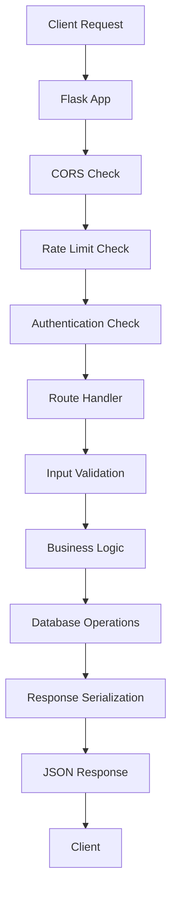

#### 5.1.2 Authentication Flow
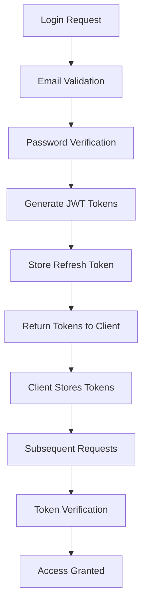

### 5.2 Data Models Relationships

#### 5.2.1 Database Schema Relationships
```mermaid
graph LR
    User --> Vehicle (1:N)
    Vehicle --> MaintenanceItem (1:N)
    Vehicle --> ServiceRecord (1:N)
    Vehicle --> FillUp (1:N)
    MaintenanceItem --> ServiceRecord (1:N)
    User --> RefreshToken (1:N)
```

#### 5.2.2 Multi-Tenant Data Isolation
- All database queries include `user_id` filtering
- Vehicle ownership verified through `user_id` field
- Cascade deletion ensures data consistency
- Subscription features control access to premium functionality

### 5.3 Vehicle Management Data Flow

#### 5.3.1 Vehicle Creation Process
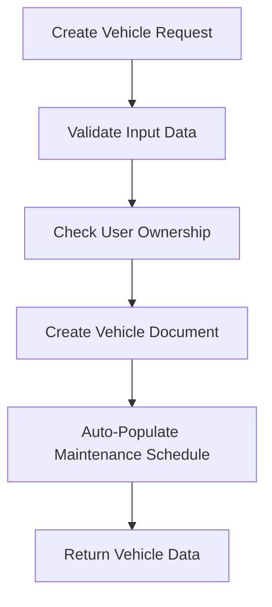

#### 5.3.2 Maintenance Schedule Auto-Population
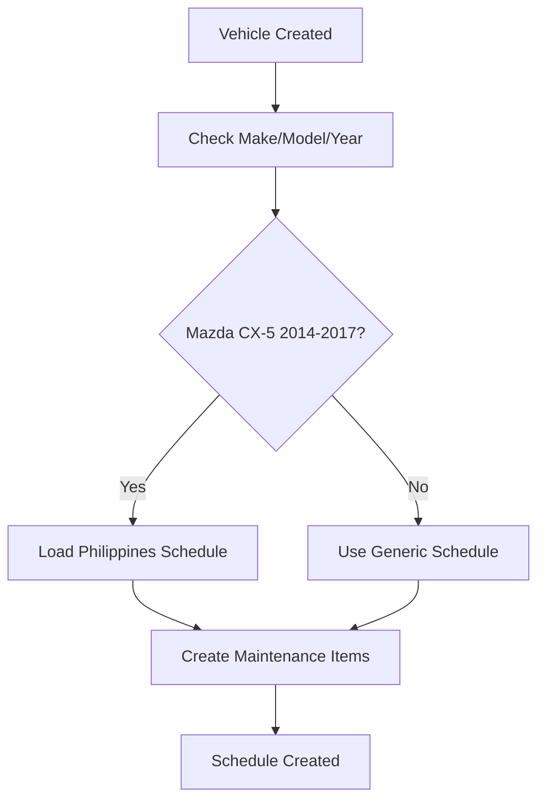

### 5.4 Maintenance Tracking Data Flow

#### 5.4.1 Maintenance Status Calculation
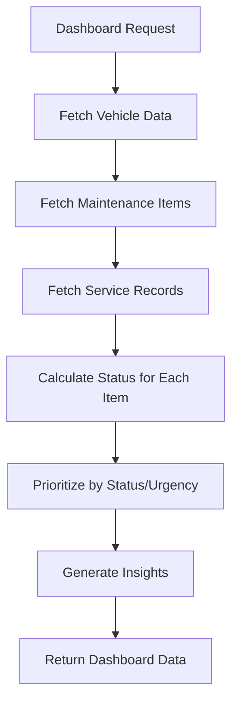

#### 5.4.2 Service Record Creation
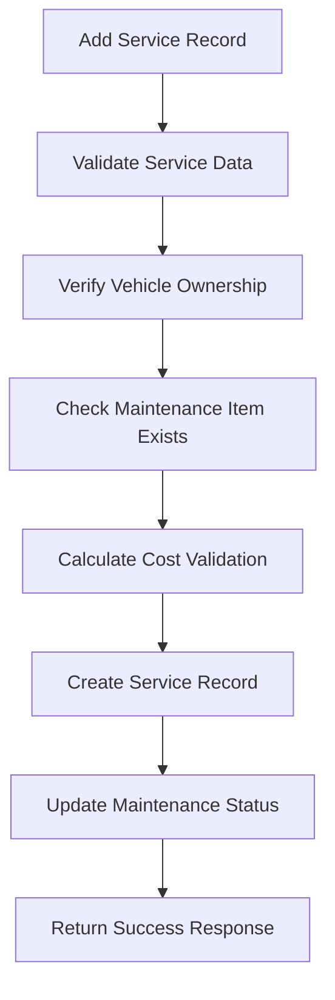

### 5.5 Fuel Tracking Data Flow

#### 5.5.1 Fill-up Record Processing
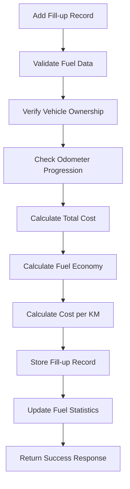

#### 5.5.2 Fuel Economy Calculation
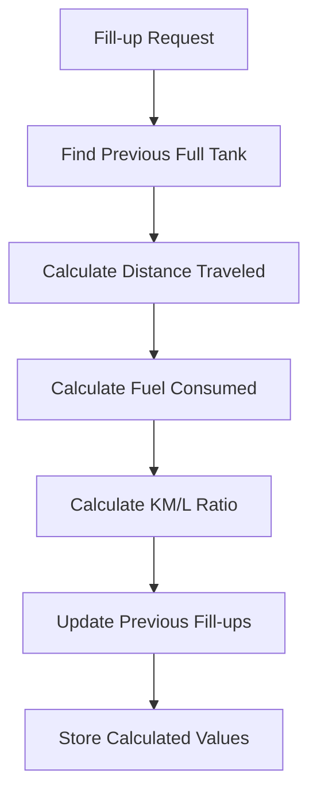

### 5.6 Analytics and Insights Data Flow

#### 5.6.1 Dashboard Data Aggregation
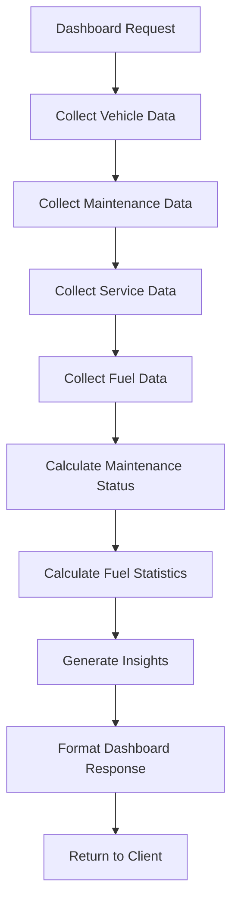

#### 5.6.2 Business Intelligence Processing
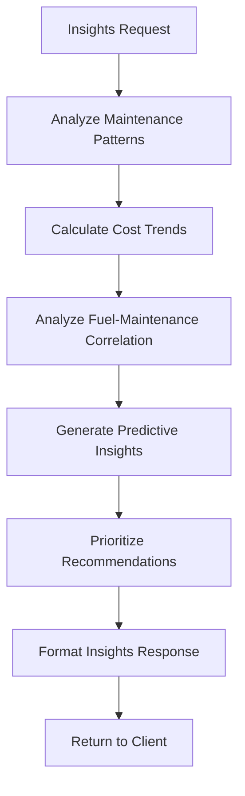

### 5.7 Export Data Flow

#### 5.7.1 Report Generation Process
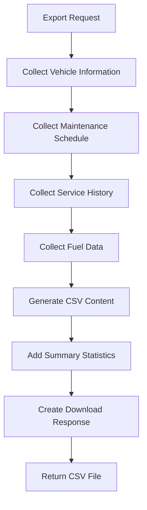

### 5.8 Error Handling Flow

#### 5.8.1 Error Processing
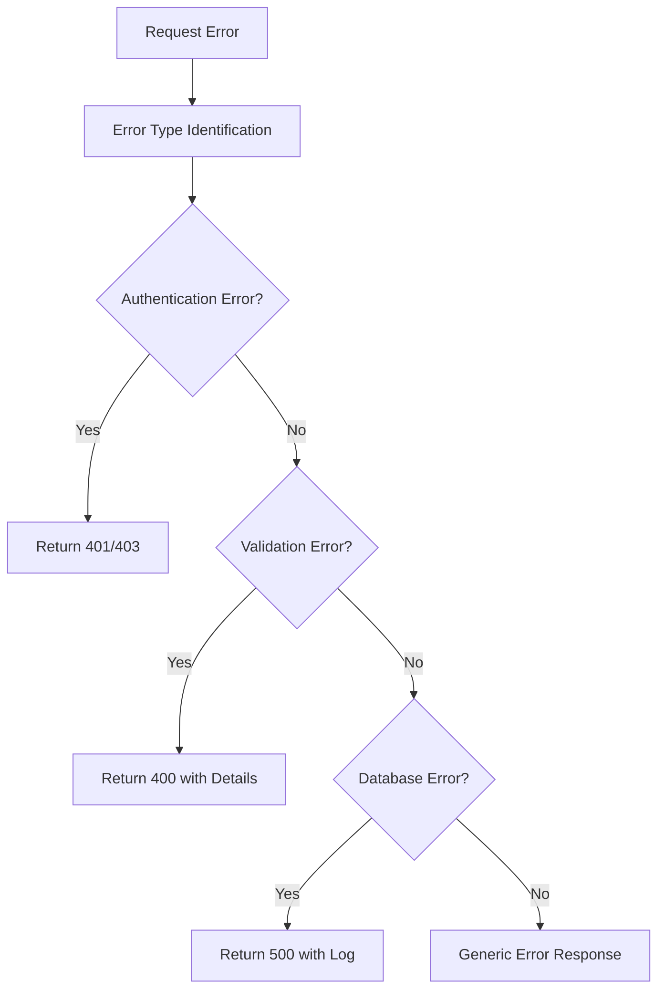

### 5.9 Performance Optimization Flow

#### 5.9.1 Data Caching Strategy
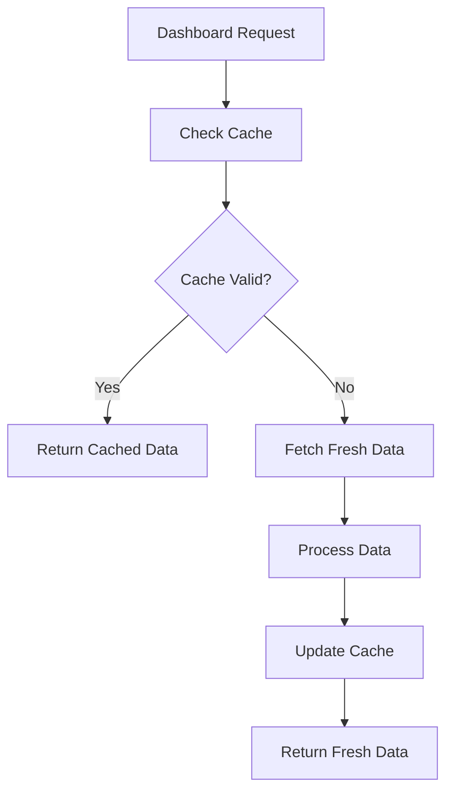

---

## 6. Security Implementation

### 6.1 Authentication Security

#### 6.1.1 JWT Token Security
```python
# Token configuration with security best practices
JWT_SECRET = os.getenv('JWT_SECRET_KEY', 'your-secret-key-here')  # Must be changed in production
JWT_ALGORITHM = 'HS256'
ACCESS_TOKEN_EXPIRY = 15 * 60  # 15 minutes
REFRESH_TOKEN_EXPIRY = 7 * 24 * 60 * 60  # 7 days

# Secure token creation with proper payload structure
def create_access_token(user_id):
    payload = {
        'user_id': str(user_id),
        'exp': datetime.utcnow() + timedelta(seconds=ACCESS_TOKEN_EXPIRY),
        'iat': datetime.utcnow(),
        'type': 'access'
    }
    return jwt.encode(payload, JWT_SECRET, algorithm=JWT_ALGORITHM)
```

#### 6.1.2 Password Security
```python
# Password hashing with bcrypt
def hash_password(password):
    """Hash password with bcrypt using work factor 12"""
    salt = bcrypt.gensalt(rounds=12)
    return bcrypt.hashpw(password.encode('utf-8'), salt)

def verify_password(password, hashed_password):
    """Verify password against bcrypt hash"""
    return bcrypt.checkpw(password.encode('utf-8'), hashed_password)

# Password complexity validation
def validate_password_complexity(password):
    """Validate password meets security requirements"""
    if len(password) < 8:
        return False, "Password must be at least 8 characters"
    
    if not re.search(r'[A-Z]', password):
        return False, "Password must contain at least one uppercase letter"
    
    if not re.search(r'[a-z]', password):
        return False, "Password must contain at least one lowercase letter"
    
    if not re.search(r'\d', password):
        return False, "Password must contain at least one number"
    
    if not re.search(r'[!@#$%^&*(),.?":{}|<>]', password):
        return False, "Password must contain at least one special character"
    
    return True, "Password meets complexity requirements"
```

#### 6.1.3 Session Management
```python
# Refresh token rotation and revocation
def rotate_refresh_token(user_id, old_token):
    """Rotate refresh token and invalidate old one"""
    # Delete old refresh token
    RefreshToken.delete_refresh_token(old_token)
    
    # Create new refresh token
    new_token = create_refresh_token(user_id)
    
    # Store new token with expiration
    RefreshToken.create_refresh_token({
        'user_id': user_id,
        'token': new_token,
        'expires_at': datetime.utcnow() + timedelta(days=7)
    })
    
    return new_token

def revoke_refresh_token(token):
    """Revoke refresh token"""
    RefreshToken.delete_refresh_token(token)
```

### 6.2 Input Validation and Sanitization

#### 6.2.1 Request Validation
```python
def validate_json_request(required_fields):
    """Comprehensive JSON request validation"""
    if not request.is_json:
        return False, {'error': 'Request must be JSON'}
    
    data = request.get_json()
    if not data:
        return False, {'error': 'Empty JSON payload'}
    
    # Check required fields
    missing_fields = [field for field in required_fields if field not in data]
    if missing_fields:
        return False, {'error': f'Missing required fields: {missing_fields}'}
    
    # Validate data types
    validation_errors = []
    for field, value in data.items():
        if field in required_fields and (value is None or value == ''):
            validation_errors.append(f"Field '{field}' cannot be empty")
    
    if validation_errors:
        return False, {'error': ' '.join(validation_errors)}
    
    return True, data

def sanitize_request_data(data):
    """Sanitize input data to prevent injection attacks"""
    if isinstance(data, dict):
        return {k: sanitize_request_data(v) for k, v in data.items()}
    elif isinstance(data, list):
        return [sanitize_request_data(item) for item in data]
    elif isinstance(data, str):
        # Remove potential HTML/JS injection
        sanitized = data.strip()
        sanitized = re.sub(r'<script[^>]*>.*?</script>', '', sanitized, flags=re.IGNORECASE)
        sanitized = re.sub(r'javascript:', '', sanitized, flags=re.IGNORECASE)
        return sanitized
    else:
        return data
```

#### 6.2.2 Email Security
```python
def validate_email_security(email):
    """Comprehensive email validation with security checks"""
    try:
        # Use email-validator for comprehensive validation
        emailinfo = validate_email(email, check_deliverability=False)
        
        # Convert to lowercase
        normalized_email = emailinfo.email.lower()
        
        # Check for suspicious patterns
        suspicious_patterns = [
            r'.*test.*@.*',  # Test emails
            r'.*temp.*@.*',  # Temporary emails
            r'.*admin.*@.*',  # Admin pattern attempts
        ]
        
        for pattern in suspicious_patterns:
            if re.match(pattern, normalized_email):
                return False, "Suspicious email pattern detected"
        
        return True, normalized_email
        
    except EmailNotValidError as e:
        return False, f"Invalid email format: {str(e)}"
```

### 6.3 Rate Limiting Implementation

#### 6.3.1 Rate Limiting Strategies
```python
# Different rate limiting strategies for different endpoint types
def auth_rate_limit(limit=5, window_seconds=900):
    """Strict rate limiting for authentication endpoints"""
    return rate_limit(limit, window_seconds, 'auth')

def user_rate_limit(limit=100, window_seconds=60):
    """Standard rate limiting for user endpoints"""
    return rate_limit(limit, window_seconds, 'user')

def api_rate_limit(limit=1000, window_seconds=3600):
    """Lenient rate limiting for general API endpoints"""
    return rate_limit(limit, window_seconds, 'api')

def rate_limit(limit, window_seconds, limit_type='default'):
    """Generic rate limiting decorator with Redis"""
    def decorator(f):
        @wraps(f)
        def decorated_function(*args, **kwargs):
            # Get client identifier
            user_id = get_current_user_id()
            ip_address = request.remote_addr
            
            # Create rate limit key
            key = f"rate_limit:{limit_type}:{user_id}:{ip_address}"
            
            # Check current count
            current = redis.get(key)
            if current and int(current) >= limit:
                return jsonify({
                    'error': 'Rate limit exceeded',
                    'retry_after': redis.ttl(key)
                }), 429
            
            # Increment counter with expiration
            pipe = redis.pipeline()
            pipe.incr(key)
            pipe.expire(key, window_seconds)
            pipe.execute()
            
            return f(*args, **kwargs)
        return decorated_function
    return decorator
```

### 6.4 Data Access Security

#### 6.4.1 Multi-Tenant Data Isolation
```python
# User-specific data access validation
def validate_user_access(user_id, resource_user_id):
    """Validate user has access to requested resource"""
    if str(user_id) != str(resource_user_id):
        return False
    return True

# Vehicle ownership validation
def validate_vehicle_ownership(user_id, vehicle_id):
    """Validate user owns the requested vehicle"""
    vehicle = Vehicle.get_vehicle_by_id(vehicle_id, user_id)
    if not vehicle:
        return False
    return True

# Database query isolation
def get_user_vehicles(user_id):
    """Get vehicles with user isolation"""
    vehicles_collection = db.vehicles
    return list(vehicles_collection.find({'user_id': ObjectId(user_id)}))
```

#### 6.4.2 Database Security
```python
# Secure database connection
def get_database_connection():
    """Create secure database connection"""
    mongo_uri = os.getenv('MONGODB_URI', 'mongodb://localhost:27017/car_maintenance')
    
    # Connection with SSL/TLS for production
    if os.getenv('FLASK_ENV') == 'production':
        client = MongoClient(
            mongo_uri,
            ssl=True,
            ssl_ca_certs='/etc/ssl/certs/ca-certificates.crt',
            connectTimeoutMS=30000,
            socketTimeoutMS=30000,
            serverSelectionTimeoutMS=30000
        )
    else:
        client = MongoClient(mongo_uri)
    
    return client.car_maintenance

# Query parameter sanitization
def sanitize_query_params(params):
    """Sanitize database query parameters"""
    sanitized = {}
    for key, value in params.items():
        if isinstance(value, str):
            # Prevent NoSQL injection
            sanitized[key] = re.sub(r'[\{\}\(\)\$\.\[\]]', '', value)
        else:
            sanitized[key] = value
    return sanitized
```

### 6.5 API Security Headers

#### 6.5.1 Security Headers Configuration
```python
# Security middleware
@app.after_request
def add_security_headers(response):
    """Add security headers to all responses"""
    response.headers['X-Content-Type-Options'] = 'nosniff'
    response.headers['X-Frame-Options'] = 'DENY'
    response.headers['X-XSS-Protection'] = '1; mode=block'
    response.headers['Strict-Transport-Security'] = 'max-age=31536000; includeSubDomains'
    response.headers['Content-Security-Policy'] = "default-src 'self'"
    response.headers['Referrer-Policy'] = 'strict-origin-when-cross-origin'
    response.headers['Permissions-Policy'] = 'geolocation=(), microphone=(), camera=()'
    return response
```

### 6.6 CORS Security

#### 6.6.1 CORS Configuration
```python
# Secure CORS setup
CORS_ORIGINS = {
    'development': ['http://localhost:3000', 'http://127.0.0.1:3000'],
    'production': ['https://yourdomain.com', 'https://www.yourdomain.com']
}

def get_cors_origins():
    """Get CORS origins based on environment"""
    env = os.getenv('FLASK_ENV', 'development')
    return CORS_ORIGINS.get(env, CORS_ORIGINS['development'])

# Initialize CORS with secure configuration
CORS(app, resources={
    r"/api/*": {
        "origins": get_cors_origins(),
        "methods": ["GET", "POST", "PUT", "DELETE", "OPTIONS"],
        "allow_headers": ["Content-Type", "Authorization"],
        "max_age": 86400,
        "supports_credentials": True
    }
})
```

### 6.7 Error Handling Security

#### 6.7.1 Secure Error Responses
```python
@app.errorhandler(404)
def not_found(error):
    """Secure 404 response"""
    return jsonify({
        'error': 'Resource not found',
        'request_id': request.headers.get('X-Request-ID', 'unknown')
    }), 404

@app.errorhandler(500)
def internal_error(error):
    """Secure 500 response with error logging"""
    error_id = str(uuid.uuid4())
    app.logger.error(f"Internal error {error_id}: {str(error)}")
    
    return jsonify({
        'error': 'Internal server error',
        'error_id': error_id
    }), 500

# Authentication error handler
def handle_auth_error(error):
    """Handle authentication errors securely"""
    return jsonify({
        'error': 'Authentication required',
        'code': 'auth_required'
    }), 401
```

### 6.8 Subscription Security

#### 6.8.1 Feature Access Control
```python
def check_subscription_access(user_id, required_tier='free'):
    """Check if user has access to subscription features"""
    user = User.get_user_by_id(user_id)
    if not user:
        return False
    
    subscription_hierarchy = ['free', 'personal', 'family', 'business']
    user_tier = user.get('subscription_tier', 'free')
    
    try:
        user_level = subscription_hierarchy.index(user_tier)
        required_level = subscription_hierarchy.index(required_tier)
        return user_level >= required_level
    except ValueError:
        return False

# Subscription decorator
def subscription_required(tier='personal'):
    """Decorator for subscription-protected endpoints"""
    def decorator(f):
        @wraps(f)
        def decorated_function(*args, **kwargs):
            user_id = get_current_user_id()
            if not check_subscription_access(user_id, tier):
                return jsonify({
                    'error': 'Subscription upgrade required',
                    'required_tier': tier
                }), 403
            return f(*args, **kwargs)
        return decorated_function
    return decorator
```

### 6.9 Logging and Monitoring

#### 6.9.1 Security Logging
```python
def log_security_event(event_type, details):
    """Log security events for monitoring"""
    log_entry = {
        'timestamp': datetime.utcnow(),
        'event_type': event_type,
        'details': details,
        'ip_address': request.remote_addr,
        'user_agent': request.headers.get('User-Agent', 'unknown'),
        'user_id': get_current_user_id()
    }
    
    # Log to security collection
    db.security_logs.insert_one(log_entry)
    
    # Also log to file for monitoring
    app.logger.warning(f"Security Event: {event_type} - {details}")

# Failed login attempt logging
def log_failed_login_attempt(email, ip_address):
    """Log failed login attempts for security monitoring"""
    log_security_event('failed_login', {
        'email': email,
        'ip_address': ip_address,
        'timestamp': datetime.utcnow()
    })
```

### 6.10 Environment Security

#### 6.10.1 Environment Configuration
```python
# Secure environment variables
def validate_environment():
    """Validate required security environment variables"""
    required_vars = [
        'JWT_SECRET_KEY',
        'MONGODB_URI',
        'FLASK_ENV'
    ]
    
    missing_vars = [var for var in required_vars if not os.getenv(var)]
    if missing_vars:
        raise EnvironmentError(f"Missing required environment variables: {missing_vars}")
    
    # Check JWT secret strength
    jwt_secret = os.getenv('JWT_SECRET_KEY')
    if len(jwt_secret) < 32:
        raise EnvironmentError("JWT_SECRET_KEY must be at least 32 characters long")

# Production security checks
if os.getenv('FLASK_ENV') == 'production':
    validate_environment()
    
    # Disable debug mode
    app.config['DEBUG'] = False
    
    # Enable secure cookies
    app.config['SESSION_COOKIE_SECURE'] = True
    app.config['SESSION_COOKIE_HTTPONLY'] = True
    app.config['SESSION_COOKIE_SAMESITE'] = 'Lax'
```

This comprehensive documentation provides a complete reference for the Car Maintenance Tracker backend system, covering all aspects of the architecture, components, business logic, API endpoints, data flow, and security implementation. The documentation is based on the actual implemented code and serves as a complete guide for developers working with the system.