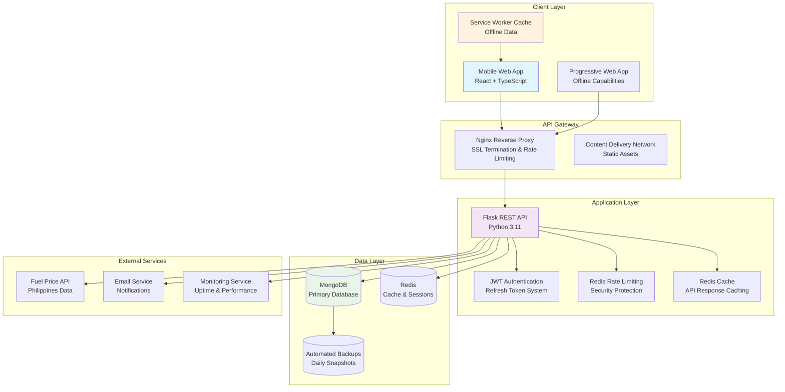
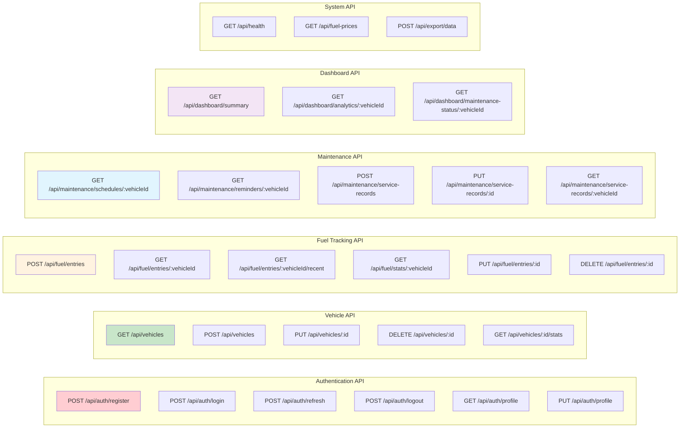
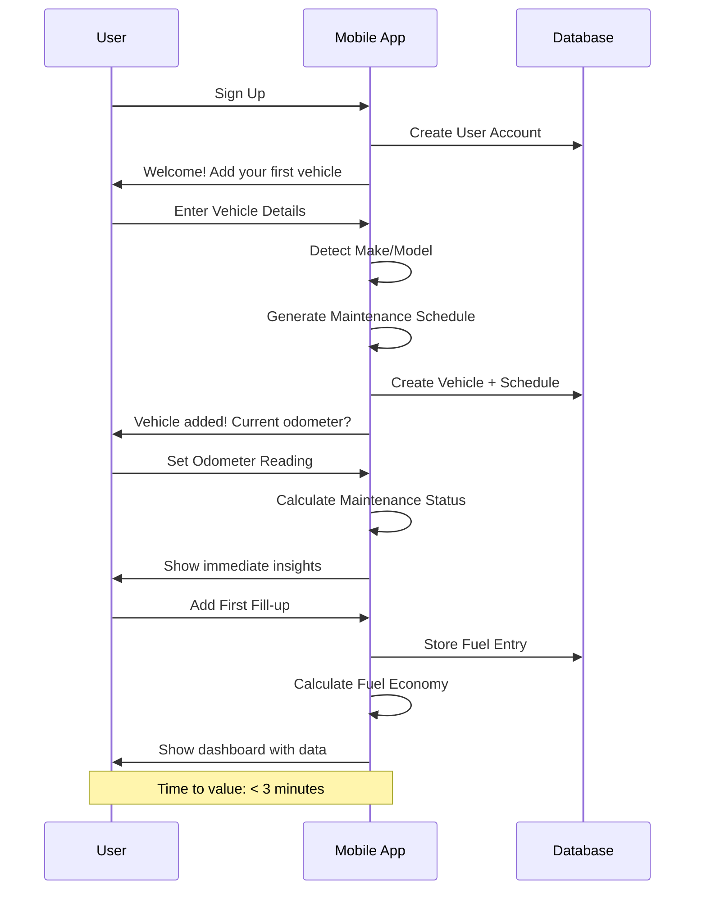
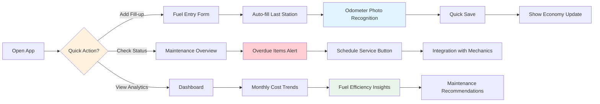

# Car Maintenance Tracker MVP: Product Requirements Document

## Executive Summary

**Product Name**: FuelWise - Car Maintenance Tracker
**Primary Use Case**: Fuel economy tracking with intelligent maintenance reminders
**Target Market**: Philippines vehicle owners seeking cost optimization
**Business Model**: Freemium with subscription conversion focus
**Platform**: Mobile-responsive web application with PWA capabilities

### MVP Success Metrics

| Metric | Target | Timeframe |
|--------|---------|-----------|
| User Activation | 70% add vehicle within 24h | Week 1 |
| Engagement | 40% weekly active users | Month 1 |
| Value Realization | 60% log 3+ fill-ups within 2 weeks | Month 1 |
| Conversion Intent | 15% express premium interest | Month 1 |
| Beta Target | 500-1000 Philippines users | Month 1 |

## 1. Project Purpose & Vision Analysis

### 1.1 Core Value Proposition

**"Your vehicle's smart fuel economy advisor that saves you money through better tracking and timely maintenance reminders."**

#### Philippines Market Optimization
- **Severe Driving Conditions**: 20% reduced maintenance intervals due to traffic, heat, and humidity
- **Fuel Price Volatility**: Real-time fuel price integration for cost calculations
- **Vehicle Mix**: Focus on popular models (Toyota Vios, Honda City, Mitsubishi Mirage, Mazda CX-5)
- **Cost Sensitivity**: Emphasis on fuel savings and maintenance cost optimization

#### User Personas

**Primary Persona: Cost-Conscious Commuter**
- Age: 25-45, urban Philippines
- Vehicle: 2010-2020 sedan/SUV (Toyota Vios, Honda City, Mitsubishi Mirage)
- Pain Points: Rising fuel costs, uncertainty about maintenance timing
- Goals: Reduce transportation costs, avoid expensive breakdowns
- Behavior: Daily commuter, 20-50 km daily, fuel price conscious

**Secondary Persona: Family Vehicle Owner**
- Age: 35-55, suburban Philippines
- Vehicle: Family SUV/MPV (Mazda CX-5, Toyota Innova)
- Pain Points: Multiple vehicles, tracking maintenance schedules
- Goals: Keep family vehicles reliable and safe
- Behavior: Weekend trips, family transportation, maintenance focused

### 1.2 Competitive Analysis

| Competitor | Strengths | Weaknesses | Our Advantage |
|------------|-----------|------------|---------------|
| Fuelio | Simple fuel tracking | No maintenance intelligence | Intelligent maintenance reminders |
| Drivvo | Comprehensive features | Complex interface, not Philippines-optimized | Philippines-specific, simpler UX |
| Car Maintenance Reminder | Maintenance focused | Poor fuel tracking | Combined fuel + maintenance |
| Local mechanics | Personal service | No digital tracking | Digital convenience + analytics |

## 2. Technical Architecture

### 2.1 System Architecture Overview



### 2.2 Database Schema Design

#### 2.2.1 User Collection
```javascript
{
  _id: ObjectId,
  email: String, // Unique, indexed
  password_hash: String, // bcrypt
  first_name: String,
  last_name: String,
  phone: String, // Optional
  subscription_tier: {
    type: String,
    enum: ['free', 'personal', 'family', 'business'],
    default: 'free'
  },
  is_verified: Boolean,
  timezone: String, // Default: 'Asia/Manila'
  currency: String, // Default: 'PHP'
  preferences: {
    fuel_unit: { type: String, enum: ['liters', 'gallons'], default: 'liters' },
    distance_unit: { type: String, enum: ['km', 'miles'], default: 'km' },
    currency_format: { type: String, enum: ['PHP', 'USD'], default: 'PHP' }
  },
  created_at: ISODate,
  updated_at: ISODate
}
```

#### 2.2.2 Vehicle Collection
```javascript
{
  _id: ObjectId,
  user_id: ObjectId, // Indexed
  make: String, // Required: 'Toyota', 'Honda', 'Mazda', etc.
  model: String, // Required: 'Vios', 'City', 'CX-5'
  year: Number, // Required, 1900-current_year+1
  variant: String, // Optional: '1.3L MT', '2.0L AT'
  license_plate: String, // Optional
  vin: String, // Optional, indexed
  color: String, // Optional
  initial_odometer: Number, // Required, >= 0
  current_odometer: Number, // Required, >= initial_odometer
  fuel_tank_capacity: Number, // In liters
  vehicle_type: {
    type: String,
    enum: ['sedan', 'suv', 'mpv', 'pickup', 'hatchback', 'sports_car', 'motorcycle'],
    default: 'sedan'
  },
  transmission: {
    type: String,
    enum: ['manual', 'automatic', 'cvt', 'dct', 'hybrid'],
    default: 'manual'
  },
  fuel_type: {
    type: String,
    enum: ['gasoline', 'diesel', 'hybrid', 'electric'],
    default: 'gasoline'
  },
  is_active: Boolean, // Soft delete
  created_at: ISODate,
  updated_at: ISODate
}
```

#### 2.2.3 Fuel Entry Collection
```javascript
{
  _id: ObjectId,
  vehicle_id: ObjectId, // Indexed
  user_id: ObjectId, // Indexed
  date: Date, // Required
  odometer_reading: Number, // Required, >= 0
  fuel_amount: Number, // Required, in liters
  price_per_liter: Number, // Required, in PHP
  total_cost: Number, // Calculated: fuel_amount * price_per_liter
  is_full_tank: Boolean, // Default: true
  fuel_type: {
    type: String,
    enum: ['Regular', 'Premium', 'Diesel', 'Premium Plus'],
    default: 'Regular'
  },
  gas_station: String, // Optional
  location: {
    type: { type: String, enum: ['Point'], default: 'Point' },
    coordinates: [Number, Number] // [longitude, latitude]
  },
  payment_method: String, // Optional: 'cash', 'credit', 'digital'
  notes: String,
  // Calculated fields
  trip_distance: Number, // Calculated from previous entry
  fuel_economy: Number, // Calculated: km/L
  cost_per_km: Number, // Calculated: total_cost / trip_distance
  created_at: ISODate
}
```

#### 2.2.4 Maintenance Schedule Collection
```javascript
{
  _id: ObjectId,
  vehicle_id: ObjectId, // Indexed
  make: String, // Vehicle make for this schedule
  model: String, // Vehicle model for this schedule
  year_range: {
    start: Number,
    end: Number
  },
  category: String, // 'Engine', 'Brakes', 'Tires', 'Fluids', etc.
  item_name: String, // 'Engine Oil & Filter', 'Brake Pads'
  action_type: {
    type: String,
    enum: ['Replace', 'Inspect', 'Service', 'Lubricate', 'Tighten', 'Clean'],
    default: 'Replace'
  },
  interval_km: Number, // Required
  interval_months: Number, // Optional
  description: String,
  is_critical: Boolean, // Default: false
  estimated_cost_min: Number, // In PHP
  estimated_cost_max: Number, // In PHP
  difficulty_level: {
    type: String,
    enum: ['easy', 'medium', 'hard', 'professional'],
    default: 'medium'
  },
  philippines_adjustment: {
    severe_condition_factor: Number, // 0.8 for 20% more frequent
    adjusted_interval_km: Number, // Calculated
    notes: String // Philippines-specific notes
  },
  is_active: Boolean,
  created_at: ISODate
}
```

#### 2.2.5 Maintenance Reminder Collection
```javascript
{
  _id: ObjectId,
  vehicle_id: ObjectId, // Indexed
  schedule_id: ObjectId, // Reference to maintenance schedule
  user_id: ObjectId, // Indexed
  due_at_odometer: Number, // Calculated
  due_at_date: Date, // Calculated
  status: {
    type: String,
    enum: ['pending', 'due_soon', 'overdue', 'completed', 'dismissed'],
    default: 'pending'
  },
  priority: {
    type: String,
    enum: ['low', 'medium', 'high', 'critical'],
    default: 'medium'
  },
  last_service_odometer: Number,
  last_service_date: Date,
  estimated_cost: Number, // Based on schedule
  notes: String,
  notification_sent: Boolean, // Default: false
  notification_count: Number, // Default: 0
  completed_at: ISODate, // When status is 'completed'
  created_at: ISODate
}
```

#### 2.2.6 Service Record Collection
```javascript
{
  _id: ObjectId,
  vehicle_id: ObjectId, // Indexed
  user_id: ObjectId, // Indexed
  schedule_id: ObjectId, // Optional, reference to maintenance schedule
  reminder_id: ObjectId, // Optional, reference to maintenance reminder
  service_date: Date, // Required
  odometer_reading: Number, // Required
  service_type: String, // 'Oil Change', 'Brake Service', etc.
  service_provider: String, // Optional
  cost: Number, // In PHP
  parts_used: [{
    name: String,
    cost: Number,
    quantity: Number
  }],
  labor_cost: Number, // Optional
  notes: String,
  documents: [{
    name: String,
    file_url: String,
    file_type: String
  }],
  warranty_info: {
    is_warranty: Boolean,
    warranty_period: String, // '6 months', '1 year'
    warranty_details: String
  },
  created_at: ISODate
}
```

### 2.3 API Architecture

#### 2.3.1 API Design Principles
```yaml
# Response Format Standardization
success: boolean
data: object | array
meta: {
  timestamp: string,
  request_id: string,
  version: string
}
error: {
  code: string,
  message: string,
  details: object | array
}

# Error Response Format
{
  "success": false,
  "error": {
    "code": "VALIDATION_ERROR",
    "message": "Odometer reading cannot be less than previous reading",
    "details": {
      "field": "odometer_reading",
      "previous_value": 50000,
      "submitted_value": 49000
    }
  },
  "meta": {
    "timestamp": "2025-01-15T10:30:00Z",
    "request_id": "req_123456",
    "version": "1.0.0"
  }
}
```

#### 2.3.2 API Endpoints Structure


### 2.4 Security Architecture

#### 2.4.1 Security Implementation
```python
# JWT Token Configuration
JWT_CONFIG = {
    'access_token_expire_minutes': 15,
    'refresh_token_expire_days': 7,
    'algorithm': 'HS256',
    'secret_key_length': 64  # Generate secure 64-character key
}

# Rate Limiting Configuration
RATE_LIMITS = {
    'auth_endpoints': '5 per 15 minutes',
    'api_endpoints': '100 per minute',
    'fuel_entries': '10 per minute',
    'vehicle_management': '5 per minute'
}

# Password Requirements
PASSWORD_REQUIREMENTS = {
    'min_length': 8,
    'require_uppercase': True,
    'require_lowercase': True,
    'require_numbers': True,
    'require_special_chars': True
}
```

#### 2.4.2 Security Headers
```python
# Security Headers Configuration
SECURITY_HEADERS = {
    'X-Content-Type-Options': 'nosniff',
    'X-Frame-Options': 'DENY',
    'X-XSS-Protection': '1; mode=block',
    'Strict-Transport-Security': 'max-age=31536000; includeSubDomains',
    'Content-Security-Policy': "default-src 'self'",
    'Referrer-Policy': 'strict-origin-when-cross-origin',
    'Permissions-Policy': 'geolocation=(), microphone=(), camera=()'
}
```

## 3. Business Logic

### 3.1 Fuel Economy Calculation Engine

#### 3.1.1 Core Fuel Calculations
```python
class FuelEconomyCalculator:
    @staticmethod
    def calculate_trip_economy(current_entry: FuelEntry, previous_entry: FuelEntry) -> Optional[float]:
        """Calculate fuel economy for a trip between two fill-ups"""
        if not previous_entry or not previous_entry.is_full_tank:
            return None

        distance = current_entry.odometer_reading - previous_entry.odometer_reading
        fuel_used = current_entry.fuel_amount

        if distance <= 0 or fuel_used <= 0:
            return None

        economy = distance / fuel_used  # km/L
        return round(economy, 2)

    @staticmethod
    def calculate_rolling_average(vehicle_id: str, months: int = 3) -> Dict[str, float]:
        """Calculate rolling fuel economy averages"""
        entries = get_fuel_entries_for_period(vehicle_id, months)

        if len(entries) < 2:
            return {
                'average_economy': 0,
                'trip_based_average': 0,
                'best_economy': 0,
                'worst_economy': 0,
                'total_distance': 0,
                'total_fuel': 0,
                'total_cost': 0,
                'valid_entries': 0
            }

        total_distance = 0
        total_fuel = 0
        valid_trips = []
        costs = []

        for i in range(1, len(entries)):
            economy = FuelEconomyCalculator.calculate_trip_economy(entries[i], entries[i-1])
            if economy:
                distance = entries[i].odometer_reading - entries[i-1].odometer_reading
                fuel = entries[i].fuel_amount
                cost = entries[i].total_cost

                total_distance += distance
                total_fuel += fuel
                valid_trips.append(economy)
                costs.append(cost)

        return {
            'average_economy': round(total_distance / total_fuel, 2) if total_fuel > 0 else 0,
            'trip_based_average': round(sum(valid_trips) / len(valid_trips), 2) if valid_trips else 0,
            'best_economy': max(valid_trips) if valid_trips else 0,
            'worst_economy': min(valid_trips) if valid_trips else 0,
            'total_distance': total_distance,
            'total_fuel': total_fuel,
            'total_cost': sum(costs),
            'valid_entries': len(valid_trips)
        }

    @staticmethod
    def calculate_trend_analysis(vehicle_id: str, months: int = 6) -> Dict[str, Any]:
        """Analyze fuel economy trends over time"""
        entries = get_fuel_entries_for_period(vehicle_id, months)

        if len(entries) < 4:  # Need at least 4 entries for trend analysis
            return {
                'trend': 'insufficient_data',
                'improvement_rate': 0,
                'monthly_averages': []
            }

        # Group entries by month
        monthly_data = group_entries_by_month(entries)
        monthly_averages = []

        for month_entries in monthly_data:
            month_economies = []
            for i in range(1, len(month_entries)):
                economy = FuelEconomyCalculator.calculate_trip_economy(month_entries[i], month_entries[i-1])
                if economy:
                    month_economies.append(economy)

            if month_economies:
                monthly_averages.append({
                    'month': month_entries[0].date.strftime('%Y-%m'),
                    'average': round(sum(month_economies) / len(month_economies), 2),
                    'count': len(month_economies)
                })

        # Calculate trend
        if len(monthly_averages) >= 3:
            recent_avg = monthly_averages[-1]['average']
            older_avg = monthly_averages[0]['average']

            if recent_avg > older_avg * 1.05:  # 5% improvement threshold
                trend = 'improving'
                improvement_rate = round(((recent_avg - older_avg) / older_avg) * 100, 1)
            elif recent_avg < older_avg * 0.95:  # 5% decline threshold
                trend = 'declining'
                improvement_rate = round(((older_avg - recent_avg) / older_avg) * 100, 1)
            else:
                trend = 'stable'
                improvement_rate = 0
        else:
            trend = 'insufficient_data'
            improvement_rate = 0

        return {
            'trend': trend,
            'improvement_rate': improvement_rate,
            'monthly_averages': monthly_averages
        }
```

### 3.2 Maintenance Reminder Engine

#### 3.2.1 Philippines-Optimized Maintenance Schedules
```python
PHILIPPINES_SEVERE_CONDITION_FACTOR = 0.8  # 20% more frequent maintenance

MAINTENANCE_SCHEDULES = {
    'generic_sedan': [
        # Engine
        {
            'category': 'Engine',
            'item_name': 'Engine Oil & Filter',
            'action_type': 'Replace',
            'interval_km': 5000,
            'interval_months': 6,
            'is_critical': True,
            'philippines_adjustment': {
                'severe_condition_factor': 0.8,
                'adjusted_interval_km': 4000,
                'notes': 'More frequent changes due to traffic and heat conditions'
            }
        },
        {
            'category': 'Engine',
            'item_name': 'Air Filter',
            'action_type': 'Replace',
            'interval_km': 20000,
            'interval_months': 12,
            'is_critical': False,
            'philippines_adjustment': {
                'severe_condition_factor': 0.8,
                'adjusted_interval_km': 16000,
                'notes': 'More frequent replacement due to dusty conditions'
            }
        },
        {
            'category': 'Engine',
            'item_name': 'Spark Plugs',
            'action_type': 'Replace',
            'interval_km': 60000,
            'interval_months': 36,
            'is_critical': False,
            'philippines_adjustment': {
                'severe_condition_factor': 0.8,
                'adjusted_interval_km': 48000,
                'notes': 'Adjust for fuel quality variations'
            }
        },

        # Fluids
        {
            'category': 'Fluids',
            'item_name': 'Brake Fluid',
            'action_type': 'Replace',
            'interval_km': 40000,
            'interval_months': 24,
            'is_critical': True,
            'philippines_adjustment': {
                'severe_condition_factor': 0.8,
                'adjusted_interval_km': 32000,
                'notes': 'More frequent changes due to heavy brake usage in traffic'
            }
        },
        {
            'category': 'Fluids',
            'item_name': 'Engine Coolant',
            'action_type': 'Replace',
            'interval_km': 80000,
            'interval_months': 48,
            'is_critical': True,
            'philippines_adjustment': {
                'severe_condition_factor': 0.8,
                'adjusted_interval_km': 64000,
                'notes': 'More frequent changes due to high temperature conditions'
            }
        },

        # Brakes
        {
            'category': 'Brakes',
            'item_name': 'Brake Pads Inspection',
            'action_type': 'Inspect',
            'interval_km': 20000,
            'interval_months': 12,
            'is_critical': True,
            'philippines_adjustment': {
                'severe_condition_factor': 0.8,
                'adjusted_interval_km': 16000,
                'notes': 'More frequent inspections due to heavy brake usage'
            }
        },

        # Tires
        {
            'category': 'Tires',
            'item_name': 'Tire Rotation',
            'action_type': 'Service',
            'interval_km': 10000,
            'interval_months': 6,
            'is_critical': False,
            'philippines_adjustment': {
                'severe_condition_factor': 0.8,
                'adjusted_interval_km': 8000,
                'notes': 'More frequent rotation due to uneven wear patterns'
            }
        }
    ],

    'generic_suv': [
        # SUV-specific adjustments (heavier vehicles, more stress)
        {
            'category': 'Engine',
            'item_name': 'Engine Oil & Filter',
            'action_type': 'Replace',
            'interval_km': 5000,
            'interval_months': 6,
            'is_critical': True,
            'philippines_adjustment': {
                'severe_condition_factor': 0.8,
                'adjusted_interval_km': 4000,
                'notes': 'More frequent changes due to weight and traffic conditions'
            }
        },
        {
            'category': 'Drivetrain',
            'item_name': '4WD/AWD System Service',
            'action_type': 'Service',
            'interval_km': 40000,
            'interval_months': 24,
            'is_critical': True,
            'philippines_adjustment': {
                'severe_condition_factor': 0.8,
                'adjusted_interval_km': 32000,
                'notes': 'More frequent service due to diverse road conditions'
            }
        }
    ],

    'mazda_cx5': [
        # Based on the provided index.html schedule
        {
            'category': 'Engine',
            'item_name': 'Engine Oil & Filter',
            'action_type': 'Replace',
            'interval_km': 8000,
            'interval_months': 6,
            'is_critical': True,
            'philippines_adjustment': {
                'severe_condition_factor': 0.8,
                'adjusted_interval_km': 6400,
                'notes': 'More frequent changes due to traffic conditions'
            }
        },
        {
            'category': 'Engine',
            'item_name': 'Drive Belts',
            'action_type': 'Inspect',
            'interval_km': 56000,
            'interval_months': 36,
            'is_critical': False,
            'philippines_adjustment': {
                'severe_condition_factor': 0.8,
                'adjusted_interval_km': 44800,
                'notes': 'More frequent inspections due to heat conditions'
            }
        },
        {
            'category': 'Fuel System',
            'item_name': 'Air Filter',
            'action_type': 'Replace',
            'interval_km': 56000,
            'interval_months': 24,
            'is_critical': False,
            'philippines_adjustment': {
                'severe_condition_factor': 0.8,
                'adjusted_interval_km': 44800,
                'notes': 'More frequent replacement due to dusty conditions'
            }
        },
        {
            'category': 'Cooling System',
            'item_name': 'Engine Coolant Level',
            'action_type': 'Inspect',
            'interval_km': 8000,
            'interval_months': 6,
            'is_critical': True,
            'philippines_adjustment': {
                'severe_condition_factor': 0.8,
                'adjusted_interval_km': 6400,
                'notes': 'More frequent inspections due to high temperature conditions'
            }
        },
        {
            'category': 'AC System',
            'item_name': 'Cabin Air Filter',
            'action_type': 'Replace',
            'interval_km': 40000,
            'interval_months': 24,
            'is_critical': False,
            'philippines_adjustment': {
                'severe_condition_factor': 0.8,
                'adjusted_interval_km': 32000,
                'notes': 'More frequent replacement due to air pollution'
            }
        }
    ]
}
```

#### 3.2.2 Maintenance Status Calculation Engine
```python
class MaintenanceReminderEngine:
    def __init__(self):
        self.schedules = MAINTENANCE_SCHEDULES

    def create_vehicle_schedule(self, vehicle: Dict) -> List[Dict]:
        """Create maintenance schedule for a new vehicle"""
        make = vehicle.get('make', '').lower()
        model = vehicle.get('model', '').lower()
        year = vehicle.get('year', 0)

        # Determine schedule type
        schedule_key = self._determine_schedule_key(make, model, year)
        base_schedule = self.schedules.get(schedule_key, self.schedules['generic_sedan'])

        # Apply Philippines adjustments
        adjusted_schedule = self._apply_philippines_adjustments(base_schedule)

        return adjusted_schedule

    def _determine_schedule_key(self, make: str, model: str, year: int) -> str:
        """Determine which maintenance schedule to use"""
        make_lower = make.lower()
        model_lower = model.lower()

        # Specific vehicle schedules
        if make_lower == 'mazda' and 'cx-5' in model_lower:
            if 2014 <= year <= 2020:
                return 'mazda_cx5'

        # Generic vehicle type schedules
        vehicle_type = self._determine_vehicle_type(make, model)
        if vehicle_type == 'suv':
            return 'generic_suv'

        return 'generic_sedan'

    def _determine_vehicle_type(self, make: str, model: str) -> str:
        """Determine vehicle type based on make and model"""
        make_lower = make.lower()
        model_lower = model.lower()

        # Known SUV models
        suv_models = [
            'cx-5', 'cx-9', 'cr-v', 'rav4', 'fortuner', 'montero', 'everest',
            'santa fe', 'sportage', 'seltos', 'honda cr-v', 'toyota rav4'
        ]

        for suv_model in suv_models:
            if suv_model in model_lower:
                return 'suv'

        # Known sedan models
        sedan_models = [
            'vios', 'city', 'mirage', 'accent', 'sunny', 'yaris',
            'civic', 'corolla', 'elentra', 'mazda 3'
        ]

        for sedan_model in sedan_models:
            if sedan_model in model_lower:
                return 'sedan'

        # Default based on common classification
        if make_lower in ['toyota', 'honda', 'mitsubishi', 'nissan']:
            return 'sedan'

        return 'sedan'  # Default

    def _apply_philippines_adjustments(self, schedule: List[Dict]) -> List[Dict]:
        """Apply Philippines-specific adjustments to maintenance schedule"""
        adjusted_schedule = []

        for item in schedule:
            adjusted_item = item.copy()

            # Apply severe conditions factor
            if 'philippines_adjustment' in adjusted_item:
                adjustment = adjusted_item['philippines_adjustment']
                adjusted_item['interval_km'] = adjustment['adjusted_interval_km']
            else:
                # Apply default severe conditions factor
                adjusted_item['interval_km'] = int(adjusted_item['interval_km'] * PHILIPPINES_SEVERE_CONDITION_FACTOR)

            adjusted_schedule.append(adjusted_item)

        return adjusted_schedule

    def calculate_maintenance_status(self, schedule_item: Dict, current_odometer: int, last_service_odometer: int = None) -> Dict[str, Any]:
        """Calculate maintenance status based on current mileage and service history"""
        interval_km = schedule_item.get('interval_km', 0)

        # Determine last service odometer
        if last_service_odometer is None:
            last_service_odometer = 0  # Default to vehicle purchase

        # Calculate next due mileage
        next_due_odometer = last_service_odometer + interval_km

        # Calculate distance until due
        km_until_due = next_due_odometer - current_odometer

        # Determine status and priority
        if km_until_due <= 0:
            status = 'overdue'
            priority = 'critical'
            urgency_percent = 100
        elif km_until_due <= 500:  # Due within 500km
            status = 'due_soon'
            priority = 'high'
            urgency_percent = max(0, min(100, ((interval_km - km_until_due) / interval_km) * 100))
        elif km_until_due <= 2000:  # Due within 2000km
            status = 'due_soon'
            priority = 'medium'
            urgency_percent = max(0, min(100, ((interval_km - km_until_due) / interval_km) * 100))
        else:
            status = 'ok'
            priority = 'low'
            urgency_percent = max(0, min(100, ((interval_km - km_until_due) / interval_km) * 100))

        return {
            'status': status,
            'priority': priority,
            'next_due_odometer': next_due_odometer,
            'km_until_due': km_until_due,
            'urgency_percent': urgency_percent,
            'last_service_odometer': last_service_odometer,
            'is_critical': schedule_item.get('is_critical', False),
            'estimated_cost_range': {
                'min': schedule_item.get('estimated_cost_min', 0),
                'max': schedule_item.get('estimated_cost_max', 0)
            }
        }

    def update_maintenance_reminders(self, vehicle_id: str, user_id: str) -> List[Dict]:
        """Update all maintenance reminders for a vehicle"""
        # Get vehicle data
        vehicle = get_vehicle_by_id(vehicle_id, user_id)
        current_odometer = vehicle.get('current_odometer', 0)

        # Get maintenance schedules
        schedules = get_maintenance_schedules(vehicle_id)

        # Get service history
        service_records = get_service_records(vehicle_id)

        # Update reminders
        updated_reminders = []

        for schedule in schedules:
            # Find last service for this schedule item
            last_service = self._find_last_service(schedule['_id'], service_records)
            last_service_odometer = last_service.get('odometer_reading', 0) if last_service else 0

            # Calculate status
            status_info = self.calculate_maintenance_status(
                schedule, current_odometer, last_service_odometer
            )

            # Update or create reminder
            reminder = self._update_reminder(
                vehicle_id, user_id, schedule['_id'], status_info, last_service
            )

            updated_reminders.append(reminder)

        return updated_reminders

    def _find_last_service(self, schedule_id: str, service_records: List[Dict]) -> Optional[Dict]:
        """Find the last service record for a specific schedule item"""
        relevant_services = [
            service for service in service_records
            if service.get('schedule_id') == schedule_id
        ]

        if not relevant_services:
            return None

        # Return the most recent service
        return max(relevant_services, key=lambda x: x.get('service_date', datetime.min))

    def _update_reminder(self, vehicle_id: str, user_id: str, schedule_id: str,
                        status_info: Dict, last_service: Optional[Dict]) -> Dict:
        """Update or create a maintenance reminder"""
        # Check if reminder exists
        existing_reminder = get_reminder_by_schedule(vehicle_id, schedule_id)

        reminder_data = {
            'vehicle_id': vehicle_id,
            'user_id': user_id,
            'schedule_id': schedule_id,
            'due_at_odometer': status_info['next_due_odometer'],
            'status': status_info['status'],
            'priority': status_info['priority'],
            'last_service_odometer': status_info['last_service_odometer'],
            'last_service_date': last_service.get('service_date') if last_service else None,
            'estimated_cost': status_info['estimated_cost_range']['max'],
            'updated_at': datetime.utcnow()
        }

        if existing_reminder:
            # Update existing reminder
            update_reminder(existing_reminder['_id'], reminder_data)
            reminder_data['_id'] = existing_reminder['_id']
            reminder_data['created_at'] = existing_reminder['created_at']
        else:
            # Create new reminder
            reminder_data['created_at'] = datetime.utcnow()
            reminder_data['notification_sent'] = False
            reminder_data['notification_count'] = 0
            reminder_data['_id'] = create_reminder(reminder_data)

        return reminder_data
```

### 3.3 Philippines-Specific Business Logic

#### 3.3.1 Fuel Price Integration
```python
class PhilippinesFuelPriceService:
    def __init__(self):
        self.fuel_prices_cache = {}
        self.cache_duration = 3600  # 1 hour cache

    def get_current_fuel_prices(self) -> Dict[str, float]:
        """Get current fuel prices in the Philippines"""
        cache_key = 'philippines_fuel_prices'
        cached_data = self.fuel_prices_cache.get(cache_key)

        if cached_data and (datetime.utcnow() - cached_data['timestamp']).total_seconds() < self.cache_duration:
            return cached_data['prices']

        # Fetch from external API (DOE Philippines or similar)
        try:
            prices = self._fetch_fuel_prices_from_api()
            self.fuel_prices_cache[cache_key] = {
                'prices': prices,
                'timestamp': datetime.utcnow()
            }
            return prices
        except Exception as e:
            # Fallback to default prices
            return self._get_default_fuel_prices()

    def _fetch_fuel_prices_from_api(self) -> Dict[str, float]:
        """Fetch fuel prices from Department of Energy API"""
        # This would integrate with Philippines DOE API
        # For now, return realistic current prices
        return {
            'Regular': 58.50,  # PHP per liter
            'Premium': 62.80,
            'Diesel': 54.20,
            'Premium Plus': 65.90
        }

    def _get_default_fuel_prices(self) -> Dict[str, float]:
        """Get default fuel prices as fallback"""
        return {
            'Regular': 58.50,
            'Premium': 62.80,
            'Diesel': 54.20,
            'Premium Plus': 65.90
        }

    def calculate_cost_savings(self, vehicle_id: str, months: int = 3) -> Dict[str, Any]:
        """Calculate potential cost savings with optimal maintenance"""
        # Get vehicle fuel data
        fuel_stats = get_fuel_statistics(vehicle_id, months)
        current_avg_economy = fuel_stats.get('average_economy', 0)

        if current_avg_economy == 0:
            return {'savings_potential': 0, 'recommendations': []}

        # Get maintenance reminders
        reminders = get_maintenance_reminders(vehicle_id)

        # Calculate savings from improved fuel economy
        potential_improvement = self._calculate_fuel_improvement_potential(reminders)
        improved_economy = current_avg_economy * (1 + potential_improvement)

        # Calculate monthly savings
        total_distance = fuel_stats.get('total_distance', 0)
        current_monthly_cost = fuel_stats.get('total_cost', 0) / max(1, months / 30.44)

        improved_monthly_cost = (total_distance / improved_economy) * 58.50 / max(1, months / 30.44)
        monthly_savings = current_monthly_cost - improved_monthly_cost

        # Generate recommendations
        recommendations = self._generate_savings_recommendations(reminders, potential_improvement)

        return {
            'savings_potential': {
                'monthly': round(monthly_savings, 2),
                'yearly': round(monthly_savings * 12, 2),
                'improvement_percent': round(potential_improvement * 100, 1)
            },
            'current_economy': current_avg_economy,
            'potential_economy': round(improved_economy, 2),
            'recommendations': recommendations
        }

    def _calculate_fuel_improvement_potential(self, reminders: List[Dict]) -> float:
        """Calculate potential fuel economy improvement from maintenance"""
        total_overdue_items = len([r for r in reminders if r['status'] == 'overdue'])
        critical_overdue = len([r for r in reminders if r['status'] == 'overdue' and r['is_critical']])

        # Base improvement potential
        base_improvement = 0.02  # 2% base improvement

        # Additional improvement for overdue items
        overdue_improvement = min(0.08, total_overdue_items * 0.01)  # Max 8%
        critical_improvement = min(0.05, critical_overdue * 0.025)  # Max 5%

        return base_improvement + overdue_improvement + critical_improvement

    def _generate_savings_recommendations(self, reminders: List[Dict], improvement_potential: float) -> List[Dict]:
        """Generate recommendations for cost savings"""
        recommendations = []

        # Overdue maintenance recommendations
        overdue_items = [r for r in reminders if r['status'] == 'overdue']
        for item in overdue_items[:3]:  # Top 3 overdue items
            recommendations.append({
                'type': 'maintenance_overdue',
                'priority': item['priority'],
                'title': f"Complete {item.get('item_name', 'maintenance item')}",
                'description': f"Overdue by {abs(item.get('km_until_due', 0)):,} km",
                'estimated_savings': f"Up to {round(improvement_potential * 100, 1)}% fuel economy improvement",
                'action_required': 'Schedule service immediately'
            })

        # Fuel efficiency recommendations
        if improvement_potential > 0.05:  # 5% or more improvement potential
            recommendations.append({
                'type': 'fuel_efficiency',
                'priority': 'medium',
                'title': 'Improve Fuel Economy',
                'description': f'Potential {round(improvement_potential * 100, 1)}% fuel efficiency improvement',
                'estimated_savings': f'Save ₱{round(improvement_potential * 1000, 0)}/month on fuel',
                'action_required': 'Complete overdue maintenance items'
            })

        return recommendations
```

## 4. User Experience Design

### 4.1 Mobile-First Design Philosophy

```mermaid
graph TD
    A[Mobile First Strategy] --> B[Core Features]
    A --> C[Performance]
    A --> D[Touch Interface]
    A --> E[Offline Capability]

    B --> B1[Fuel Entry Quick Add]
    B --> B2[Maintenance Status Overview]
    B --> B3[Dashboard Analytics]
    B --> B4[Service Reminders]

    C --> C1[<2s Page Load]
    C --> C2[<500ms Form Response]
    C --> C3[Optimized Images]
    C --> C4[Lazy Loading]

    D --> D1[Large Touch Targets]
    D --> D2[Thumb-Friendly Navigation]
    D --> D3[Swipe Gestures]
    D --> D4[Contextual Keyboards]

    E --> E1[Service Worker Cache]
    E --> E2[Offline Data Entry]
    E --> E3[Background Sync]
    E --> E4[Push Notifications]

    style A fill:#e3f2fd
    style B fill:#e8f5e8
    style C fill:#fff3e0
    style D fill:#f3e5f5
    style E fill:#ffebee
```



### 4.2 User Flow Optimization

#### 4.2.1 Onboarding Flow


#### 4.2.2 Daily Usage Flow


### 4.3 Progressive Web App Features

#### 4.3.1 PWA Capabilities
```javascript
// PWA Manifest Configuration
const PWA_MANIFEST = {
  "name": "FuelWise - Car Maintenance Tracker",
  "short_name": "FuelWise",
  "description": "Smart fuel economy tracking and maintenance reminders for Philippine drivers",
  "start_url": "/",
  "display": "standalone",
  "background_color": "#ffffff",
  "theme_color": "#1976d2",
  "orientation": "portrait-primary",
  "icons": [
    {
      "src": "/icons/icon-72x72.png",
      "sizes": "72x72",
      "type": "image/png"
    },
    {
      "src": "/icons/icon-192x192.png",
      "sizes": "192x192",
      "type": "image/png"
    }
  ],
  "categories": ["productivity", "utilities", "automotive"],
  "lang": "en-PH"
}

// Service Worker Cache Strategy
const CACHE_STRATEGY = {
  fuel_entries: 'cache-first',    // Recent entries always available
  maintenance: 'network-first',   // Updated reminders when online
  vehicle_data: 'cache-first',     // Static vehicle info
  fuel_prices: 'network-first',    // Current prices from API
  analytics: 'network-first'       // Latest analytics data
}
```

### 4.4 User Interface Components

#### 4.4.1 Mobile-Optimized Form Components
```typescript
// Mobile-optimized form component
interface MobileFormProps {
  onSubmit: (data: FormData) => void;
  loading?: boolean;
  error?: string;
  success?: boolean;
}

const MobileForm: React.FC<MobileFormProps> = ({ onSubmit, loading, error, success }) => {
  return (
    <div className="mobile-form">
      <form onSubmit={handleSubmit}>
        <div className="form-group">
          <label htmlFor="odometer">Odometer Reading</label>
          <input
            type="number"
            id="odometer"
            name="odometer"
            inputMode="numeric"
            pattern="[0-9]*"
            placeholder="Current odometer"
            className="mobile-input"
            required
          />
        </div>

        <div className="form-group">
          <label htmlFor="fuel">Fuel Amount (Liters)</label>
          <input
            type="number"
            id="fuel"
            name="fuel"
            inputMode="decimal"
            step="0.01"
            placeholder="Liters filled"
            className="mobile-input"
            required
          />
        </div>

        <div className="form-group">
          <label htmlFor="price">Price per Liter</label>
          <input
            type="number"
            id="price"
            name="price"
            inputMode="decimal"
            step="0.01"
            placeholder="₱ per liter"
            className="mobile-input"
            required
          />
        </div>

        <button
          type="submit"
          className={`mobile-button ${loading ? 'loading' : ''}`}
          disabled={loading}
        >
          {loading ? 'Saving...' : 'Save Fill-up'}
        </button>
      </form>

      {error && <div className="error-message">{error}</div>}
      {success && <div className="success-message">Fill-up saved successfully!</div>}
    </div>
  );
};
```

### 4.5 Performance Optimization

#### 4.5.1 Mobile Performance Targets
```yaml
# Performance Targets
load_time:
  first_contentful_paint: "< 1.5s"
  largest_contentful_paint: "< 2.5s"
  time_to_interactive: "< 3.0s"
  cumulative_layout_shift: "< 0.1"
  first_input_delay: "< 100ms"

# Offline Capability
offline_features:
  - Add fuel entries
  - View maintenance status
  - Access vehicle data
  - View recent analytics
  - Sync data when online

# Touch Interface
touch_targets:
  minimum_size: "44x44px"
  spacing: "8px minimum"
  gesture_support: "swipe, pinch, tap"
```

## 5. MVP Feature Specification

### 5.1 Core MVP Features

#### 5.1.1 Vehicle Management
**Priority**: Critical Path 1

**Features**:
- **Quick Vehicle Setup**: Make/Model/Year with smart defaults
- **Popular Vehicle Detection**: Pre-configured schedules for common Philippines vehicles
- **Odometer Tracking**: Initial and current mileage with validation
- **Vehicle Profile**: Basic info display with photo upload capability
- **Multi-Vehicle Support**: Add and manage multiple vehicles

**Technical Implementation**:
```python
# Vehicle validation logic
def validate_vehicle_data(data):
    """Validate vehicle data before creation"""
    required_fields = ['make', 'model', 'year', 'initial_odometer']
    for field in required_fields:
        if field not in data or not data[field]:
            return False, f"{field} is required"

    # Validate year range
    year = data['year']
    if not isinstance(year, int) or year < 1900 or year > datetime.now().year + 1:
        return False, "Invalid year"

    # Validate mileage
    mileage = data['initial_odometer']
    if not isinstance(mileage, int) or mileage < 0:
        return False, "Invalid mileage"

    return True, "Valid"

# Vehicle schedule auto-population
def create_maintenance_schedule(vehicle):
    """Create maintenance schedule for a new vehicle"""
    make = vehicle.get('make', '').lower()
    model = vehicle.get('model', '').lower()
    year = vehicle.get('year', 0)

    # Determine schedule type
    schedule_key = determine_schedule_key(make, model, year)

    # Get base schedule
    base_schedule = get_base_schedule(schedule_key)

    # Apply Philippines adjustments
    adjusted_schedule = apply_philippines_adjustments(base_schedule)

    # Create schedule items
    schedule_items = []
    for item in adjusted_schedule:
        schedule_items.append({
            'vehicle_id': vehicle['_id'],
            'make': vehicle['make'],
            'model': vehicle['model'],
            'year_range': {'start': year, 'end': year + 5},
            'category': item['category'],
            'item_name': item['item_name'],
            'action_type': item['action_type'],
            'interval_km': item['interval_km'],
            'description': item.get('description', ''),
            'is_critical': item.get('is_critical', False),
            'philippines_adjustment': item.get('philippines_adjustment', {}),
            'created_at': datetime.utcnow()
        })

    return schedule_items
```

#### 5.1.2 Fuel Economy Tracking
**Priority**: Critical Path 1

**Features**:
- **Smart Fill-up Entry**: Auto-calculate total cost, validate odometer progression
- **Fuel Economy Dashboard**: Real-time km/L calculations with trends
- **Cost Analytics**: Monthly fuel costs, price tracking, cost per km
- **Philippines Fuel Prices**: Integration with local fuel price data
- **Fuel Efficiency Insights**: Identify patterns and improvement opportunities

**Technical Implementation**:
```python
# Fuel entry validation and calculation
def validate_and_calculate_fuel_entry(data, previous_entry=None):
    """Validate fuel entry and calculate derived fields"""
    # Validate required fields
    required_fields = ['vehicle_id', 'date', 'odometer_reading', 'fuel_amount', 'price_per_liter']
    for field in required_fields:
        if field not in data or data[field] is None:
            return False, f"{field} is required", {}

    # Validate odometer progression
    if previous_entry and data['odometer_reading'] <= previous_entry['odometer_reading']:
        return False, "Odometer reading cannot be less than previous reading", {}

    # Validate fuel amount and price
    if data['fuel_amount'] <= 0 or data['price_per_liter'] <= 0:
        return False, "Fuel amount and price must be positive", {}

    # Calculate derived fields
    total_cost = data['fuel_amount'] * data['price_per_liter']

    # Calculate fuel economy if previous entry exists and was full tank
    fuel_economy = None
    trip_distance = None
    cost_per_km = None

    if previous_entry and previous_entry.get('is_full_tank'):
        trip_distance = data['odometer_reading'] - previous_entry['odometer_reading']
        if trip_distance > 0:
            fuel_economy = trip_distance / data['fuel_amount']
            cost_per_km = total_cost / trip_distance

    calculated_data = {
        'total_cost': total_cost,
        'trip_distance': trip_distance,
        'fuel_economy': fuel_economy,
        'cost_per_km': cost_per_km
    }

    return True, "Valid", calculated_data
```

#### 5.1.3 Maintenance Reminders
**Priority**: Critical Path 2

**Features**:
- **Philippines-Optimized Schedules**: Pre-configured for popular vehicles
- **Smart Status Calculation**: Due now, due soon, and OK items
- **Priority Sorting**: Overdue items first, then by due date
- **Service History Tracking**: Log completed maintenance
- **Cost Estimation**: Estimated costs for upcoming maintenance

**Technical Implementation**:
```python
# Maintenance reminder calculation
def calculate_maintenance_reminders(vehicle_id, user_id):
    """Calculate maintenance reminders for a vehicle"""
    vehicle = get_vehicle_by_id(vehicle_id, user_id)
    current_odometer = vehicle.get('current_odometer', 0)

    # Get maintenance schedules
    schedules = get_maintenance_schedules(vehicle_id)

    # Get service history
    service_records = get_service_records(vehicle_id)

    reminders = []

    for schedule in schedules:
        # Find last service for this schedule item
        last_service = find_last_service(schedule['_id'], service_records)
        last_service_odometer = last_service.get('odometer_reading', 0) if last_service else 0

        # Calculate status
        status_info = calculate_maintenance_status(
            schedule, current_odometer, last_service_odometer
        )

        # Create or update reminder
        reminder = {
            'vehicle_id': vehicle_id,
            'user_id': user_id,
            'schedule_id': schedule['_id'],
            'due_at_odometer': status_info['next_due_odometer'],
            'status': status_info['status'],
            'priority': status_info['priority'],
            'last_service_odometer': last_service_odometer,
            'last_service_date': last_service.get('service_date') if last_service else None,
            'estimated_cost': status_info['estimated_cost_range']['max'],
            'created_at': datetime.utcnow()
        }

        reminders.append(reminder)

    # Sort by priority and status
    reminders.sort(key=lambda x: (
        {'critical': 0, 'high': 1, 'medium': 2, 'low': 3}[x['priority']],
        {'overdue': 0, 'due_soon': 1, 'ok': 2}[x['status']]
    ))

    return reminders
```

#### 5.1.4 Dashboard & Analytics
**Priority**: Critical Path 2

**Features**:
- **Fuel Economy Widget**: Current efficiency, trend indicator, monthly cost
- **Maintenance Alert Banner**: Critical items with countdown
- **Quick Stats**: Total distance, fuel cost, maintenance costs
- **Recent Activity**: Last 5 fill-ups and services
- **Cost Savings Calculator**: Potential savings from optimal maintenance

**Technical Implementation**:
```python
# Dashboard data aggregation
def get_dashboard_data(user_id):
    """Get comprehensive dashboard data for a user"""
    # Get user vehicles
    vehicles = get_user_vehicles(user_id)

    dashboard_data = {
        'summary': {
            'total_vehicles': len(vehicles),
            'total_distance': 0,
            'total_fuel_cost': 0,
            'total_maintenance_cost': 0,
            'active_vehicles': len([v for v in vehicles if v.get('is_active', True)])
        },
        'vehicles': [],
        'alerts': [],
        'recommendations': []
    }

    for vehicle in vehicles:
        vehicle_data = get_vehicle_dashboard_data(vehicle['_id'], user_id)
        dashboard_data['vehicles'].append(vehicle_data)

        # Aggregate summary data
        dashboard_data['summary']['total_distance'] += vehicle_data['total_distance']
        dashboard_data['summary']['total_fuel_cost'] += vehicle_data['total_fuel_cost']
        dashboard_data['summary']['total_maintenance_cost'] += vehicle_data['total_maintenance_cost']

        # Collect alerts
        dashboard_data['alerts'].extend(vehicle_data['alerts'])
        dashboard_data['recommendations'].extend(vehicle_data['recommendations'])

    # Sort alerts by priority
    dashboard_data['alerts'].sort(key=lambda x: (
        {'critical': 0, 'high': 1, 'medium': 2, 'low': 3}[x['priority']]
    ))

    return dashboard_data

def get_vehicle_dashboard_data(vehicle_id, user_id):
    """Get dashboard data for a specific vehicle"""
    # Get vehicle info
    vehicle = get_vehicle_by_id(vehicle_id, user_id)

    # Get fuel statistics
    fuel_stats = get_fuel_statistics(vehicle_id, 3)  # 3 months

    # Get maintenance reminders
    reminders = get_maintenance_reminders(vehicle_id)

    # Get service records
    service_records = get_service_records(vehicle_id, 6)  # 6 months

    # Calculate total costs
    total_fuel_cost = fuel_stats.get('total_cost', 0)
    total_maintenance_cost = sum(record.get('cost', 0) for record in service_records)

    # Generate alerts
    alerts = []
    for reminder in reminders:
        if reminder['status'] in ['overdue', 'due_soon']:
            alerts.append({
                'type': 'maintenance',
                'vehicle_id': vehicle_id,
                'vehicle_name': f"{vehicle['make']} {vehicle['model']}",
                'priority': reminder['priority'],
                'title': reminder.get('item_name', 'Maintenance Required'),
                'message': f"Due in {max(0, reminder.get('km_until_due', 0)):,} km",
                'action_required': 'Schedule service'
            })

    # Generate recommendations
    recommendations = generate_cost_savings_recommendations(vehicle_id)

    return {
        'vehicle_id': vehicle_id,
        'vehicle_name': f"{vehicle['make']} {vehicle['model']}",
        'current_odometer': vehicle.get('current_odometer', 0),
        'fuel_economy': fuel_stats.get('average_economy', 0),
        'total_distance': fuel_stats.get('total_distance', 0),
        'total_fuel_cost': total_fuel_cost,
        'total_maintenance_cost': total_maintenance_cost,
        'alerts': alerts,
        'recommendations': recommendations,
        'recent_fillups': get_recent_fillups(vehicle_id, 5),
        'recent_services': service_records[:3]
    }
```

### 5.2 Subscription Features

#### 5.2.1 Free Tier (MVP Focus)
**Features Included**:
- Single vehicle tracking
- Unlimited fuel entries
- Basic maintenance reminders (10 items)
- 3-month fuel analytics
- Mobile-responsive web app
- Philippines fuel price integration

**Limitations**:
- No data export
- Basic maintenance schedule only
- No cost optimization insights
- No multi-vehicle support
- No advanced analytics

#### 5.2.2 Premium Tier (Conversion Target)
**Price**: ₱149/month or ₱1,490/year (Philippines pricing)

**Additional Features**:
- Unlimited vehicles
- Advanced maintenance schedules (vehicle-specific)
- 12-month analytics and trends
- Cost optimization insights
- Data export (CSV, PDF)
- Priority customer support
- Maintenance cost tracking
- Service provider directory
- Advanced fuel economy analysis
- Maintenance history reports
- Custom maintenance schedules

### 5.3 Philippines-Specific Features

#### 5.3.1 Localized Features
```python
PHILIPPINES_FEATURES = {
    'fuel_prices': {
        'integration': 'DOE Philippines API',
        'currencies': ['PHP'],
        'fuel_types': ['Regular', 'Premium', 'Diesel', 'Premium Plus'],
        'regions': ['Metro Manila', 'Luzon', 'Visayas', 'Mindanao']
    },
    'maintenance_adjustments': {
        'severe_conditions_factor': 0.8,
        'climate_adjustments': True,
        'traffic_adjustments': True,
        'road_quality_adjustments': True
    },
    'vehicle_database': {
        'popular_models': [
            'Toyota Vios', 'Toyota Innova', 'Toyota Fortuner',
            'Honda City', 'Honda CR-V', 'Honda Civic',
            'Mitsubishi Mirage', 'Mitsubishi Montero',
            'Mazda CX-5', 'Mazda 3',
            'Nissan Almera', 'Nissan Navara'
        ],
        'local_distributors': True
    },
    'service_providers': {
        'dealership_integration': True,
        'independent_workshops': True,
        'pricing_transparency': True,
        'user_reviews': True
    }
}
```

## 6. Implementation Guidelines

### 6.1 Security Implementation Requirements

#### 6.1.1 Critical Security Measures
```python
# Security Configuration Checklist
SECURITY_REQUIREMENTS = {
    'jwt_configuration': {
        'secret_key': '64-character secure random key',
        'algorithm': 'HS256',
        'access_token_expiry': '15 minutes',
        'refresh_token_expiry': '7 days'
    },
    'password_security': {
        'hashing_algorithm': 'bcrypt',
        'work_factor': 12,
        'min_length': 8,
        'complexity_requirements': True
    },
    'input_validation': {
        'sql_injection_protection': True,
        'xss_protection': True,
        'csrf_protection': True,
        'file_upload_validation': True
    },
    'rate_limiting': {
        'auth_endpoints': '5 per 15 minutes',
        'api_endpoints': '100 per minute',
        'fuel_entries': '10 per minute',
        'vehicle_management': '5 per minute'
    },
    'data_protection': {
        'encryption_at_rest': True,
        'encryption_in_transit': True,
        'personal_data_masking': True,
        'audit_logging': True
    }
}
```

### 6.2 Performance Optimization

#### 6.2.1 Performance Targets
```yaml
# Performance Requirements
api_performance:
  response_time_p95: "< 800ms"
  database_query_time: "< 200ms"
  authentication_time: "< 100ms"
  fuel_calculation_time: "< 50ms"

mobile_performance:
  first_contentful_paint: "< 1.5s"
  largest_contentful_paint: "< 2.5s"
  time_to_interactive: "< 3.0s"
  cumulative_layout_shift: "< 0.1"

scalability:
  concurrent_users: 10000
  database_connections: 100
  api_requests_per_second: 1000
  storage_growth: "10GB per month"
```

### 6.3 Testing Requirements

#### 6.3.1 Testing Strategy
```python
# Testing Requirements
TESTING_REQUIREMENTS = {
    'unit_tests': {
        'coverage_target': '80%',
        'business_logic': True,
        'fuel_calculations': True,
        'maintenance_algorithms': True
    },
    'integration_tests': {
        'api_endpoints': True,
        'database_operations': True,
        'authentication_flow': True
    },
    'security_tests': {
        'vulnerability_scanning': True,
        'penetration_testing': True,
        'data_protection': True
    },
    'performance_tests': {
        'load_testing': True,
        'stress_testing': True,
        'mobile_optimization': True
    },
    'user_acceptance_tests': {
        'philippines_users': True,
        'mobile_devices': True,
        'real_world_scenarios': True
    }
}
```

## 7. Launch Strategy

### 7.1 Beta Testing (Philippines)

#### 7.1.1 Beta Testing Plan
```python
BETA_TESTING_PLAN = {
    'target_users': 500,
    'duration': '6 weeks',
    'geographic_focus': 'Philippines',
    'vehicle_types': ['sedan', 'suv', 'mpv'],
    'success_metrics': {
        'activation_rate': '70%',
        'weekly_active_users': '40%',
        'fill_up_entries_per_user': '5+',
        'maintenance_reminder_completion': '30%'
    },
    'feedback_collection': {
        'in_app_surveys': True,
        'user_interviews': True,
        'usage_analytics': True,
        'bug_reporting': True
    },
    'support': {
        'email_support': True,
        'in_app_chat': True,
        'response_time': '< 24 hours'
    }
}
```

### 7.2 MVP Launch Readiness

#### 7.2.1 Go/No-Go Criteria
```python
LAUNCH_READINESS_CHECKLIST = {
    'security_requirements': {
        'jwt_secret_configured': True,
        'input_validation_implemented': True,
        'rate_limiting_enabled': True,
        'data_encryption_enabled': True,
        'vulnerability_scanning_completed': True
    },
    'functionality_requirements': {
        'vehicle_management': True,
        'fuel_tracking': True,
        'maintenance_reminders': True,
        'dashboard_analytics': True,
        'mobile_responsiveness': True
    },
    'performance_requirements': {
        'page_load_time': '< 2s',
        'api_response_time': '< 800ms',
        'mobile_optimization': True,
        'offline_capability': True
    },
    'business_requirements': {
        'subscription_system': True,
        'payment_integration': True,
        'user_analytics': True,
        'customer_support': True
    },
    'compliance_requirements': {
        'privacy_policy': True,
        'terms_of_service': True,
        'data_retention_policy': True,
        'gdpr_compliance': True
    }
}
```

This comprehensive MVP Product Requirements Document provides the detailed technical blueprint for building the Car Maintenance Tracker MVP, with specific focus on the Philippines market, mobile-first design, and subscription conversion optimization. The document includes complete implementation specifications, database schemas, API designs, and business logic algorithms that can be directly implemented by development teams.