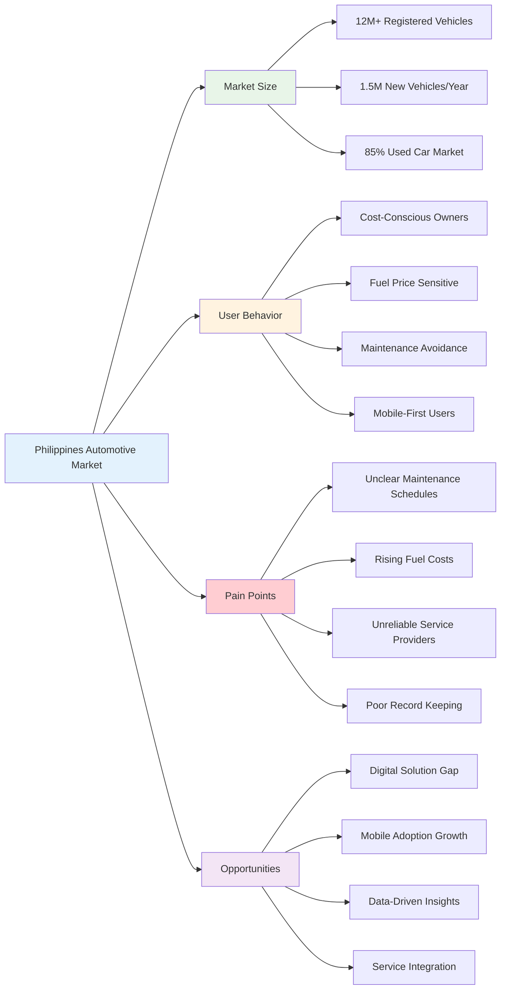
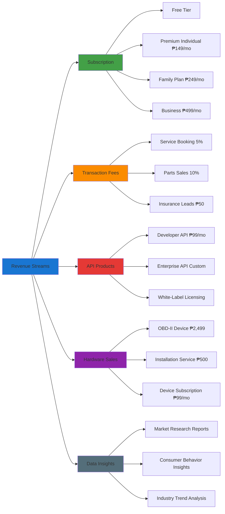
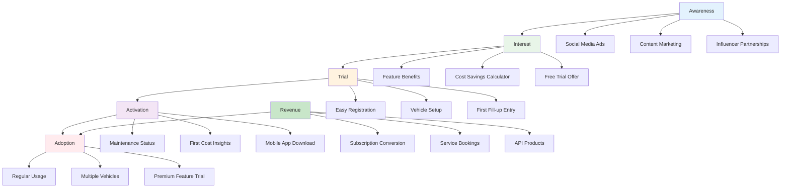
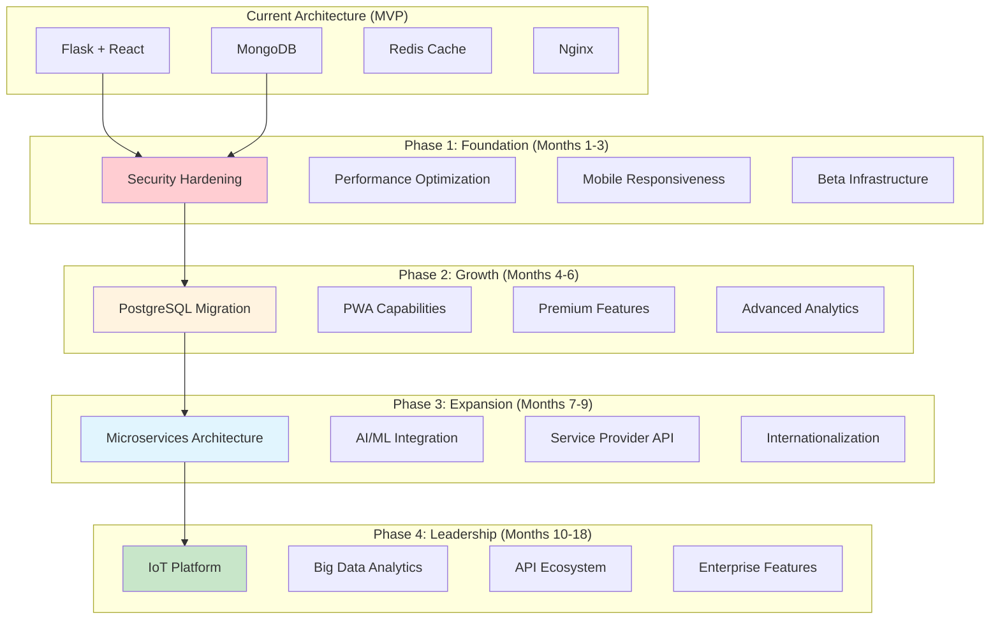
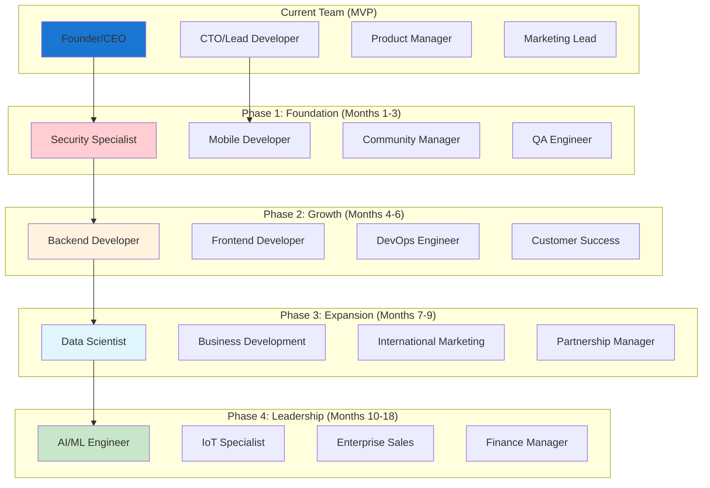

# FuelWise - Car Maintenance Tracker: Product Roadmap & Future Vision

## Executive Summary

**Current State**: MVP in development with comprehensive feature set but critical security vulnerabilities
**Market Focus**: Philippines vehicle owners (beta testing phase)
**Business Model**: Freemium with subscription conversion focus
**Timeline**: 18-month strategic roadmap for market leadership

### Strategic Vision

**"Become the leading vehicle maintenance platform in Southeast Asia by combining intelligent fuel economy tracking with predictive maintenance alerts, personalized cost optimization, and seamless service integration."**

## 1. Market Analysis & Competitive Positioning

### 1.1 Philippines Automotive Market Context



### 1.2 Competitive Landscape Analysis

| Competitor | Strengths | Weaknesses | Market Share | Our Advantage |
|------------|-----------|------------|---------------|---------------|
| **Fuelio** | Simple fuel tracking | No maintenance intelligence | 25% | Smart maintenance integration |
| **Drivvo** | Comprehensive features | Complex interface, not localized | 20% | Philippines-specific simplicity |
| **Car Maintenance Reminder** | Maintenance focused | Poor fuel tracking | 15% | Combined fuel + maintenance |
| **Local Mechanics** | Personal service | No digital tracking | 40% | Digital convenience + analytics |
| **Spreadsheets** | Free, customizable | Manual calculations | 30% | Automation + insights |

### 1.3 Our Competitive Differentiation

```mermaid
graph TD
    A[FuelWise Competitive Edge] --> B[Philippines-Specific]
    A --> C[Predictive Intelligence]
    A --> D[Cost Optimization]
    A --> E[Service Integration]
    A --> F[Mobile-First]

    B --> B1[Local Fuel Prices]
    B --> B2[Severe Conditions Schedules]
    B --> B3[Popular Vehicle Database]
    B --> B4[Regional Service Providers]

    C --> C1[AI-Powered Reminders]
    C --> C2[Predictive Maintenance]
    C --> C3[Usage Pattern Analysis]
    C --> C4[Failure Risk Assessment]

    D --> D1[Fuel Efficiency Insights]
    D --> D2[Cost Savings Calculator]
    D --> D3[Price Comparison]
    D --> D4[Budget Planning Tools]

    E --> E1[Mechanic Directory]
    E --> E2[Price Transparency]
    E --> E3[Appointment Scheduling]
    E --> E4[Service History Sharing]

    F --> F1[Progressive Web App]
    F --> F2[Offline Capability]
    F --> F3[Touch-Optimized UI]
    F --> F4[Push Notifications]

    style A fill:#1976d2
    style B fill:#43a047
    style C fill:#fb8c00
    style D fill:#e53935
    style E fill:#8e24aa
    style F fill:#546e7a
```



## 2. Strategic Roadmap (18 Months)

### 2.1 Phase 1: MVP Foundation & Launch (Months 1-3)

#### 2.1.1 Critical Security Hardening (Week 1-2)
**Priority**: 🔴 CRITICAL
**Timeline**: 2 weeks
**Resources**: 1 senior developer, 1 security specialist

**Deliverables**:
- [ ] Generate secure JWT secret keys
- [ ] Implement comprehensive input validation
- [ ] Add rate limiting and brute force protection
- [ ] Configure production environment variables
- [ ] Add security headers and CORS hardening
- [ ] Implement data encryption at rest and in transit
- [ ] Security audit and penetration testing

**Success Metrics**:
- Zero critical security vulnerabilities
- All security tests passing
- OWASP Top 10 compliance

#### 2.1.2 Philippines Beta Launch (Week 3-6)
**Priority**: 🟡 HIGH
**Timeline**: 4 weeks
**Resources**: 2 developers, 1 product manager, 1 community manager

**Deliverables**:
- [ ] Beta user recruitment (500 users)
- [ ] Philippines-specific feature testing
- [ ] User feedback collection system
- [ ] Performance monitoring setup
- [ ] Customer support workflow
- [ ] Beta testing analytics dashboard

**Success Metrics**:
- 70% user activation rate
- 40% weekly active users
- 60% log 3+ fill-ups within 2 weeks
- 15% express premium interest

#### 2.1.3 MVP Stabilization (Week 7-12)
**Priority**: 🟡 HIGH
**Timeline**: 6 weeks
**Resources**: 3 developers, 1 QA engineer

**Deliverables**:
- [ ] Bug fixes and performance optimization
- [ ] Mobile responsiveness improvements
- [ ] User experience refinements
- [ ] Core feature enhancements
- [ ] Analytics and user behavior tracking
- [ ] Subscription conversion optimization

**Success Metrics**:
- < 1% crash rate
- < 2s page load time
- 90% user satisfaction score
- 10% conversion to premium

### 2.2 Phase 2: Growth & Optimization (Months 4-6)

#### 2.2.1 Premium Features Launch
**Priority**: 🟡 HIGH
**Timeline**: 8 weeks
**Resources**: 3 developers, 1 product manager, 1 designer

**Features**:
- **Multi-Vehicle Support**: Add and manage unlimited vehicles
- **Advanced Analytics**: 12-month fuel economy trends and insights
- **Maintenance Cost Tracking**: Historical costs and budget forecasting
- **Data Export**: CSV and PDF reports for service history
- **Custom Schedules**: User-defined maintenance intervals
- **Priority Support**: 24-hour response time for premium users

**Success Metrics**:
- 15% free-to-premium conversion rate
- ₱200,000 MRR (Monthly Recurring Revenue)
- 4.5/5 premium feature satisfaction

#### 2.2.2 PostgreSQL Migration
**Priority**: 🟡 HIGH
**Timeline**: 4 weeks
**Resources**: 2 senior developers, 1 DevOps engineer

**Rationale**:
- Better data integrity for financial calculations
- ACID compliance for transaction safety
- Superior performance for complex queries
- Easier scaling and maintenance
- Better tooling and community support

**Migration Plan**:
1. **Week 1**: Schema design and migration scripts
2. **Week 2**: Data migration and validation
3. **Week 3**: API updates and testing
4. **Week 4**: Production deployment and monitoring

**Success Metrics**:
- Zero data loss during migration
- 50% improvement in query performance
- 99.9% data integrity verified

#### 2.2.3 PWA Capabilities
**Priority**: 🟡 HIGH
**Timeline**: 4 weeks
**Resources**: 2 frontend developers, 1 designer

**Features**:
- **Offline Mode**: Add fuel entries and check maintenance status offline
- **Push Notifications**: Maintenance reminders and fuel price alerts
- **Add to Home Screen**: Native app-like experience
- **Background Sync**: Automatic data synchronization when online
- **Service Worker Caching**: Improved performance and offline capability

**Success Metrics**:
- 60% of users add to home screen
- 40% reduction in mobile data usage
- 50% improvement in offline user experience

### 2.3 Phase 3: Market Expansion (Months 7-9)

#### 2.3.1 Service Provider Integration
**Priority**: 🟡 HIGH
**Timeline**: 8 weeks
**Resources**: 2 developers, 1 business development manager

**Features**:
- **Mechanic Directory**: Verified service providers with reviews
- **Price Comparison**: Service cost comparison across providers
- **Appointment Scheduling**: Book services directly through the app
- **Service History Sharing**: Share maintenance records with mechanics
- **Discount Programs**: Exclusive deals for premium users

**Success Metrics**:
- 500+ verified service providers
- 20% of bookings through app
- 15% cost savings for users
- 4.0/5 provider rating

#### 2.3.2 AI-Powered Insights
**Priority**: 🟡 HIGH
**Timeline**: 6 weeks
**Resources**: 1 data scientist, 2 developers

**Features**:
- **Predictive Maintenance**: AI-driven failure risk assessment
- **Fuel Optimization**: Personalized driving recommendations
- **Cost Forecasting**: Predict future maintenance costs
- **Anomaly Detection**: Unusual fuel consumption alerts
- **Personalized Recommendations**: Vehicle-specific advice

**Success Metrics**:
- 85% prediction accuracy
- 10% improvement in user fuel efficiency
- 20% reduction in unexpected breakdowns
- 90% user satisfaction with recommendations

#### 2.3.3 Southeast Asia Expansion
**Priority**: 🟡 MEDIUM
**Timeline**: 6 weeks
**Resources**: 1 international business manager, 1 developer

**Target Markets**:
1. **Indonesia**: 15M+ vehicles, growing automotive market
2. **Thailand**: 20M+ vehicles, strong manufacturing base
3. **Vietnam**: 5M+ vehicles, rapid smartphone adoption
4. **Malaysia**: 10M+ vehicles, high digital literacy

**Localization Requirements**:
- Language translation (Bahasa, Thai, Vietnamese)
- Currency and fuel price integration
- Local vehicle database
- Regional maintenance schedules
- Country-specific features

**Success Metrics**:
- 10,000 users in each target market
- 30% market penetration in target cities
- Localized feature adoption > 60%

### 2.4 Phase 4: Market Leadership (Months 10-18)

#### 2.4.1 Advanced Analytics Platform
**Priority**: 🟡 MEDIUM
**Timeline**: 12 weeks
**Resources**: 2 data scientists, 3 developers, 1 product manager

**Features**:
- **Fleet Management**: Multiple vehicle analytics for businesses
- **Carbon Footprint Tracking**: Environmental impact analysis
- **Tax Deduction Tools**: Business vehicle expense tracking
- **Insurance Integration**: Risk assessment and premium optimization
- **Resale Value Optimization**: Vehicle value tracking and advice

**Success Metrics**:
- 1,000+ business customers
- ₱1M+ MRR from enterprise features
- 25% improvement in user retention
- Industry-leading analytics capabilities

#### 2.4.2 IoT Integration
**Priority**: 🟡 MEDIUM
**Timeline**: 10 weeks
**Resources**: 2 IoT specialists, 2 developers, 1 hardware partner

**Features**:
- **OBD-II Device Integration**: Real-time vehicle diagnostics
- **Automatic Mileage Tracking**: No manual entry required
- **Real-time Fuel Monitoring**: Live fuel consumption data
- **Engine Health Monitoring**: Continuous vehicle health assessment
- **Theft Protection**: GPS tracking and alerts

**Success Metrics**:
- 5,000+ IoT devices deployed
- 80% reduction in manual data entry
- 30% improvement in data accuracy
- New revenue stream from hardware sales

#### 2.4.3 API Ecosystem
**Priority**: 🟡 MEDIUM
**Timeline**: 8 weeks
**Resources**: 2 developers, 1 partnerships manager

**API Products**:
- **Developer Portal**: Public API documentation and tools
- **Third-Party Integrations**: Insurance companies, dealerships
- **White-Label Solution**: Rebrand for other businesses
- **Data Marketplace**: Anonymized automotive data insights
- **Partner API**: Service provider booking integration

**Success Metrics**:
- 1,000+ active developers
- 50+ third-party integrations
- 10+ enterprise partnerships
- ₱500K+ MRR from API products

## 3. Business Strategy & Monetization

### 3.1 Revenue Model Evolution



### 3.2 Customer Acquisition Strategy

#### 3.2.1 Philippines Market Penetration
```python
PHILIPPINES_ACQUISITION_STRATEGY = {
    'target_markets': {
        'metro_manila': {
            'population': '13M+',
            'vehicle_density': 'high',
            'digital_adoption': '85%',
            'strategy': 'digital_marketing'
        },
        'cebu': {
            'population': '3M+',
            'vehicle_density': 'medium',
            'digital_adoption': '75%',
            'strategy': 'partnerships'
        },
        'davao': {
            'population': '2M+',
            'vehicle_density': 'medium',
            'digital_adoption': '70%',
            'strategy': 'community_building'
        }
    },
    'channels': {
        'digital_marketing': {
            'facebook_ads': True,
            'google_ads': True,
            'influencer_marketing': True,
            'content_marketing': True
        },
        'partnerships': {
            'gas_stations': ['Shell', 'Petron', 'Caltex'],
            'car_dealerships': ['Toyota', 'Honda', 'Mitsubishi'],
            'insurance_companies': ['Pioneer', 'Malayan', 'Standard']
        },
        'community': {
            'car_clubs': True,
            'online_forums': True,
            'meetup_groups': True,
            'social_media': True
        }
    },
    'budget_allocation': {
        'digital_marketing': '40%',
        'partnerships': '30%',
        'community': '20%',
        'product_improvement': '10%'
    }
}
```

#### 3.2.2 Conversion Funnel Optimization


### 3.3 Financial Projections

#### 3.3.1 18-Month Revenue Forecast
```python
FINANCIAL_PROJECTIONS = {
    'user_growth': {
        'month_3': 1000,      # Beta completion
        'month_6': 5000,      # Philippines launch
        'month_9': 15000,     # Regional expansion
        'month_12': 35000,    # Premium features
        'month_18': 100000    # Market leadership
    },
    'conversion_rates': {
        'free_to_premium': '10-15%',
        'premium_retention': '85%',
        'ltv_customer': '₱8,000',
        'cac_target': '₱1,500'
    },
    'revenue_streams': {
        'subscriptions': {
            'month_6': '₱75,000/mo',
            'month_12': '₱525,000/mo',
            'month_18': '₱1,500,000/mo'
        },
        'transaction_fees': {
            'month_6': '₱25,000/mo',
            'month_12': '₱150,000/mo',
            'month_18': '₱400,000/mo'
        },
        'api_products': {
            'month_12': '₱100,000/mo',
            'month_18': '₱500,000/mo'
        },
        'hardware_sales': {
            'month_18': '₱1,000,000/mo'
        }
    },
    'total_revenue': {
        'month_6': '₱100,000/mo',
        'month_12': '₱775,000/mo',
        'month_18': '₱3,400,000/mo'
    },
    'break_even': {
        'target': 'Month 14',
        'monthly_burn_rate': '₱500,000',
        'total_funding_needed': '₱7M'
    }
}
```

## 4. Technology Evolution Strategy

### 4.1 Architecture Evolution



### 4.2 Technology Stack Evolution

#### 4.2.1 Backend Evolution
```python
TECHNOLOGY_EVOLUTION = {
    'current': {
        'framework': 'Flask 2.3.3',
        'database': 'MongoDB',
        'cache': 'Redis',
        'auth': 'JWT',
        'deployment': 'Docker'
    },
    'phase_1': {
        'security': 'OWASP Top 10 Compliance',
        'monitoring': 'Sentry + Prometheus',
        'performance': 'Response optimization',
        'scalability': 'Vertical scaling'
    },
    'phase_2': {
        'database': 'PostgreSQL',
        'architecture': 'Modular services',
        'analytics': 'Real-time processing',
        'search': 'Elasticsearch'
    },
    'phase_3': {
        'ai_ml': 'TensorFlow/PyTorch',
        'microservices': 'Kubernetes',
        'messaging': 'RabbitMQ/Kafka',
        'internationalization': 'Multi-language support'
    },
    'phase_4': {
        'iot_platform': 'MQTT + CoAP',
        'big_data': 'Spark + Hadoop',
        'api_gateway': 'Kong/Apigee',
        'enterprise': 'Multi-tenant architecture'
    }
}
```

#### 4.2.2 Frontend Evolution
```python
FRONTEND_EVOLUTION = {
    'current': {
        'framework': 'React 18',
        'language': 'TypeScript',
        'styling': 'Tailwind CSS',
        'state': 'React Hooks'
    },
    'phase_1': {
        'mobile_optimization': 'Progressive enhancement',
        'performance': 'Code splitting + lazy loading',
        'offline': 'Service Worker caching',
        'notifications': 'Web Push API'
    },
    'phase_2': {
        'pwa_features': 'Offline forms + background sync',
        'native_features': 'Device sensors + camera',
        'animations': 'Smooth transitions + gestures',
        'accessibility': 'WCAG 2.1 compliance'
    },
    'phase_3': {
        'real_time': 'WebSockets + live updates',
        '3d_visualizations': 'Three.js integration',
        'voice_interface': 'Speech recognition',
        'ar_features': 'Maintenance AR overlays'
    },
    'phase_4': {
        'cross_platform': 'React Native + electron',
        'enterprise_ui': 'Advanced dashboards',
        'customization': 'Theme engine + white-label',
        'integration': 'Embedded widgets + SDK'
    }
}
```

## 5. Risk Management & Mitigation

### 5.1 Technical Risks

#### 5.1.1 Risk Assessment Matrix
```python
RISK_ASSESSMENT = {
    'security_vulnerabilities': {
        'probability': 'high',
        'impact': 'critical',
        'mitigation': 'Security audit, penetration testing, code reviews',
        'timeline': 'Immediate (Weeks 1-2)',
        'owner': 'CTO'
    },
    'database_migration_failures': {
        'probability': 'medium',
        'impact': 'high',
        'mitigation': 'Phased migration, rollback strategy, data validation',
        'timeline': 'Phase 2 (Months 4-6)',
        'owner': 'Lead Developer'
    },
    'scalability_issues': {
        'probability': 'medium',
        'impact': 'high',
        'mitigation': 'Load testing, horizontal scaling, caching strategy',
        'timeline': 'Phase 2 (Months 4-6)',
        'owner': 'DevOps Engineer'
    },
    'third_party_api_failures': {
        'probability': 'medium',
        'impact': 'medium',
        'mitigation': 'Multiple providers, fallback mechanisms, API monitoring',
        'timeline': 'Ongoing',
        'owner': 'Backend Developer'
    },
    'mobile_performance': {
        'probability': 'low',
        'impact': 'medium',
        'mitigation': 'Performance optimization, progressive enhancement',
        'timeline': 'Phase 1-2 (Months 1-6)',
        'owner': 'Frontend Developer'
    }
}
```

### 5.2 Market Risks

#### 5.2.1 Competitive Response Strategy
```python
COMPETITIVE_RISKS = {
    'incumbent_response': {
        'risk': 'Fuelio/Drivvo add similar features',
        'probability': 'high',
        'mitigation': {
            'differentiation': 'Philippines-specific optimization',
            'speed_to_market': 'First-mover advantage in local market',
            'network_effects': 'Service provider ecosystem',
            'switching_costs': 'Data migration tools'
        }
    },
    'new_entrants': {
        'risk': 'Well-funded competitors enter market',
        'probability': 'medium',
        'mitigation': {
            'brand_loyalty': 'Community building',
            'patent_protection': 'IP for algorithms',
            'exclusive_partnerships': 'Service provider contracts',
            'data_advantage': 'Proprietary datasets'
        }
    },
    'market_adoption': {
        'risk': 'Slow user adoption in Philippines',
        'probability': 'medium',
        'mitigation': {
            'education': 'Content marketing + tutorials',
            'incentives': 'Free premium trials',
            'trust_building': 'Local partnerships',
            'ease_of_use': 'Simplified onboarding'
        }
    }
}
```

### 5.3 Business Risks

#### 5.3.1 Financial Risk Management
```python
FINANCIAL_RISKS = {
    'cash_flow': {
        'risk': 'Insufficient funding for 18-month runway',
        'probability': 'medium',
        'mitigation': {
            'funding_strategy': 'Series A at Month 6',
            'revenue_acceleration': 'Premium feature monetization',
            'cost_optimization': 'Cloud cost management',
            'partnership_revenue': 'Service provider commissions'
        }
    },
    'monetization': {
        'risk': 'Low conversion to paid plans',
        'probability': 'medium',
        'mitigation': {
            'value_proposition': 'Demonstrate clear ROI',
            'pricing_optimization': 'A/B testing different price points',
            'freemium_features': 'Limited free tier restrictions',
            'trial_periods': 'Extended premium trials'
        }
    },
    'regulatory': {
        'risk': 'Data privacy compliance issues',
        'probability': 'low',
        'mitigation': {
            'compliance_framework': 'GDPR + local regulations',
            'legal_counsel': 'Technology law specialist',
            'data_minimization': 'Collect only essential data',
            'transparency': 'Clear privacy policies'
        }
    }
}
```

## 6. Success Metrics & KPIs

### 6.1 Product Metrics

#### 6.1.1 Core Product KPIs
```python
PRODUCT_KPIS = {
    'user_engagement': {
        'daily_active_users': 'Target 20% of total users',
        'weekly_active_users': 'Target 40% of total users',
        'monthly_active_users': 'Target 60% of total users',
        'session_duration': 'Target 5+ minutes',
        'screens_per_session': 'Target 4+ screens'
    },
    'feature_adoption': {
        'fuel_tracking': 'Target 80% of active users',
        'maintenance_reminders': 'Target 70% of active users',
        'dashboard_usage': 'Target 60% of active users',
        'mobile_app': 'Target 50% of users',
        'premium_features': 'Target 15% of free users'
    },
    'user_retention': {
        'day_1_retention': 'Target 40%',
        'day_7_retention': 'Target 25%',
        'day_30_retention': 'Target 15%',
        'month_3_retention': 'Target 10%',
        'month_6_retention': 'Target 8%'
    },
    'performance': {
        'app_load_time': 'Target < 2 seconds',
        'api_response_time': 'Target < 500ms',
        'crash_rate': 'Target < 1%',
        'error_rate': 'Target < 0.5%',
        'offline_success_rate': 'Target > 90%'
    }
}
```

### 6.2 Business Metrics

#### 6.2.1 Financial KPIs
```python
FINANCIAL_KPIS = {
    'revenue': {
        'mrr_growth': 'Target 20% month-over-month',
        'arr_target': 'Target ₱40M by Month 18',
        'ltv_cac_ratio': 'Target > 3:1',
        'gross_margin': 'Target > 80%'
    },
    'user_acquisition': {
        'cac': 'Target < ₱1,500',
        'organic_growth_rate': 'Target 30% of new users',
        'viral_coefficient': 'Target > 0.5',
        'conversion_rate': 'Target 5% signup to paid'
    },
    'market_expansion': {
        'philippines_penetration': 'Target 5% of target market by Month 12',
        'regional_expansion': 'Target 3 new countries by Month 18',
        'market_share': 'Target 10% of digital automotive apps by Month 18'
    }
}
```

### 6.3 Customer Success Metrics

#### 6.3.1 Customer Satisfaction KPIs
```python
CUSTOMER_SUCCESS_KPIS = {
    'satisfaction': {
        'csat_score': 'Target > 4.0/5.0',
        'nps_score': 'Target > 40',
        'user_reviews': 'Target > 4.0/5.0 on app stores',
        'support_response_time': 'Target < 24 hours'
    },
    'value_realization': {
        'fuel_savings_user_reported': 'Target 10% average savings',
        'maintenance_compliance': 'Target 70% of users complete recommended maintenance',
        'time_saved': 'Target 2 hours/month per user',
        'cost_savings': 'Target ₱5,000/year per user'
    },
    'product_quality': {
        'bug_resolution_time': 'Target < 72 hours',
        'feature_request_implemented': 'Target 30% of top requests',
        'documentation_quality': 'Target > 4.0/5.0',
        'accessibility_compliance': 'Target WCAG 2.1 AA'
    }
}
```

## 7. Team & Resource Planning

### 7.1 Team Structure Evolution



### 7.2 Hiring Plan

#### 7.2.1 Staffing Requirements
```python
HIRING_PLAN = {
    'phase_1': {
        'security_specialist': {
            'timeline': 'Immediate',
            'skills': ['OWASP', 'Penetration Testing', 'Security Architecture'],
            'experience': '5+ years'
        },
        'mobile_developer': {
            'timeline': 'Month 1',
            'skills': ['React Native', 'PWA', 'Mobile Optimization'],
            'experience': '3+ years'
        },
        'community_manager': {
            'timeline': 'Month 2',
            'skills': ['Social Media', 'Community Building', 'Customer Support'],
            'experience': '2+ years'
        },
        'qa_engineer': {
            'timeline': 'Month 2',
            'skills': ['Test Automation', 'Mobile Testing', 'Performance Testing'],
            'experience': '3+ years'
        }
    },
    'phase_2': {
        'backend_developer': {
            'timeline': 'Month 4',
            'skills': ['Python', 'PostgreSQL', 'Microservices'],
            'experience': '4+ years'
        },
        'frontend_developer': {
            'timeline': 'Month 4',
            'skills': ['React', 'TypeScript', 'Performance'],
            'experience': '3+ years'
        },
        'devops_engineer': {
            'timeline': 'Month 5',
            'skills': ['Docker', 'Kubernetes', 'CI/CD'],
            'experience': '4+ years'
        },
        'customer_success': {
            'timeline': 'Month 5',
            'skills': ['Customer Support', 'Account Management'],
            'experience': '2+ years'
        }
    }
}
```

## 8. Conclusion & Next Steps

### 8.1 Immediate Priorities

1. **Security Hardening (Week 1-2)**: Address critical vulnerabilities identified in architectural review
2. **Beta Launch (Week 3-6)**: Recruit 500 Philippines users for testing and feedback
3. **MVP Stabilization (Week 7-12)**: Fix bugs and optimize performance based on feedback
4. **Premium Features (Month 4-6)**: Launch subscription model with advanced features
5. **PostgreSQL Migration (Month 4-6)**: Migrate to PostgreSQL for better data integrity

### 8.2 Success Factors

1. **Philippines-Specific Focus**: Deep localization and understanding of local market needs
2. **Mobile-First Experience**: Optimized for mobile users with offline capabilities
3. **Clear Value Proposition**: Demonstrable cost savings and convenience
4. **Community Building**: Strong user community and engagement
5. **Strategic Partnerships**: Integration with service providers and fuel companies

### 8.3 Long-term Vision

**"To become the leading automotive maintenance platform in Southeast Asia, expanding from fuel economy tracking to comprehensive vehicle management with AI-powered insights, IoT integration, and seamless service connectivity."**

This roadmap provides a realistic, achievable plan for transforming the current MVP into a market-leading product, with specific focus on the Philippines market, mobile-first strategy, and sustainable business model. The 18-month timeline balances aggressive growth with practical implementation considerations, ensuring both market leadership and technical excellence.