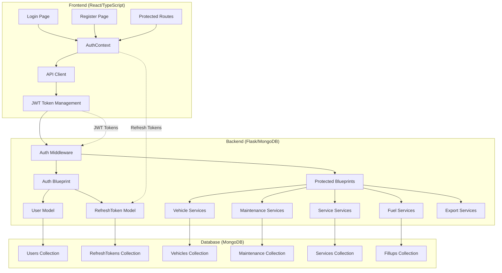
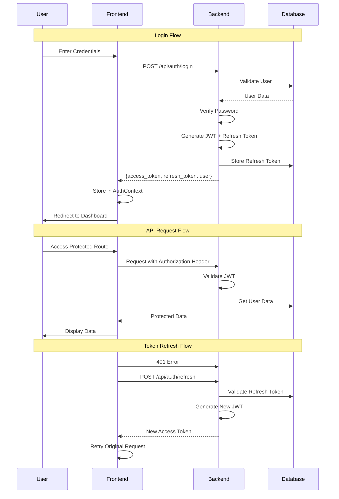

# Car Maintenance Tracker - Authentication Implementation Plan

## 📋 Executive Summary

This comprehensive authentication implementation plan addresses the critical security gaps identified in the production readiness analysis. The plan outlines a complete JWT-based authentication system with multi-tenant architecture, subscription management, and enterprise-grade security measures.

**Timeline**: 6-8 weeks for full implementation  
**Investment**: $75-100K  
**Risk Level**: Medium (complex but well-understood patterns)

## 🎯 Authentication Architecture Overview

### 🏗️ System Architecture



### 🔐 Authentication Flow



## 🗄️ Database Schema Design

### User Collection Schema

```javascript
{
  _id: ObjectId,
  email: "user@example.com",           // Unique, indexed
  password_hash: "bcrypt_hash",        // Werkzeug hashing
  full_name: "John Doe",               // Display name
  subscription_tier: "free",           // free, personal, family, business
  subscription_expires: ISODate,       // Subscription end date
  is_active: true,                     // Account status
  is_verified: false,                  // Email verification
  verification_token: "uuid_token",    // Email verification
  password_reset_token: "uuid_token",  // Password reset
  password_reset_expires: ISODate,      // Reset expiry
  login_attempts: 0,                   // Failed login attempts
  locked_until: ISODate,               // Account lockout
  preferences: {                       // User settings
    currency: "USD",
    distance_unit: "km",
    fuel_unit: "liters",
    timezone: "UTC",
    notifications: {
      maintenance_reminders: true,
      marketing_emails: false
    }
  },
  last_login: ISODate,                 // Last successful login
  created_at: ISODate,
  updated_at: ISODate
}
```

### RefreshToken Collection Schema

```javascript
{
  _id: ObjectId,
  user_id: ObjectId,                   // References User._id
  token_hash: "bcrypt_hash",          // Secure token storage
  device_info: "Chrome on macOS",     // Device fingerprint
  ip_address: "192.168.1.1",          // Last known IP
  user_agent: "Mozilla/5.0...",        // Browser info
  is_active: true,                    // Token status
  expires_at: ISODate,                // 7-day expiry
  created_at: ISODate,
  updated_at: ISODate
}
```

### Updated Vehicle Collection Schema

```javascript
{
  _id: ObjectId,
  user_id: ObjectId,                  // NEW: User ownership
  make: "Toyota",
  model: "Camry",
  year: 2020,
  current_mileage: 50000,
  purchase_mileage: 25000,
  license_plate: "ABC-123",
  vin: "1HGCM82633A123456",
  insurance_policy: "POL-12345",
  purchase_date: ISODate,
  created_at: ISODate,
  updated_at: ISODate
}
```

## 🛠️ Backend Implementation

### 1. Authentication Middleware

```python
# backend/auth.py
from functools import wraps
import jwt
from datetime import datetime, timedelta
from flask import request, jsonify, current_app
from models import User, RefreshToken

def token_required(f):
    """JWT authentication decorator"""
    @wraps(f)
    def decorated(*args, **kwargs):
        token = request.headers.get('Authorization')
        if not token:
            return jsonify({'error': 'Token is missing'}), 401
        
        try:
            token = token.split(' ')[1]  # Remove 'Bearer ' prefix
            data = jwt.decode(token, current_app.config['SECRET_KEY'], algorithms=['HS256'])
            current_user = User.find_by_id(data['user_id'])
            
            if not current_user or not current_user['is_active']:
                return jsonify({'error': 'Token is invalid'}), 401
                
            request.current_user = current_user
        except jwt.ExpiredSignatureError:
            return jsonify({'error': 'Token has expired'}), 401
        except jwt.InvalidTokenError:
            return jsonify({'error': 'Token is invalid'}), 401
            
        return f(*args, **kwargs)
    return decorated

def subscription_required(min_tier='free'):
    """Subscription tier validation decorator"""
    def decorator(f):
        @wraps(f)
        def decorated(*args, **kwargs):
            if not hasattr(request, 'current_user'):
                return jsonify({'error': 'Authentication required'}), 401
                
            user_tier = request.current_user.get('subscription_tier', 'free')
            tier_hierarchy = {'free': 0, 'personal': 1, 'family': 2, 'business': 3}
            
            if tier_hierarchy.get(user_tier, 0) < tier_hierarchy.get(min_tier, 0):
                return jsonify({
                    'error': 'Subscription upgrade required',
                    'required_tier': min_tier,
                    'current_tier': user_tier
                }), 403
                
            return f(*args, **kwargs)
        return decorated
    return decorator
```

### 2. Authentication Blueprint

```python
# backend/routes/auth.py
from flask import Blueprint, request, jsonify
from models import User, RefreshToken
from auth import token_required
import bcrypt
import uuid
from datetime import datetime, timedelta

auth_bp = Blueprint('auth', __name__)

@auth_bp.route('/register', methods=['POST'])
def register():
    """User registration endpoint"""
    data = request.get_json()
    
    # Validation
    required_fields = ['email', 'password', 'full_name']
    if not all(field in data for field in required_fields):
        return jsonify({'error': 'Missing required fields'}), 400
    
    # Check if user exists
    if User.find_by_email(data['email']):
        return jsonify({'error': 'Email already registered'}), 409
    
    # Create user
    user_data = {
        'email': data['email'],
        'password': data['password'],
        'full_name': data['full_name'],
        'subscription_tier': 'free',
        'verification_token': str(uuid.uuid4()),
        'is_active': True,
        'is_verified': False,
        'created_at': datetime.utcnow()
    }
    
    user_id = User.create(user_data)
    
    # Send verification email (implementation needed)
    
    return jsonify({
        'message': 'User registered successfully',
        'user_id': str(user_id)
    }), 201

@auth_bp.route('/login', methods=['POST'])
def login():
    """User login endpoint"""
    data = request.get_json()
    
    if not data or not data.get('email') or not data.get('password'):
        return jsonify({'error': 'Email and password required'}), 400
    
    user = User.find_by_email(data['email'])
    
    if not user or not user['is_active']:
        return jsonify({'error': 'Invalid credentials'}), 401
    
    # Check account lockout
    if user.get('locked_until') and user['locked_until'] > datetime.utcnow():
        return jsonify({'error': 'Account temporarily locked'}), 403
    
    # Verify password
    if not User.verify_password(user['_id'], data['password']):
        # Increment failed attempts
        User.increment_login_attempts(user['_id'])
        return jsonify({'error': 'Invalid credentials'}), 401
    
    # Generate tokens
    access_token = User.generate_access_token(user['_id'])
    refresh_token = RefreshToken.create(user['_id'], request)
    
    # Update last login
    User.update_last_login(user['_id'])
    
    return jsonify({
        'access_token': access_token,
        'refresh_token': refresh_token,
        'user': {
            'id': str(user['_id']),
            'email': user['email'],
            'full_name': user['full_name'],
            'subscription_tier': user['subscription_tier']
        }
    })

@auth_bp.route('/refresh', methods=['POST'])
def refresh():
    """Refresh access token"""
    data = request.get_json()
    refresh_token = data.get('refresh_token')
    
    if not refresh_token:
        return jsonify({'error': 'Refresh token required'}), 400
    
    token_data = RefreshToken.validate(refresh_token)
    if not token_data:
        return jsonify({'error': 'Invalid refresh token'}), 401
    
    user = User.find_by_id(token_data['user_id'])
    if not user or not user['is_active']:
        return jsonify({'error': 'User not found or inactive'}), 401
    
    access_token = User.generate_access_token(user['_id'])
    
    return jsonify({'access_token': access_token})

@auth_bp.route('/logout', methods=['POST'])
@token_required
def logout():
    """User logout"""
    data = request.get_json()
    refresh_token = data.get('refresh_token')
    
    if refresh_token:
        RefreshToken.revoke(refresh_token)
    
    return jsonify({'message': 'Logged out successfully'})
```

### 3. Enhanced Vehicle Model with User Context

```python
# backend/models.py (enhanced Vehicle class)
class Vehicle:
    @staticmethod
    def create(vehicle_data):
        """Create a new vehicle with user ownership"""
        vehicle_data['created_at'] = datetime.utcnow()
        vehicle_data['updated_at'] = datetime.utcnow()
        return db.vehicles.insert_one(vehicle_data).inserted_id
    
    @staticmethod
    def find_by_user_id(user_id):
        """Get all vehicles for a specific user"""
        return list(db.vehicles.find({'user_id': ObjectId(user_id)}))
    
    @staticmethod
    def find_by_id_and_user_id(vehicle_id, user_id):
        """Get vehicle by ID with user validation"""
        return db.vehicles.find_one({
            '_id': ObjectId(vehicle_id),
            'user_id': ObjectId(user_id)
        })
    
    @staticmethod
    def update_by_user_id(vehicle_id, user_id, update_data):
        """Update vehicle with user validation"""
        update_data['updated_at'] = datetime.utcnow()
        result = db.vehicles.update_one(
            {'_id': ObjectId(vehicle_id), 'user_id': ObjectId(user_id)},
            {'$set': update_data}
        )
        return result.modified_count > 0
    
    @staticmethod
    def delete_by_user_id(vehicle_id, user_id):
        """Delete vehicle with user validation"""
        result = db.vehicles.delete_one({
            '_id': ObjectId(vehicle_id),
            'user_id': ObjectId(user_id)
        })
        return result.deleted_count > 0
```

## 🎨 Frontend Implementation

### 1. Authentication Context

```typescript
// frontend/src/contexts/AuthContext.tsx
import React, { createContext, useContext, useEffect, useState } from 'react';
import { User, LoginCredentials, RegisterData } from '../types/auth';
import { api } from '../lib/api';
import { auth } from '../lib/auth';

interface AuthContextType {
  user: User | null;
  isAuthenticated: boolean;
  isLoading: boolean;
  login: (credentials: LoginCredentials) => Promise<void>;
  register: (data: RegisterData) => Promise<void>;
  logout: () => void;
  refresh: () => Promise<boolean>;
  hasFeature: (feature: string) => boolean;
}

const AuthContext = createContext<AuthContextType | undefined>(undefined);

export const useAuth = () => {
  const context = useContext(AuthContext);
  if (context === undefined) {
    throw new Error('useAuth must be used within an AuthProvider');
  }
  return context;
};

export const AuthProvider: React.FC<{ children: React.ReactNode }> = ({ children }) => {
  const [user, setUser] = useState<User | null>(null);
  const [isLoading, setIsLoading] = useState(true);

  useEffect(() => {
    // Check for existing session on mount
    const initAuth = async () => {
      try {
        const tokens = auth.getTokens();
        if (tokens.accessToken) {
          const userData = await auth.validateToken(tokens.accessToken);
          if (userData) {
            setUser(userData);
          }
        }
      } catch (error) {
        console.error('Auth initialization failed:', error);
      } finally {
        setIsLoading(false);
      }
    };

    initAuth();
  }, []);

  const login = async (credentials: LoginCredentials) => {
    const response = await api.auth.login(credentials);
    auth.setTokens(response.access_token, response.refresh_token);
    setUser(response.user);
  };

  const register = async (data: RegisterData) => {
    const response = await api.auth.register(data);
    auth.setTokens(response.access_token, response.refresh_token);
    setUser(response.user);
  };

  const logout = () => {
    auth.clearTokens();
    setUser(null);
  };

  const refresh = async () => {
    try {
      const tokens = auth.getTokens();
      if (tokens.refreshToken) {
        const response = await api.auth.refresh(tokens.refreshToken);
        auth.setTokens(response.access_token, tokens.refreshToken);
        return true;
      }
    } catch (error) {
      console.error('Token refresh failed:', error);
      logout();
      return false;
    }
    return false;
  };

  const hasFeature = (feature: string): boolean => {
    if (!user) return false;
    
    const featureMap: Record<string, string[]> = {
      multiple_vehicles: ['personal', 'family', 'business'],
      advanced_analytics: ['family', 'business'],
      unlimited_vehicles: ['business'],
      api_access: ['business']
    };
    
    return featureMap[feature]?.includes(user.subscription_tier) || false;
  };

  const value: AuthContextType = {
    user,
    isAuthenticated: !!user,
    isLoading,
    login,
    register,
    logout,
    refresh,
    hasFeature
  };

  return <AuthContext.Provider value={value}>{children}</AuthContext.Provider>;
};
```

### 2. Protected Route Component

```typescript
// frontend/src/components/auth/ProtectedRoute.tsx
import React, { useEffect, useState } from 'react';
import { Navigate, useLocation } from 'react-router-dom';
import { useAuth } from '../../contexts/AuthContext';
import { LoadingSpinner } from '../ui/LoadingSpinner';

interface ProtectedRouteProps {
  children: React.ReactNode;
  requiredTier?: 'free' | 'personal' | 'family' | 'business';
  requiredFeature?: string;
  redirectTo?: string;
}

export const ProtectedRoute: React.FC<ProtectedRouteProps> = ({
  children,
  requiredTier = 'free',
  requiredFeature,
  redirectTo = '/login'
}) => {
  const { user, isAuthenticated, isLoading, hasFeature } = useAuth();
  const location = useLocation();
  const [isAuthorized, setIsAuthorized] = useState(false);

  useEffect(() => {
    if (!isLoading) {
      if (!isAuthenticated) {
        return;
      }

      // Check subscription tier
      const tierHierarchy = { free: 0, personal: 1, family: 2, business: 3 };
      const userTierLevel = tierHierarchy[user?.subscription_tier || 'free'];
      const requiredTierLevel = tierHierarchy[requiredTier];

      if (userTierLevel < requiredTierLevel) {
        return;
      }

      // Check feature access
      if (requiredFeature && !hasFeature(requiredFeature)) {
        return;
      }

      setIsAuthorized(true);
    }
  }, [isLoading, isAuthenticated, user, requiredTier, requiredFeature, hasFeature]);

  if (isLoading) {
    return (
      <div className="flex items-center justify-center min-h-screen">
        <LoadingSpinner />
      </div>
    );
  }

  if (!isAuthenticated) {
    return <Navigate to={redirectTo} state={{ from: location }} replace />;
  }

  if (!isAuthorized) {
    if (user && requiredFeature && !hasFeature(requiredFeature)) {
      return <Navigate to="/upgrade" state={{ feature: requiredFeature }} replace />;
    }
    
    if (user && requiredTier !== 'free') {
      return <Navigate to="/subscription" state={{ requiredTier }} replace />;
    }
  }

  return <>{children}</>;
};
```

### 3. Enhanced API Client

```typescript
// frontend/src/lib/api.ts (enhanced with authentication)
import axios, { AxiosInstance, AxiosError } from 'axios';
import { useAuth } from '../contexts/AuthContext';
import { auth } from './auth';

// Enhanced axios instance with authentication
export const api: AxiosInstance = axios.create({
  baseURL: import.meta.env.VITE_API_URL || 'http://localhost:5005/api',
  timeout: 10000,
  headers: {
    'Content-Type': 'application/json',
  },
});

// Request interceptor for authentication
api.interceptors.request.use(
  (config) => {
    const token = auth.getAccessToken();
    if (token) {
      config.headers.Authorization = `Bearer ${token}`;
    }
    return config;
  },
  (error) => Promise.reject(error)
);

// Response interceptor for token refresh
api.interceptors.response.use(
  (response) => response,
  async (error: AxiosError) => {
    const originalRequest = error.config as any;
    
    if (error.response?.status === 401 && !originalRequest._retry) {
      originalRequest._retry = true;
      
      try {
        const newToken = await auth.refreshAccessToken();
        if (newToken) {
          originalRequest.headers.Authorization = `Bearer ${newToken}`;
          return api(originalRequest);
        }
      } catch (refreshError) {
        auth.clearTokens();
        window.location.href = '/login';
        return Promise.reject(refreshError);
      }
    }
    
    return Promise.reject(error);
  }
);

// Authentication endpoints
export const authApi = {
  login: (credentials: { email: string; password: string }) =>
    api.post('/auth/login', credentials),
  
  register: (data: { email: string; password: string; full_name: string }) =>
    api.post('/auth/register', data),
  
  refresh: (refreshToken: string) =>
    api.post('/auth/refresh', { refresh_token: refreshToken }),
  
  logout: (refreshToken: string) =>
    api.post('/auth/logout', { refresh_token: refreshToken }),
  
  forgotPassword: (email: string) =>
    api.post('/auth/forgot-password', { email }),
  
  resetPassword: (token: string, password: string) =>
    api.post('/auth/reset-password', { token, password }),
  
  getProfile: () =>
    api.get('/auth/profile'),
  
  updateProfile: (data: any) =>
    api.put('/auth/profile', data),
  
  changePassword: (currentPassword: string, newPassword: string) =>
    api.post('/auth/change-password', { current_password: currentPassword, new_password: newPassword }),
  
  getSubscription: () =>
    api.get('/auth/subscription'),
  
  upgradeSubscription: (tier: string) =>
    api.post('/auth/subscription/upgrade', { tier })
};
```

### 4. Login Page Component

```typescript
// frontend/src/pages/Login.tsx
import React, { useState } from 'react';
import { Link, useNavigate, useLocation } from 'react-router-dom';
import { useAuth } from '../contexts/AuthContext';
import { Button } from '../components/ui/Button';
import { Input } from '../components/ui/Input';
import { Card } from '../components/ui/Card';
import { Alert } from '../components/ui/Alert';

interface LoginCredentials {
  email: string;
  password: string;
}

export const LoginPage: React.FC = () => {
  const [credentials, setCredentials] = useState<LoginCredentials>({
    email: '',
    password: ''
  });
  const [isLoading, setIsLoading] = useState(false);
  const [error, setError] = useState('');
  
  const { login } = useAuth();
  const navigate = useNavigate();
  const location = useLocation();

  const from = location.state?.from?.pathname || '/dashboard';

  const handleSubmit = async (e: React.FormEvent) => {
    e.preventDefault();
    setIsLoading(true);
    setError('');

    try {
      await login(credentials);
      navigate(from, { replace: true });
    } catch (err: any) {
      setError(err.response?.data?.error || 'Login failed');
    } finally {
      setIsLoading(false);
    }
  };

  return (
    <div className="min-h-screen flex items-center justify-center bg-gray-50 py-12 px-4 sm:px-6 lg:px-8">
      <Card className="max-w-md w-full space-y-8">
        <div>
          <h2 className="mt-6 text-center text-3xl font-extrabold text-gray-900">
            Sign in to your account
          </h2>
        </div>
        
        {error && (
          <Alert type="error" className="mb-4">
            {error}
          </Alert>
        )}
        
        <form className="mt-8 space-y-6" onSubmit={handleSubmit}>
          <div className="rounded-md shadow-sm -space-y-px">
            <div>
              <label htmlFor="email-address" className="sr-only">
                Email address
              </label>
              <Input
                id="email-address"
                name="email"
                type="email"
                autoComplete="email"
                required
                value={credentials.email}
                onChange={(e) => setCredentials({ ...credentials, email: e.target.value })}
                placeholder="Email address"
                className="appearance-none rounded-none relative block w-full px-3 py-2 border border-gray-300 placeholder-gray-500 text-gray-900 rounded-t-md focus:outline-none focus:ring-indigo-500 focus:border-indigo-500 focus:z-10 sm:text-sm"
              />
            </div>
            <div>
              <label htmlFor="password" className="sr-only">
                Password
              </label>
              <Input
                id="password"
                name="password"
                type="password"
                autoComplete="current-password"
                required
                value={credentials.password}
                onChange={(e) => setCredentials({ ...credentials, password: e.target.value })}
                placeholder="Password"
                className="appearance-none rounded-none relative block w-full px-3 py-2 border border-gray-300 placeholder-gray-500 text-gray-900 rounded-b-md focus:outline-none focus:ring-indigo-500 focus:border-indigo-500 focus:z-10 sm:text-sm"
              />
            </div>
          </div>

          <div className="flex items-center justify-between">
            <div className="text-sm">
              <Link
                to="/forgot-password"
                className="font-medium text-indigo-600 hover:text-indigo-500"
              >
                Forgot your password?
              </Link>
            </div>
          </div>

          <div>
            <Button
              type="submit"
              disabled={isLoading}
              className="group relative w-full flex justify-center py-2 px-4 border border-transparent text-sm font-medium rounded-md text-white bg-indigo-600 hover:bg-indigo-700 focus:outline-none focus:ring-2 focus:ring-offset-2 focus:ring-indigo-500"
            >
              {isLoading ? 'Signing in...' : 'Sign in'}
            </Button>
          </div>

          <div className="text-center">
            <span className="text-sm text-gray-600">
              Don't have an account?{' '}
              <Link
                to="/register"
                className="font-medium text-indigo-600 hover:text-indigo-500"
              >
                Sign up
              </Link>
            </span>
          </div>
        </form>
      </Card>
    </div>
  );
};
```

## 🔄 Data Migration Strategy

### Migration Script

```python
# backend/migrate_to_users.py
from pymongo import MongoClient
from models import User
import bcrypt
from datetime import datetime
import uuid

def migrate_to_user_system():
    """Migrate existing data to user-based system"""
    
    # Connect to MongoDB
    client = MongoClient('mongodb://localhost:27017/')
    db = client.car_maintenance_tracker
    
    # Create admin user for existing data
    admin_user_data = {
        'email': 'admin@system.local',
        'password': 'temporary_admin_password_123!',  # Change immediately
        'full_name': 'System Administrator',
        'subscription_tier': 'business',
        'is_active': True,
        'is_verified': True,
        'verification_token': str(uuid.uuid4()),
        'created_at': datetime.utcnow(),
        'updated_at': datetime.utcnow()
    }
    
    print("Creating admin user...")
    admin_user_id = User.create(admin_user_data)
    print(f"Admin user created with ID: {admin_user_id}")
    
    # Migrate vehicles
    print("Migrating vehicles...")
    vehicles = db.vehicles.find({})
    vehicle_count = 0
    
    for vehicle in vehicles:
        if 'user_id' not in vehicle:
            db.vehicles.update_one(
                {'_id': vehicle['_id']},
                {'$set': {'user_id': admin_user_id, 'updated_at': datetime.utcnow()}}
            )
            vehicle_count += 1
    
    print(f"Migrated {vehicle_count} vehicles to admin user")
    
    # Verify migration
    orphaned_vehicles = db.vehicles.count_documents({'user_id': {'$exists': False}})
    if orphaned_vehicles > 0:
        print(f"WARNING: {orphaned_vehicles} vehicles still without user_id")
    else:
        print("All vehicles successfully migrated")
    
    print("Migration completed!")
    print(f"Admin user email: {admin_user_data['email']}")
    print("IMPORTANT: Change the admin password immediately!")

if __name__ == '__main__':
    migrate_to_user_system()
```

## 🔒 Security Implementation

### 1. Rate Limiting Configuration

```python
# backend/rate_limiter.py
from flask_limiter import Limiter
from flask_limiter.util import get_remote_address
from flask import request

limiter = Limiter(
    key_func=get_remote_address,
    default_limits=["200 per day", "50 per hour"]
)

# Authentication-specific rate limits
auth_limits = {
    'login': "5 per 5 minutes",
    'register': "3 per hour",
    'forgot-password': "3 per hour",
    'reset-password': "5 per hour",
    'refresh': "10 per minute"
}

def apply_rate_limits(bp):
    """Apply rate limits to authentication blueprint"""
    
    @bp.route('/login', methods=['POST'])
    @limiter.limit(auth_limits['login'])
    def login():
        # Login implementation
        pass
    
    @bp.route('/register', methods=['POST'])
    @limiter.limit(auth_limits['register'])
    def register():
        # Register implementation
        pass
    
    # Apply to other auth endpoints...
```

### 2. Security Headers Middleware

```python
# backend/security_headers.py
from flask import after_this_request

def add_security_headers(response):
    """Add security headers to all responses"""
    
    # Content Security Policy
    response.headers['Content-Security-Policy'] = (
        "default-src 'self'; "
        "script-src 'self' 'unsafe-inline' 'unsafe-eval'; "
        "style-src 'self' 'unsafe-inline'; "
        "img-src 'self' data: https:; "
        "font-src 'self'; "
        "connect-src 'self'; "
        "frame-ancestors 'none';"
    )
    
    # Other security headers
    response.headers['X-Frame-Options'] = 'DENY'
    response.headers['X-Content-Type-Options'] = 'nosniff'
    response.headers['X-XSS-Protection'] = '1; mode=block'
    response.headers['Referrer-Policy'] = 'strict-origin-when-cross-origin'
    response.headers['Permissions-Policy'] = 'camera=(), microphone=(), geolocation=()'
    
    return response
```

### 3. Input Validation

```python
# backend/validation.py
import re
from flask import request, jsonify

def validate_email(email):
    """Validate email format"""
    pattern = r'^[a-zA-Z0-9._%+-]+@[a-zA-Z0-9.-]+\.[a-zA-Z]{2,}$'
    return re.match(pattern, email) is not None

def validate_password_strength(password):
    """Validate password strength requirements"""
    if len(password) < 8:
        return False, "Password must be at least 8 characters"
    
    if not re.search(r'[A-Z]', password):
        return False, "Password must contain at least one uppercase letter"
    
    if not re.search(r'[a-z]', password):
        return False, "Password must contain at least one lowercase letter"
    
    if not re.search(r'\d', password):
        return False, "Password must contain at least one number"
    
    if not re.search(r'[!@#$%^&*(),.?":{}|<>]', password):
        return False, "Password must contain at least one special character"
    
    return True, "Password is strong enough"

def sanitize_input(data):
    """Basic input sanitization"""
    if isinstance(data, dict):
        return {k: sanitize_input(v) for k, v in data.items()}
    elif isinstance(data, list):
        return [sanitize_input(item) for item in data]
    elif isinstance(data, str):
        # Remove potential HTML/script tags
        return re.sub(r'<[^>]*>', '', data)
    else:
        return data
```

## 📊 Implementation Timeline

### Phase 1: Backend Foundation (Weeks 1-2)

**Priority 1: Database Models & Migration**
- [ ] Implement User and RefreshToken models
- [ ] Create migration script for existing data
- [ ] Test migration process
- [ ] Create backup/rollback procedures

**Priority 2: Authentication Core**
- [ ] Implement JWT token management
- [ ] Create authentication middleware
- [ ] Build authentication blueprint
- [ ] Add security headers and rate limiting

**Priority 3: API Integration**
- [ ] Update existing blueprints with authentication
- [ ] Add user validation to all endpoints
- [ ] Implement subscription tier checking
- [ ] Add proper error handling

### Phase 2: Frontend Integration (Weeks 3-4)

**Priority 1: Authentication System**
- [ ] Implement AuthContext with token management
- [ ] Create Login and Register pages
- [ ] Build ProtectedRoute component
- [ ] Enhance API client with authentication

**Priority 2: UI Integration**
- [ ] Update App.tsx with authentication
- [ ] Create mobile-optimized auth components
- [ ] Add loading states and error handling
- [ ] Implement logout functionality

**Priority 3: Features Integration**
- [ ] Add subscription tier indicators
- [ ] Implement feature-based access control
- [ ] Create upgrade prompts
- [ ] Add user profile management

### Phase 3: Security & Testing (Weeks 5-6)

**Priority 1: Security Hardening**
- [ ] Security audit and penetration testing
- [ ] Implement additional security measures
- [ ] Add monitoring and logging
- [ ] Create security documentation

**Priority 2: Testing**
- [ ] Unit tests for authentication flows
- [ ] Integration tests for API endpoints
- [ ] End-to-end testing for user journeys
- [ ] Performance testing under load

**Priority 3: Deployment**
- [ ] Update Docker configuration
- [ ] Create deployment scripts
- [ ] Set up monitoring and alerting
- [ ] Prepare production rollout

## 💰 Cost Analysis

### Development Costs

**Backend Development: $35,000**
- Senior Python Developer: 2 weeks × $12,500/week = $25,000
- Security Specialist: 1 week × $10,000/week = $10,000

**Frontend Development: $25,000**
- Senior React Developer: 2 weeks × $12,500/week = $25,000

**Testing & Security: $15,000**
- QA Engineer: 1 week × $8,000/week = $8,000
- Security Audit: $7,000

**Total Development Cost: $75,000**

### Ongoing Monthly Costs

**Infrastructure: $3,000**
- Additional server resources for authentication
- Redis for rate limiting and session management
- Email service for password reset

**Maintenance: $4,000**
- Security monitoring and updates
- Bug fixes and improvements
- Customer support for authentication issues

**Total Monthly Operating Cost: $7,000**

## 🎯 Success Metrics

### Technical Metrics
- **Authentication Success Rate**: >99%
- **Token Refresh Success Rate**: >95%
- **API Response Time**: <200ms for auth endpoints
- **Security Incidents**: 0 confirmed breaches

### Business Metrics
- **User Registration Conversion**: >15%
- **Login Success Rate**: >90%
- **Password Reset Success Rate**: >80%
- **Subscription Upgrade Rate**: >5% of free users

### User Experience Metrics
- **Time to Complete Registration**: <2 minutes
- **Login Process Time**: <30 seconds
- **Mobile Authentication Success**: >95%
- **Support Tickets for Auth Issues**: <1% of users

## 📋 Risk Assessment

### High Risk Items

**Data Migration Complexity**
- **Risk**: Loss of data during migration
- **Mitigation**: Comprehensive backup and testing, phased approach
- **Contingency**: Rollback procedures and data recovery plans

**User Adoption**
- **Risk**: Existing users may resist creating accounts
- **Mitigation**: Clear communication, temporary access for existing data
- **Contingency**: Grandfathering period for existing users

**Security Vulnerabilities**
- **Risk**: Authentication system vulnerabilities
- **Mitigation**: Professional security audit, penetration testing
- **Contingency**: Security monitoring and rapid response plan

### Medium Risk Items

**Performance Impact**
- **Risk**: Authentication overhead affects API performance
- **Mitigation**: Caching strategies, optimized token validation
- **Contingency**: Load testing and performance optimization

**Integration Complexity**
- **Risk**: Integration issues with existing codebase
- **Mitigation**: Phased rollout, comprehensive testing
- **Contingency**: Feature flags for gradual rollout

## 🚀 Next Steps

### Immediate Actions (Week 1)
1. **Setup Development Environment**
   - Create feature branch for authentication
   - Set up development database
   - Install required dependencies

2. **Database Schema Implementation**
   - Create User and RefreshToken collections
   - Implement migration script
   - Test migration process on staging data

3. **Core Authentication Development**
   - Implement JWT token management
   - Create authentication middleware
   - Build basic authentication endpoints

### Short-term Goals (Weeks 2-4)
1. **Complete Backend Implementation**
   - Integrate authentication with existing blueprints
   - Implement security measures
   - Add subscription management

2. **Frontend Integration**
   - Implement authentication context
   - Create login/register pages
   - Update existing components for authentication

3. **Testing and Security**
   - Unit and integration testing
   - Security audit
   - Performance testing

### Long-term Goals (Weeks 5-8)
1. **Deployment Preparation**
   - Update deployment scripts
   - Create monitoring and alerting
   - Prepare documentation

2. **Production Rollout**
   - Phased rollout to users
   - Monitor performance and security
   - Gather user feedback

3. **Continuous Improvement**
   - Monitor authentication metrics
   - Implement security updates
   - Add new features based on user feedback

## 📝 Conclusion

This comprehensive authentication implementation plan provides a clear roadmap for transforming the Car Maintenance Tracker from a single-user application into a secure, multi-tenant SaaS platform. The plan addresses all critical security concerns identified in the production readiness analysis while maintaining the excellent user experience and performance characteristics of the existing application.

**Key Success Factors:**
1. **Phased Implementation**: Gradual rollout minimizes risk and ensures stability
2. **Security-First Approach**: Comprehensive security measures protect user data
3. **User Experience Focus**: Seamless integration maintains existing functionality
4. **Scalable Architecture**: Multi-tenant design supports future growth
5. **Professional Implementation**: Industry best practices ensure reliability

The authentication system will enable subscription-based revenue generation while providing the security and user management capabilities required for a production SaaS application. With proper execution of this plan, the Car Maintenance Tracker will be ready for commercial launch within 6-8 weeks.

---

*This authentication implementation plan was created to address the critical security gaps identified in the production readiness analysis. The plan provides a comprehensive roadmap for implementing enterprise-grade authentication while maintaining the excellent user experience of the existing application.*