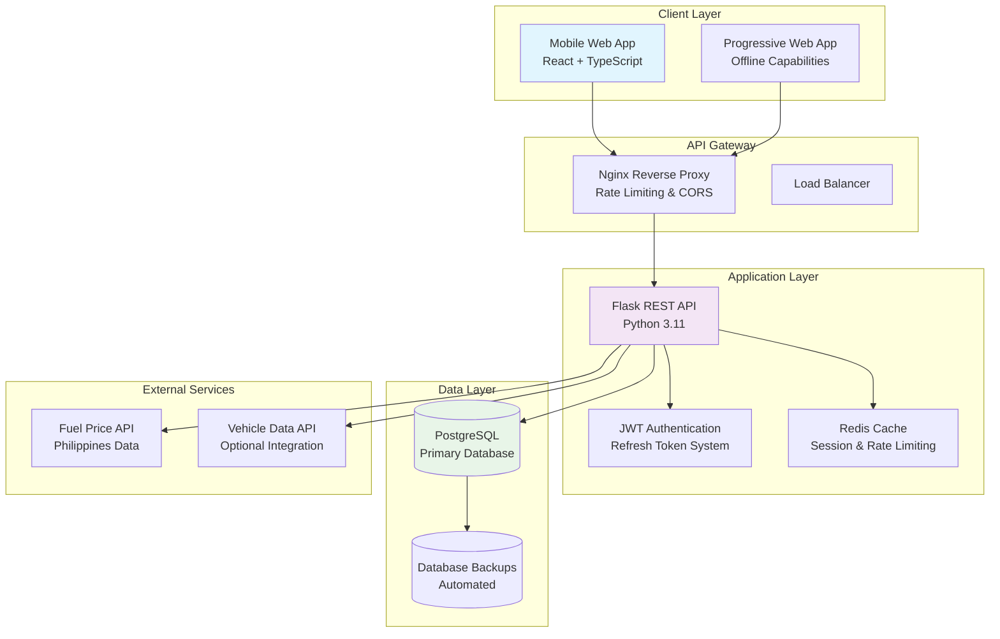
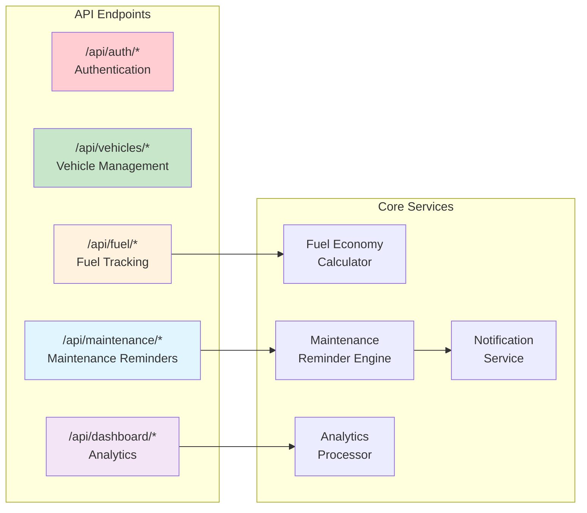
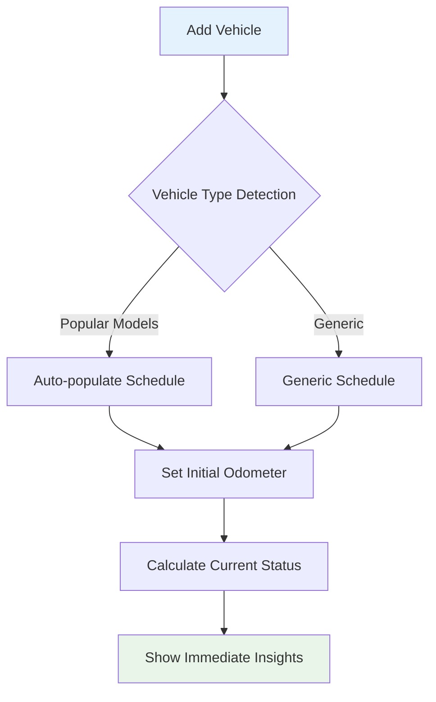
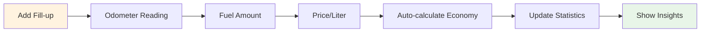
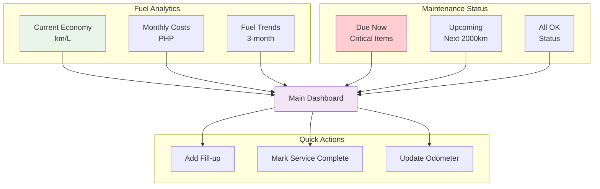
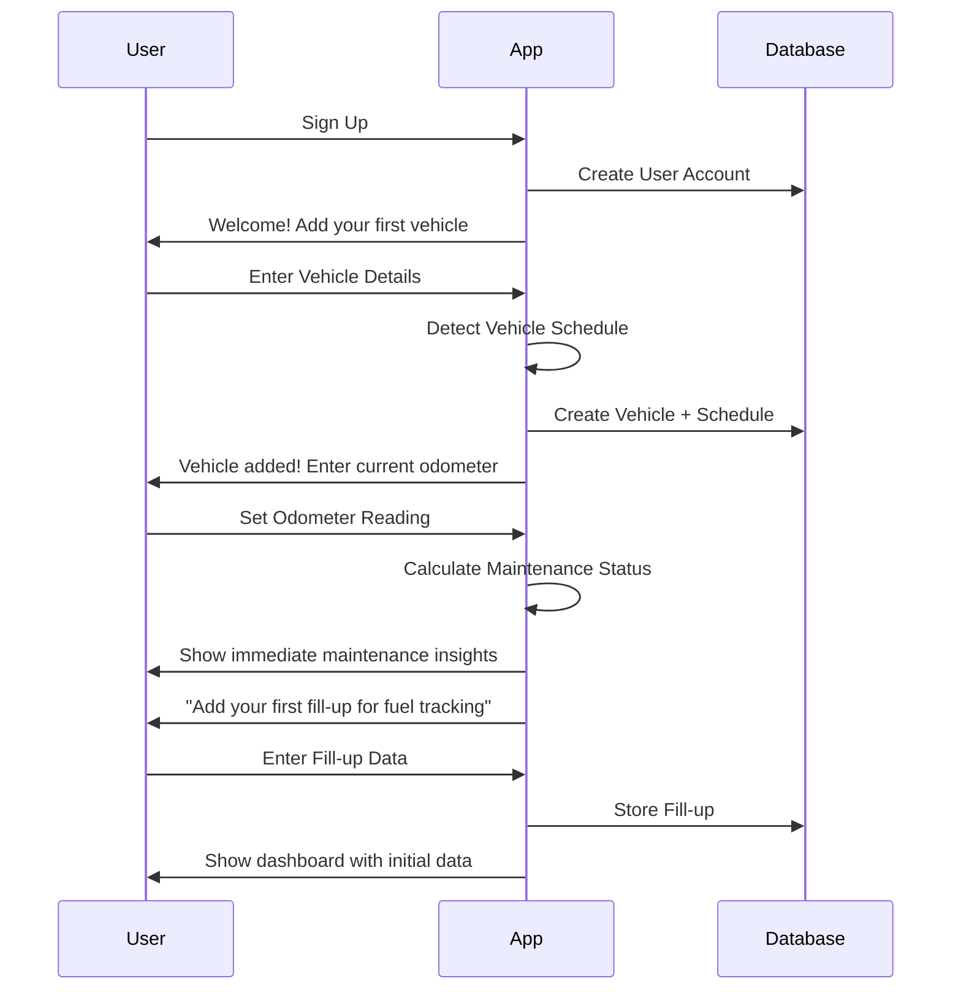
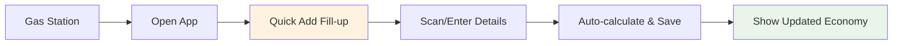
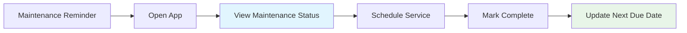
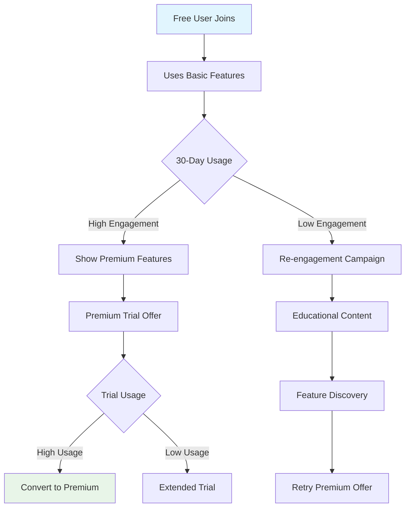

# Car Maintenance Tracker MVP: Product Requirements Document

## Executive Summary

**Primary Use Case**: Fuel economy tracking with simple maintenance reminders
**Target Market**: Philippines vehicle owners seeking cost optimization
**Business Model**: Freemium with subscription conversion focus
**Platform**: Mobile-responsive web application

## 1. Project Purpose & Vision Analysis

### 1.1 Core Value Proposition

**"Your vehicle's smart fuel economy advisor that saves you money through better tracking and timely maintenance reminders."**

#### Primary Benefits
1. **Immediate Value**: Track fuel costs and economy from first fill-up
2. **Cost Optimization**: Identify fuel inefficiencies and maintenance needs
3. **Simple Maintenance**: Basic reminders without overwhelming complexity
4. **Philippines Context**: Localized for severe driving conditions and local fuel prices

#### User Personas

**Primary Persona: Cost-Conscious Commuter**
- Age: 25-45, urban Philippines
- Vehicle: 2010-2020 sedan/SUV
- Pain Points: Rising fuel costs, uncertainty about maintenance timing
- Goals: Reduce transportation costs, avoid expensive breakdowns

**Secondary Persona: Family Vehicle Owner**
- Age: 35-55, suburban Philippines
- Vehicle: Family SUV/MPV
- Pain Points: Multiple vehicles, tracking maintenance schedules
- Goals: Keep family vehicles reliable and safe

### 1.2 Success Metrics

#### MVP Success Criteria
- **User Activation**: 70% of signups add their first vehicle within 24 hours
- **Engagement**: 40% weekly active users after month 1
- **Value Realization**: 60% log at least 3 fill-ups within 2 weeks
- **Conversion Intent**: 15% express interest in premium features

#### Business Metrics
- **User Acquisition**: 1,000 beta users in first month
- **Retention**: 30% monthly active users after 3 months
- **Conversion Pipeline**: 5% signup for premium waitlist

## 2. Technical Architecture

### 2.1 System Architecture Overview



### 2.2 Database Schema Migration (PostgreSQL)

**Rationale for PostgreSQL**:
- ACID compliance for financial/maintenance data
- Better performance for relational queries
- Mature ecosystem and tooling
- Cost-effective scaling

```sql
-- Core Tables Schema
CREATE TABLE users (
    id UUID PRIMARY KEY DEFAULT gen_random_uuid(),
    email VARCHAR(255) UNIQUE NOT NULL,
    password_hash VARCHAR(255) NOT NULL,
    first_name VARCHAR(100) NOT NULL,
    last_name VARCHAR(100) NOT NULL,
    phone VARCHAR(20),
    subscription_tier VARCHAR(20) DEFAULT 'free',
    timezone VARCHAR(50) DEFAULT 'Asia/Manila',
    currency VARCHAR(3) DEFAULT 'PHP',
    created_at TIMESTAMP WITH TIME ZONE DEFAULT NOW(),
    updated_at TIMESTAMP WITH TIME ZONE DEFAULT NOW()
);

CREATE TABLE vehicles (
    id UUID PRIMARY KEY DEFAULT gen_random_uuid(),
    user_id UUID NOT NULL REFERENCES users(id) ON DELETE CASCADE,
    make VARCHAR(50) NOT NULL,
    model VARCHAR(50) NOT NULL,
    year INTEGER NOT NULL CHECK (year >= 1900 AND year <= EXTRACT(YEAR FROM NOW()) + 1),
    variant VARCHAR(100), -- e.g., "2.0L AWD", "1.5L CVT"
    initial_odometer INTEGER NOT NULL CHECK (initial_odometer >= 0),
    current_odometer INTEGER NOT NULL CHECK (current_odometer >= initial_odometer),
    fuel_tank_capacity DECIMAL(5,2), -- in liters
    created_at TIMESTAMP WITH TIME ZONE DEFAULT NOW(),
    updated_at TIMESTAMP WITH TIME ZONE DEFAULT NOW(),
    CONSTRAINT valid_odometer_progression CHECK (current_odometer >= initial_odometer)
);

CREATE TABLE fuel_entries (
    id UUID PRIMARY KEY DEFAULT gen_random_uuid(),
    vehicle_id UUID NOT NULL REFERENCES vehicles(id) ON DELETE CASCADE,
    date DATE NOT NULL,
    odometer_reading INTEGER NOT NULL CHECK (odometer_reading >= 0),
    fuel_amount DECIMAL(6,2) NOT NULL CHECK (fuel_amount > 0), -- liters
    price_per_liter DECIMAL(6,2) NOT NULL CHECK (price_per_liter > 0),
    total_cost DECIMAL(8,2) GENERATED ALWAYS AS (fuel_amount * price_per_liter) STORED,
    is_full_tank BOOLEAN DEFAULT true,
    fuel_type VARCHAR(20) DEFAULT 'Regular',
    gas_station VARCHAR(100),
    notes TEXT,
    -- Calculated fields
    trip_distance INTEGER,
    fuel_economy DECIMAL(5,2), -- km/L
    cost_per_km DECIMAL(6,3),
    created_at TIMESTAMP WITH TIME ZONE DEFAULT NOW()
);

CREATE TABLE maintenance_schedules (
    id UUID PRIMARY KEY DEFAULT gen_random_uuid(),
    vehicle_id UUID NOT NULL REFERENCES vehicles(id) ON DELETE CASCADE,
    item_name VARCHAR(100) NOT NULL,
    category VARCHAR(50) NOT NULL, -- Engine, Brakes, Tires, etc.
    interval_km INTEGER NOT NULL CHECK (interval_km > 0),
    interval_months INTEGER CHECK (interval_months > 0),
    description TEXT,
    action_type VARCHAR(20) NOT NULL, -- Replace, Inspect, Service
    is_critical BOOLEAN DEFAULT false,
    estimated_cost_min DECIMAL(8,2),
    estimated_cost_max DECIMAL(8,2),
    created_at TIMESTAMP WITH TIME ZONE DEFAULT NOW()
);

CREATE TABLE maintenance_reminders (
    id UUID PRIMARY KEY DEFAULT gen_random_uuid(),
    vehicle_id UUID NOT NULL REFERENCES vehicles(id) ON DELETE CASCADE,
    schedule_id UUID NOT NULL REFERENCES maintenance_schedules(id) ON DELETE CASCADE,
    due_at_odometer INTEGER NOT NULL,
    due_at_date DATE,
    status VARCHAR(20) DEFAULT 'pending', -- pending, completed, dismissed
    priority VARCHAR(10) DEFAULT 'medium', -- low, medium, high, critical
    last_service_odometer INTEGER,
    last_service_date DATE,
    notes TEXT,
    created_at TIMESTAMP WITH TIME ZONE DEFAULT NOW()
);

-- Indexes for performance
CREATE INDEX idx_vehicles_user_id ON vehicles(user_id);
CREATE INDEX idx_fuel_entries_vehicle_date ON fuel_entries(vehicle_id, date DESC);
CREATE INDEX idx_maintenance_reminders_vehicle_status ON maintenance_reminders(vehicle_id, status);
CREATE INDEX idx_maintenance_reminders_priority ON maintenance_reminders(priority, due_at_odometer);
```

### 2.3 API Architecture



### 2.4 Core Business Logic Services

#### 2.4.1 Fuel Economy Calculator

```python
class FuelEconomyCalculator:
    @staticmethod
    def calculate_trip_economy(current_entry: FuelEntry, previous_entry: FuelEntry) -> Optional[float]:
        """Calculate fuel economy for a trip between two fill-ups"""
        if not previous_entry or not previous_entry.is_full_tank:
            return None

        distance = current_entry.odometer_reading - previous_entry.odometer_reading
        fuel_used = current_entry.fuel_amount

        if distance <= 0 or fuel_used <= 0:
            return None

        return round(distance / fuel_used, 2)  # km/L

    @staticmethod
    def calculate_rolling_average(vehicle_id: UUID, months: int = 3) -> dict:
        """Calculate rolling fuel economy averages"""
        entries = get_fuel_entries_for_period(vehicle_id, months)

        total_distance = 0
        total_fuel = 0
        valid_trips = []

        for i in range(1, len(entries)):
            economy = FuelEconomyCalculator.calculate_trip_economy(entries[i], entries[i-1])
            if economy:
                distance = entries[i].odometer_reading - entries[i-1].odometer_reading
                fuel = entries[i].fuel_amount
                total_distance += distance
                total_fuel += fuel
                valid_trips.append(economy)

        return {
            'average_economy': round(total_distance / total_fuel, 2) if total_fuel > 0 else 0,
            'trip_based_average': round(sum(valid_trips) / len(valid_trips), 2) if valid_trips else 0,
            'best_economy': max(valid_trips) if valid_trips else 0,
            'worst_economy': min(valid_trips) if valid_trips else 0,
            'total_distance': total_distance,
            'total_fuel': total_fuel,
            'total_cost': sum(entry.total_cost for entry in entries)
        }
```

#### 2.4.2 Maintenance Reminder Engine

```python
class MaintenanceReminderEngine:
    def __init__(self):
        self.schedules = {
            'generic_sedan': self._load_generic_sedan_schedule(),
            'generic_suv': self._load_generic_suv_schedule(),
            'mazda_cx5': self._load_mazda_cx5_schedule(),
        }

    def create_vehicle_schedule(self, vehicle: Vehicle) -> List[MaintenanceSchedule]:
        """Create maintenance schedule for a new vehicle"""
        schedule_key = self._determine_schedule(vehicle)
        base_schedule = self.schedules.get(schedule_key, self.schedules['generic_sedan'])

        # Adjust for Philippines severe conditions
        adjusted_schedule = self._adjust_for_severe_conditions(base_schedule)

        return self._create_schedule_items(vehicle.id, adjusted_schedule)

    def check_due_maintenance(self, vehicle: Vehicle) -> List[MaintenanceReminder]:
        """Check for due maintenance items"""
        current_odometer = vehicle.current_odometer
        reminders = []

        schedules = get_maintenance_schedules(vehicle.id)

        for schedule in schedules:
            reminder = self._calculate_maintenance_status(schedule, current_odometer)
            if reminder.status in ['due_now', 'overdue']:
                reminders.append(reminder)

        return sorted(reminders, key=lambda x: (x.priority_order, x.due_at_odometer))

    def _adjust_for_severe_conditions(self, schedule: List[dict]) -> List[dict]:
        """Adjust intervals for Philippines severe driving conditions"""
        severe_adjustment = 0.8  # 20% reduction in intervals

        for item in schedule:
            if item['category'] in ['Engine', 'Filters', 'Fluids']:
                item['interval_km'] = int(item['interval_km'] * severe_adjustment)

        return schedule
```

## 3. MVP Feature Specification

### 3.1 Core Features

#### 3.1.1 Vehicle Management


**Features**:
- **Quick Vehicle Setup**: Make/Model/Year with smart defaults
- **Popular Vehicle Detection**: Pre-configured schedules for common Philippines vehicles
- **Odometer Tracking**: Initial and current mileage with validation
- **Vehicle Profile**: Basic info display with photo upload capability

**Implementation Priority**: Critical Path 1

#### 3.1.2 Fuel Economy Tracking



**Features**:
- **Smart Fill-up Entry**: Auto-calculate total cost, validate odometer progression
- **Fuel Economy Dashboard**: Real-time km/L calculations with trends
- **Cost Analytics**: Monthly fuel costs, price tracking, cost per km
- **Philippines Fuel Prices**: Integration with local fuel price data
- **Fuel Efficiency Insights**: Identify patterns and improvement opportunities

**Key Calculations**:
```python
# Trip-based fuel economy
economy_kmpl = distance_traveled / fuel_amount

# Cost efficiency
cost_per_km = fuel_cost / distance_traveled

# Rolling averages (3-month, 6-month, yearly)
# Trend analysis (improving/declining efficiency)
```

**Implementation Priority**: Critical Path 1

#### 3.1.3 Simple Maintenance Reminders

**Generic Maintenance Schedules** (Philippines-optimized):

```python
GENERIC_SEDAN_SCHEDULE = [
    # Engine
    {'name': 'Engine Oil & Filter', 'category': 'Engine', 'interval_km': 5000, 'critical': True},
    {'name': 'Air Filter', 'category': 'Engine', 'interval_km': 20000, 'critical': False},
    {'name': 'Spark Plugs', 'category': 'Engine', 'interval_km': 60000, 'critical': False},

    # Fluids
    {'name': 'Brake Fluid', 'category': 'Fluids', 'interval_km': 40000, 'critical': True},
    {'name': 'Coolant System', 'category': 'Fluids', 'interval_km': 40000, 'critical': True},
    {'name': 'Transmission Fluid', 'category': 'Fluids', 'interval_km': 60000, 'critical': True},

    # Brakes & Tires
    {'name': 'Brake Pads Inspection', 'category': 'Brakes', 'interval_km': 20000, 'critical': True},
    {'name': 'Tire Rotation', 'category': 'Tires', 'interval_km': 10000, 'critical': False},

    # Filters
    {'name': 'Cabin Air Filter', 'category': 'Filters', 'interval_km': 20000, 'critical': False},
    {'name': 'Fuel Filter', 'category': 'Filters', 'interval_km': 40000, 'critical': False},
]

GENERIC_SUV_SCHEDULE = [
    # Adjusted for SUV (more frequent due to weight/usage)
    {'name': 'Engine Oil & Filter', 'category': 'Engine', 'interval_km': 5000, 'critical': True},
    {'name': 'Air Filter', 'category': 'Engine', 'interval_km': 15000, 'critical': False},
    {'name': '4WD/AWD Service', 'category': 'Drivetrain', 'interval_km': 40000, 'critical': True},
    # ... additional SUV-specific items
]
```

**Maintenance Status Logic**:
```python
def calculate_maintenance_status(schedule_item, current_odometer, last_service_odometer):
    due_at = last_service_odometer + schedule_item.interval_km
    km_until_due = due_at - current_odometer

    if km_until_due <= 0:
        return {'status': 'overdue', 'priority': 'critical'}
    elif km_until_due <= 500:  # Due within 500km
        return {'status': 'due_soon', 'priority': 'high'}
    elif km_until_due <= 2000:  # Due within 2000km
        return {'status': 'upcoming', 'priority': 'medium'}
    else:
        return {'status': 'ok', 'priority': 'low'}
```

**Implementation Priority**: Critical Path 2

#### 3.1.4 Dashboard & Analytics



**Dashboard Components**:
- **Fuel Economy Widget**: Current efficiency, trend indicator, monthly cost
- **Maintenance Alert Banner**: Critical items with countdown
- **Quick Stats**: Total distance, fuel cost, maintenance costs
- **Recent Activity**: Last 5 fill-ups and services

**Implementation Priority**: Critical Path 2

### 3.2 User Experience Flow

#### 3.2.1 Onboarding Experience



**Onboarding Goals**:
- **Time to Value**: Under 3 minutes to see first insights
- **Progressive Disclosure**: One feature at a time
- **Immediate Gratification**: Show maintenance status immediately
- **Sample Data**: Pre-populate with example to show value

#### 3.2.2 Daily Usage Patterns

**Primary User Flow**: Quick Fill-up Entry


**Secondary User Flow**: Maintenance Check


### 3.3 Mobile-Responsive Design Priorities

#### 3.3.1 Mobile-First Components

```css
/* Key responsive breakpoints */
mobile: 320px - 768px   (Priority 1)
tablet: 768px - 1024px  (Priority 2)
desktop: 1024px+        (Priority 3)
```

**Critical Mobile Features**:
- **One-thumb navigation**: Bottom navigation bar
- **Quick actions**: Floating action button for fill-up entry
- **Touch-optimized forms**: Large input fields, smart keyboards
- **Offline capability**: Cache last 30 days of data
- **PWA features**: Add to home screen, push notifications

#### 3.3.2 Performance Optimization

```javascript
// Lazy loading strategy
const Dashboard = lazy(() => import('./pages/Dashboard'));
const FuelTracking = lazy(() => import('./pages/FuelTracking'));
const Maintenance = lazy(() => import('./pages/Maintenance'));

// Service worker for offline capability
const CACHE_STRATEGY = {
  fuel_entries: 'cache-first',    // Recent entries always available
  maintenance: 'network-first',   // Updated reminders when online
  vehicle_data: 'cache-first'     // Static vehicle info
};
```

## 4. Subscription Strategy

### 4.1 Freemium Model

#### 4.1.1 Free Tier (MVP Focus)
**Features Included**:
- Single vehicle tracking
- Unlimited fuel entries
- Basic maintenance reminders (10 items)
- 3-month fuel analytics
- Mobile-responsive web app

**Limitations**:
- No data export
- Basic maintenance schedule only
- No cost optimization insights
- No multi-vehicle support

#### 4.1.2 Premium Tier (Conversion Target)
**Price**: ₱149/month or ₱1,490/year (Philippines pricing)

**Additional Features**:
- Unlimited vehicles
- Advanced maintenance schedules (vehicle-specific)
- 12-month analytics and trends
- Cost optimization insights
- Data export (CSV, PDF)
- Priority customer support
- Maintenance cost tracking
- Service provider directory

### 4.1.3 Conversion Strategy



**Conversion Triggers**:
- **Multi-vehicle need**: User tries to add second vehicle
- **Advanced analytics request**: After 3 months of usage
- **Export request**: User wants to share/backup data
- **Cost insights**: Show potential savings with premium features

## 5. Implementation Phases

### 5.1 Phase 1: Core MVP (Weeks 1-4)

**Week 1-2: Foundation**
- [ ] Database setup (PostgreSQL)
- [ ] Authentication system
- [ ] Basic vehicle management
- [ ] Core API endpoints

**Week 3-4: Core Features**
- [ ] Fuel tracking functionality
- [ ] Basic maintenance reminders
- [ ] Simple dashboard
- [ ] Mobile-responsive UI

**Deliverables**:
- Working fuel tracking system
- Basic maintenance reminders
- User can complete full onboarding flow
- Mobile-optimized interface

### 5.2 Phase 2: Enhancement (Weeks 5-6)

**Analytics & Insights**
- [ ] Fuel economy calculations
- [ ] Trend analysis
- [ ] Maintenance status intelligence
- [ ] Cost optimization basic insights

**User Experience**
- [ ] Progressive Web App features
- [ ] Offline capability
- [ ] Push notifications
- [ ] Performance optimization

### 5.3 Phase 3: Launch Preparation (Weeks 7-8)

**Beta Testing**
- [ ] Philippines beta user recruitment
- [ ] Feedback collection system
- [ ] Performance monitoring
- [ ] Bug fixes and optimization

**Business Features**
- [ ] Subscription system setup
- [ ] Payment integration (Philippines payment methods)
- [ ] Analytics tracking
- [ ] Customer support system

## 6. Technical Implementation Guidelines

### 6.1 Database Migration Strategy

```python
# Migration from MongoDB to PostgreSQL
class MongoToPostgreSQLMigrator:
    def migrate_users(self):
        # Preserve user data, convert ObjectId to UUID
        pass

    def migrate_vehicles(self):
        # Rename fields: current_mileage -> current_odometer
        # Add new fields: fuel_tank_capacity, variant
        pass

    def migrate_fuel_data(self):
        # Convert fillups to fuel_entries
        # Recalculate all fuel economy values
        pass

    def migrate_maintenance_data(self):
        # Convert to new schedule + reminder system
        # Recalculate all due dates
        pass
```

### 6.2 API Design Principles

```python
# Consistent API response format
{
    "success": true,
    "data": {
        "fuel_economy": {
            "current": 12.5,
            "trend": "improving",
            "monthly_average": 11.8
        }
    },
    "meta": {
        "timestamp": "2025-01-15T10:30:00Z",
        "request_id": "req_123456"
    }
}

# Error response format
{
    "success": false,
    "error": {
        "code": "VALIDATION_ERROR",
        "message": "Odometer reading cannot be less than previous reading",
        "details": {
            "field": "odometer_reading",
            "previous_value": 50000,
            "submitted_value": 49000
        }
    },
    "meta": {
        "timestamp": "2025-01-15T10:30:00Z",
        "request_id": "req_123456"
    }
}
```

### 6.3 Performance Requirements

**Response Time Targets**:
- Dashboard load: < 800ms
- Fill-up entry: < 500ms
- Maintenance check: < 600ms
- Analytics generation: < 1200ms

**Optimization Strategies**:
- Database query optimization with proper indexes
- Redis caching for frequently accessed data
- CDN for static assets
- Image optimization and compression
- Lazy loading for non-critical components

## 7. Success Metrics and KPIs

### 7.1 User Engagement Metrics

**Week 1 Targets**:
- User signup: 100 beta users
- Vehicle addition rate: 80% of signups
- First fill-up rate: 60% of vehicle additions

**Month 1 Targets**:
- Total users: 1,000
- Weekly active users: 400 (40%)
- Fill-ups per active user: 2.5/week
- Maintenance items viewed: 85% of users

**Month 3 Targets**:
- Total users: 5,000
- Monthly active users: 1,500 (30%)
- Premium feature interest: 15% of active users
- User retention (month 3): 25%

### 7.2 Business Metrics

**Revenue Pipeline**:
- Premium waitlist signup: 200 users by month 2
- Conversion intent surveys: 15% positive response
- Feature request frequency: Premium features = 40% of requests

**Cost Efficiency**:
- Customer acquisition cost: < ₱50 per user (organic growth focus)
- Server costs: < ₱5 per monthly active user
- Support ticket volume: < 2% of monthly active users

This MVP specification focuses on delivering immediate value through fuel economy tracking while building a foundation for maintenance management. The emphasis on Philippines-specific optimizations and mobile-responsive design addresses your target market needs while keeping development scope manageable for a successful launch.
